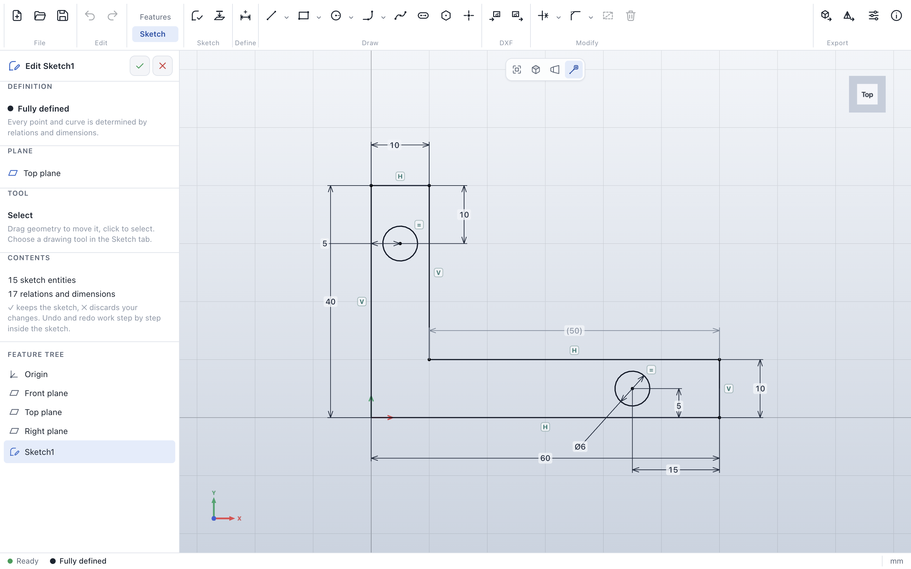
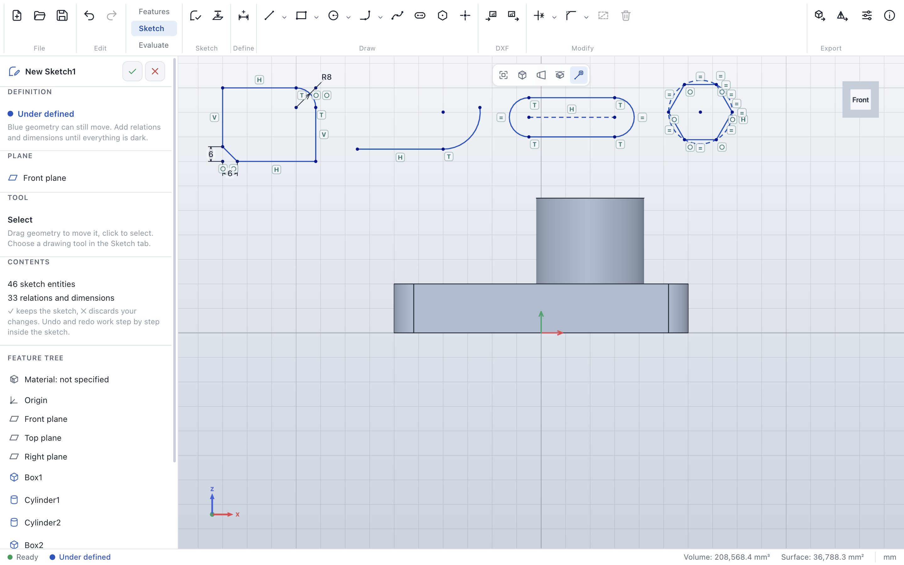
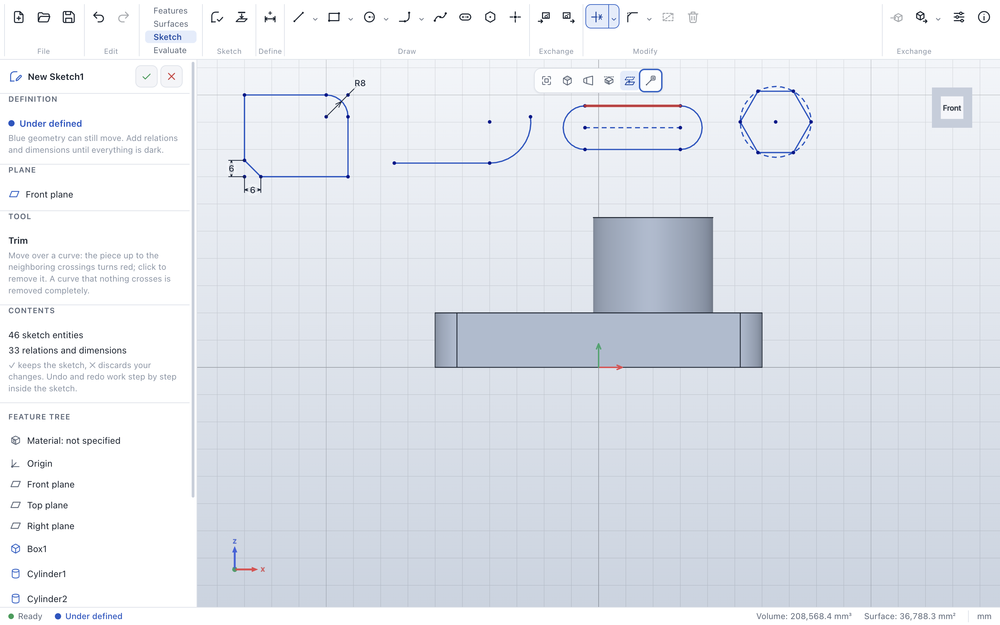
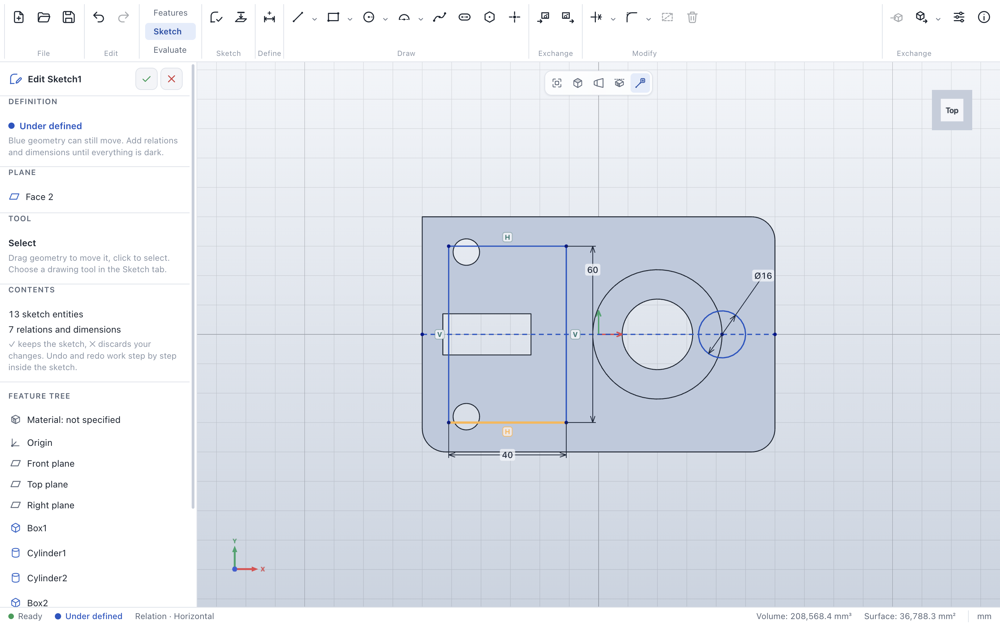
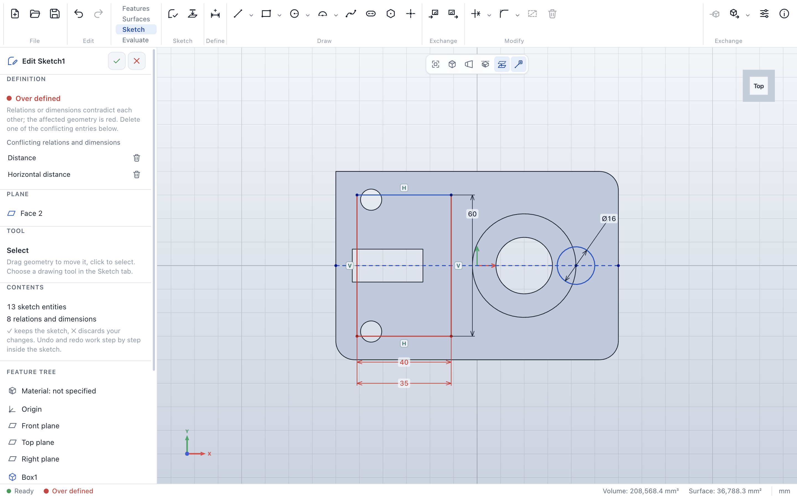
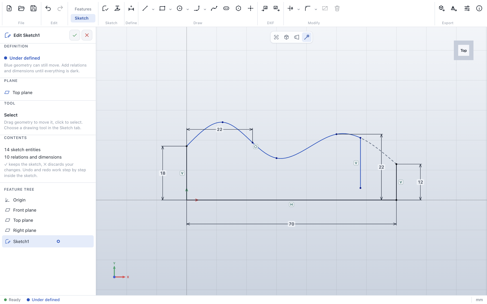
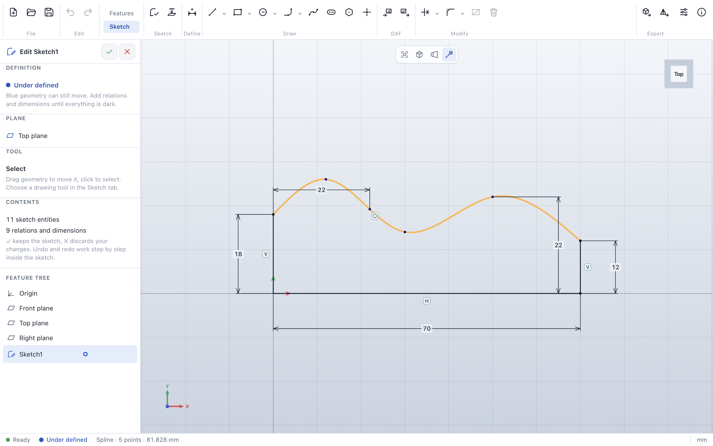

<p align="center">
  
</p>

<h1 align="center">ParaWerk</h1>

<p align="center">
  <strong>Parametric 2D/3D CAD for the desktop: parts, assemblies, standard parts and drawings.</strong><br>
  Cross-platform (Windows · macOS · Linux) · built with Node.js and Electron · English and German UI
</p>

<p align="center">
  
  <a href="https://github.com/Ujap1994/ParaWerk/actions/workflows/ci.yml"></a>
  
  
  <a href="LICENSE"></a>
</p>

> [!WARNING]
> **ParaWerk is under active development.** The 2D sketcher (Phase 1) is complete; part modeling
> (Phase 2) has started with *Extrude* and *Revolve*. It is a technical preview, not a usable CAD system
> yet: holes, patterns, reference geometry and many other features are still missing. Please read the
> [disclaimer](#disclaimer) first.

---

## Contents

- [What is ParaWerk?](#what-is-parawerk)
- [Disclaimer](#disclaimer)
- [Available now](#available-now)
- [Planned features](#planned-features)
- [Design approach](#design-approach)
- [Technology](#technology)
- [Quality and performance from day one](#quality-and-performance-from-day-one)
- [Roadmap](#roadmap)
- [Packages](#packages)
- [Build from source](#build-from-source)
- [Documentation](#documentation)
- [License](#license)

## What is ParaWerk?

ParaWerk is a desktop CAD application for designing mechanical parts and assemblies. It follows the
**feature-based, history-driven workflow** that professional mechanical CAD systems use:

1. **Sketch** a fully constrained 2D profile.
2. **Build features** such as extrudes, revolves, fillets and hole patterns into a solid part.
3. **Assemble** parts and ISO/DIN standard parts (screws, nuts, washers, pins) with mates.
4. **Derive drawings** that follow ISO/DIN conventions, either automatically or by hand.
5. **Export** to the formats manufacturing needs: 3MF, STL, STEP, DXF, PDF and more.

The goal is not to clone any commercial product. The goal is a focused, fast and dependable tool for
makers, students and small workshops that covers the everyday mechanical design workflow very well.

## Disclaimer

> [!CAUTION]
> **ParaWerk is under active development.** It is not finished, not stable and not suitable for productive
> or commercial use. Features can be missing, behave incorrectly or change at any time, and files created
> with development versions may not open in later versions. Use it at your own risk.

- **Early development.** ParaWerk is an independent project in an early stage of development. Features
  may be incomplete, change without notice or contain errors. Do not use it for productive work yet,
  and always keep backups of your files.
- **No warranty.** The software is provided **"as is"**, without warranty of any kind, express or implied,
  including but not limited to fitness for a particular purpose. The authors are not liable for any
  damage, data loss, faulty parts, production costs or other consequences resulting from its use.
- **You are responsible for your designs.** Geometry, dimensions, tolerances, mass properties,
  standard-part data, drawings and exported files must be checked by a qualified person before anything
  is manufactured, ordered or used. ParaWerk is **not** certified for safety-critical applications.
- **Standards.** Standard parts and drawing conventions are implemented to the best of our knowledge from
  publicly available information. They do not replace the official ISO, EN and DIN standards, which are
  published by the respective standards bodies. ParaWerk makes no claim of conformity with any standard.
- **File compatibility.** Import and export of third-party file formats is provided on a best-effort basis.
  Exchanged data can lose information or differ from the original.
- **Trademarks.** SOLIDWORKS is a registered trademark of Dassault Systèmes SolidWorks Corporation.
  AutoCAD is a registered trademark of Autodesk, Inc. All other product names and trademarks belong to
  their respective owners. ParaWerk is **not affiliated with, endorsed by or sponsored by** any of these
  companies. Product names are mentioned for descriptive purposes only.
- **Third-party software.** ParaWerk builds on open-source components such as Open CASCADE Technology.
  Their licenses are listed in [THIRD_PARTY_NOTICES.md](THIRD_PARTY_NOTICES.md) and shipped with the
  application.

## Available now

Preview 0.2 adds the complete 2D sketcher (Phase 1) to the foundation of Phase 0:



- **Geometry kernel:** Open CASCADE Technology 8 (own WebAssembly build) in a background worker;
  **extrude** and **revolve** sketches (add or remove material), box and cylinder, fillet and chamfer; incremental rebuild that only recomputes from the first changed feature;
  exact volume and surface area.
- **3D view:** shaded model with edges, view cube, standard views, orthographic and perspective
  projection, rotation around the point under the cursor, zoom towards the cursor, mouse and trackpad
  presets, hover and selection highlighting of faces and edges.
- **Feature tree and property panels:** live preview while editing, rollback of later features,
  suppress, delete, undo and redo; clear error messages when a feature cannot be built.
- **Extrude and revolve:** the closed outlines of a sketch become a solid or a cut, straight or around a
  centerline; outlines inside others become holes, and lines, arcs, circles, ellipses and splines stay
  exact.
- **Variables and equations:** named values for the whole part, used by name in parameters and sketch
  dimensions; calculations with units in every number field.
- **2D sketcher:** sketches on the front, top and right plane and on planar faces, with their own undo
  history.
  - *Drawing:* lines and centerlines, rectangles (corner, center, 3-point, parallelogram), circles
    (center, 3-point), ellipses, arcs (center, 3-point, tangent), splines, slots, polygons and points, with
    snapping, inference lines and automatic relations.
  - *Relations and dimensions:* thirteen relation types, offered for the selection and checked by the
    solver, shown as symbols next to the geometry; one smart dimension tool for lengths, distances,
    angles, radii and diameters; over-defining dimensions become reference dimensions.
  - *Definition status:* under-defined geometry is blue, fully defined dark, conflicts red and listed.
  - *Editing:* trim, extend, sketch fillet and chamfer, offset, mirror, linear and circular patterns,
    move, copy and scale; dragging with live constraint solving (about 7 ms per step at 2,000 entities).
  - *Splines:* smooth curves through fit points; points can be held on them, other curves trimmed and
    extended at them, and splines themselves are cut exactly, without changing their shape.
  - *Model edges:* convert edges of the part into the sketch.
  - *DXF:* import into a sketch and export for laser cutting and CNC.
- **Files:** native `.pwpart` files, STEP and binary STL export.
- **Interface:** English and German (switchable at runtime, system language by default), light and dark
  theme, own icon set and visual design.

| Drawing tools with relation symbols | Trim with preview |
|---|---|
|  |  |
| **Relation symbols: point at one to see its geometry** | **Conflicts are red and listed** |
|  |  |
| **Extrude a sketch (live preview)** | **A pocket cut from a sketch on the top face** |
|  |  |
| **Revolve a half section around its centerline** | **Variables and equations** |
|  |  |
| **Splines: cut exactly at a line, the rest is only hinted** | **Splines with a point held on them** |
|  |  |
| **Fillet with live preview** | **Dark theme, German interface** |
|  |  |

See the [user guide](docs/user-guide/README.md) for details.

## Planned features

> Everything below is **planned**. Each item moves to "Available now", with screenshots, once it ships.

### Part modeling
- Feature tree with rollback bar, suppress, reorder and edit-in-place
- Extrude and cut (blind, through all, up to surface, mid-plane, thin), revolve, sweep, loft
- Fillet, chamfer, shell, draft, rib, hole feature with ISO metric threads, linear, circular and mirror patterns
- Reference planes, axes, points and coordinate systems; multi-body parts
- Configurations and design tables, materials, mass properties, measuring and section views

### Assemblies
- Components and sub-assemblies with standard, advanced and mechanical mates
- Dragging that respects mates, degree-of-freedom analysis, interference and clearance checks
- Component patterns, exploded views and bills of materials (BOM)
- Large-assembly mode with instancing, so assemblies with thousands of fasteners stay smooth

### Standard parts library (ISO / DIN)
- A large catalog of screws, nuts, washers, pins, bolts, retaining rings, keys and threaded rods
  (for example ISO 4762 / DIN 912, ISO 4017 / DIN 933, ISO 4032 / DIN 934, ISO 7089 / DIN 125, ISO 2338 / DIN 7)
- Search and filter, drag and drop into assemblies, automatic mates into holes and fastener stacks
- Proper designations in the BOM, for example `ISO 4762 - M8 x 30 - 8.8`

### Drawings
- Sheet formats A4–A0 with ISO title blocks; first-angle projection (ISO standard) by default
- Standard, projected, isometric, section, detail, broken-out, break and auxiliary views
- Dimensions, tolerances and fits, geometric tolerances, surface texture symbols, center lines and thread display
- Balloons and parts lists for assembly drawings
- Automatic drawing creation that places views and model dimensions for you, then manual refinement
- Drawings stay associative: when the model changes, the drawing updates

### Import and export
| Format | Import | Export | Typical use |
|---|:---:|:---:|---|
| ParaWerk native (`.pwpart`, `.pwasm`, `.pwdrw`) | ✓ | ✓ | Your working files |
| STEP (AP203 / AP214 / AP242) | ✓ | ✓ | Exchange with other CAD systems |
| 3MF | ✓ | ✓ | 3D printing, with colors and multiple objects |
| STL | ✓ (mesh) | ✓ | 3D printing |
| IGES | ✓ | ✓ | Legacy CAD exchange |
| DXF | ✓ | ✓ | Laser cutting, CNC, 2D exchange |
| PDF | – | ✓ | Vector drawings at true scale |
| SVG, PNG | – | ✓ | Documentation |
| glTF / GLB, OBJ | – | ✓ | Visualization |

DWG is not supported because it is a closed, proprietary format. DXF is the open format for 2D exchange
and is read by all common CAD programs.

## Design approach

**Proven functionality, independent implementation.** ParaWerk offers the capabilities that experienced
mechanical designers rely on in feature-based CAD, but it is not a copy of any product. All source code,
tests, user interface, icons and visual design are ParaWerk's own work. No code, assets or UI designs from
other products are used.

What you can expect:

- An **independent, modern visual design** with light and dark themes and its own icon set
- A **feature tree** that records how a part was built and lets you roll back, suppress and reorder
- **Contextual property panels** with live preview while you create or edit a feature
- An **efficient, mouse-driven workflow**: view cube, standard and section views, mouse gestures,
  customizable shortcuts and a searchable command palette
- A UI in **English and German**, switchable at runtime (default: system language)

## Technology

| Area | Planned technology |
|---|---|
| Application shell | Electron with secure defaults (context isolation, sandbox, no Node integration in the renderer), single instance |
| Language | TypeScript (strict) |
| Geometry kernel | [Open CASCADE Technology](https://dev.opencascade.org/) 8.0.1 (B-Rep modeling, booleans, fillets, STEP), compiled to WebAssembly with ParaWerk's own C++ facade, running in a worker ([ADR 0001](docs/adr/0001-geometry-kernel.md)) |
| Sketch solver | Own sparse geometric constraint solver in a worker, with per-entity definition status and conflict detection ([ADR 0005](docs/adr/0005-sketch-solver.md)) |
| Assembly solver | Rigid-body mate solver with degree-of-freedom analysis |
| 3D viewport | three.js (WebGL 2, WebGPU later) with GPU picking, instancing and level of detail |
| Testing | Vitest, Playwright for Electron, geometry golden tests, visual regression, benchmark suite |
| Packaging | electron-builder and GitHub Actions |

The architecture is explained in [ROADMAP.md](ROADMAP.md#architecture-overview); each major decision has an
[architecture decision record](docs/adr/README.md).

## Quality and performance from day one

- **Automated tests from the first commit:** unit, integration (against the real geometry kernel, with
  analytically known volumes) and end-to-end UI tests with Playwright, run in CI on Windows, macOS and
  Linux.
- **Performance tests from the first commit:** kernel, solver and rendering benchmarks run in CI for
  every push. The **scale ladder** grows with every phase, up to tens of thousands of components before
  v1.0. Current reference numbers (Apple M3): fillet of 12 edges in 32 ms; 1,000 instanced components
  (2.3 million triangles) at 118 fps, 10,000 components at 32 fps. All results:
  [docs/benchmarks](docs/benchmarks/README.md).
- **Stability:** memory-leak tests for the kernel, automatic recovery when the geometry kernel crashes,
  and a validated, versioned file format.

## Roadmap

<p align="center">
  
</p>

| Phase | Content | Milestone |
|---|---|---|
| 0 ✅ | Foundation and technical spikes: app shell, kernel, CI, packaging, test and benchmark harness | v0.1 – tech gate |
| 1 ✅ | 2D sketcher and constraint solver | v0.2 |
| 2 ⏳ | Part modeling core, native files, STL / 3MF / STEP export (in progress) | v0.3 – first real parts |
| 3 | Advanced features and configurations | v0.4 |
| 4 | Assemblies and mate solver | v0.5 |
| 5 | Standard parts library (ISO / DIN) | v0.6 |
| 6 | Drawings (ISO / DIN), PDF and DXF export | v0.8 |
| 7 | Complete data exchange | v0.9 |
| 8 | Scale, hardening, documentation | v1.0 |
| Post-1.0 | FEM, sheet metal, weldments, surfaces, motion | – |

The detailed plan, with effort estimates, performance targets, risks and decision gates, is in **[ROADMAP.md](ROADMAP.md)**.

## Packages

Every release is built and published automatically by GitHub Actions
([releases](https://github.com/Ujap1994/ParaWerk/releases)):

| Platform | Packages | Architectures |
|---|---|---|
| Windows | Installer (NSIS), portable | x64, arm64 |
| macOS | `.dmg`, `.zip` | Universal, Apple Silicon (arm64), Intel (x64) |
| Linux | AppImage, `.deb`, `.rpm`, pacman, Snap, Flatpak, `.tar.gz` | x64, arm64 |

Preview builds are not signed with a developer certificate yet, so macOS and Windows ask once before the
first start; the [getting started guide](docs/user-guide/getting-started.md) shows how to confirm.

## Build from source

Requirements: Node.js 24 and npm.

```bash
git clone https://github.com/Ujap1994/ParaWerk.git
cd ParaWerk
npm ci
npm run dev            # start with hot reload
npm test               # unit and integration tests
npm run build && npm run test:e2e   # end-to-end tests of the UI
npm run bench:kernel   # geometry kernel benchmarks (also bench:solver, bench:render)
npm run package        # build installers for the current platform into release/
```

## Documentation

- [User guide](docs/user-guide/README.md) with screenshots of every feature (generated automatically by
  `npm run docs:screenshots`, so they always match the current version)
- [Roadmap](ROADMAP.md) with effort estimates, phases, risks and decision gates
- [Architecture decision records](docs/adr/README.md)
- [Benchmarks](docs/benchmarks/README.md)
- [Changelog](CHANGELOG.md) and [third-party notices](THIRD_PARTY_NOTICES.md)

## License

ParaWerk is free software: you can redistribute it and/or modify it under the terms of the
**GNU General Public License** as published by the Free Software Foundation, either **version 3** of the
License, or (at your option) any later version. See [LICENSE](LICENSE) for the full text.

ParaWerk is distributed in the hope that it will be useful, but WITHOUT ANY WARRANTY; without even the
implied warranty of MERCHANTABILITY or FITNESS FOR A PARTICULAR PURPOSE.
