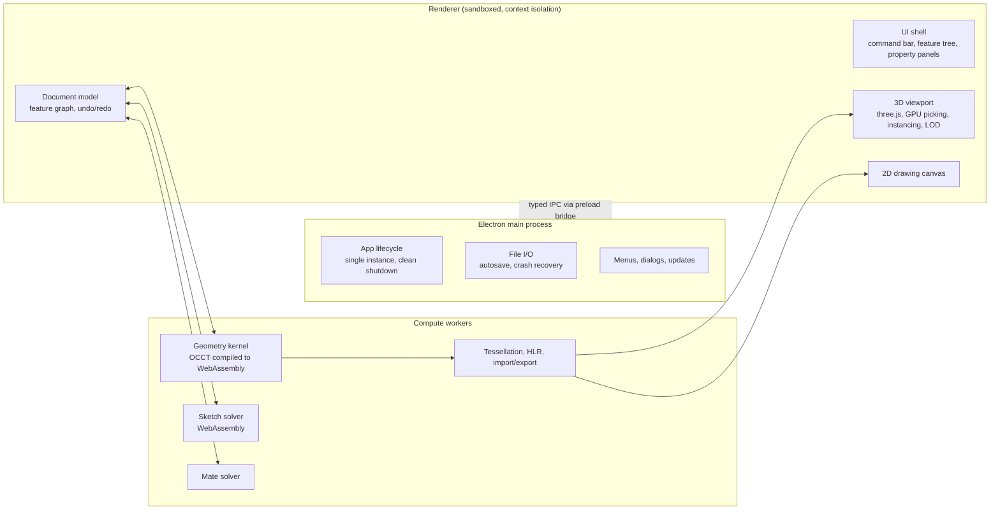

# ParaWerk Roadmap

This document is the plan for building ParaWerk from scratch to v1.0. It contains effort and time
estimates, the architecture, the scope of every phase, performance targets, the test strategy, risks
and decision gates. It is reviewed and updated at the end of every phase.

> All numbers are **estimates** based on the scope described here and on experience with comparable
> software. They are not commitments. They are refined at each decision gate with measured data.

## Contents

1. [Summary](#1-summary)
2. [Progress](#progress)
3. [Guiding principles](#2-guiding-principles)
3. [How the estimates work](#3-how-the-estimates-work)
4. [Architecture overview](#architecture-overview)
5. [Phases](#5-phases)
6. [Performance and scale testing](#6-performance-and-scale-testing)
7. [Test strategy](#7-test-strategy)
8. [Releases and packaging](#8-releases-and-packaging)
9. [Risk register](#9-risk-register)
10. [Decision gates](#10-decision-gates)
11. [After v1.0](#11-after-v10)
12. [Open decisions](#open-decisions)

---

## 1. Summary

| Phase | Content | Traditional effort ¹ | AI-assisted, Scenario B ² | Milestone |
|---|---|---|---|---|
| 0 | Foundation and technical spikes | 2–4 PM | 4–6 weeks | v0.1 – tech gate |
| 1 | 2D sketcher and constraint solver | 6–10 PM | 7–9 weeks | v0.2 |
| 2 | Part modeling core | 10–16 PM | 12–16 weeks | v0.3 – first real parts |
| 3 | Advanced features and configurations | 6–10 PM | 7–9 weeks | v0.4 |
| 4 | Assemblies and mate solver | 9–14 PM | 10–13 weeks | v0.5 |
| 5 | Standard parts library (ISO / DIN) | 4–7 PM | 5–7 weeks | v0.6 |
| 6 | Drawings (ISO / DIN) | 10–16 PM | 12–16 weeks | v0.8 |
| 7 | Complete data exchange | 3–5 PM | 3–5 weeks | v0.9 |
| 8 | Scale, hardening, documentation | 7–12 PM | 10–14 weeks | v1.0 |
| **Total** | | **≈ 57–94 PM (5–8 person-years)** | **≈ 70–95 weeks of work, 15–20 months calendar time with overlapping phases** | |

¹ PM = person-months of an experienced developer working without AI assistance, using an existing
geometry kernel. Shown for comparison only.
² Scenario B: development by Claude Code, with the project owner spending about 15–20 hours per week on
direction, review, hands-on testing and decisions. See [section 3](#3-how-the-estimates-work).

**Time to v1.0 by scenario**

| Scenario | Owner time per week | First real parts (v0.3) | v1.0 |
|---|---|---|---|
| A – hobby pace | ~5–8 h | ~month 13–17 | ~2.5–4 years |
| B – intensive | ~15–20 h | ~month 6–8 | ~15–20 months |
| C – full-time | ~40 h | ~month 4–5 | ~10–13 months |

In every scenario the owner invests roughly **1,000–1,700 hours** in total up to v1.0. The pace only changes
how that time is spread over the calendar.

## Progress

### Phase 0 – completed on 2026-10-19 (Gate 1 reached)

| Item | Status |
|---|---|
| Electron application, secure defaults, single instance, clean shutdown | ✅ done |
| UI shell (command bar, feature tree, property panel, status bar), English and German, light and dark theme | ✅ done |
| 3D view: navigation, view cube, standard views, projections, picking and highlighting | ✅ done |
| Kernel spike: OCCT WebAssembly worker, features, incremental rebuild, tessellation, STEP/STL, benchmarks | ✅ done ([ADR 0001](docs/adr/0001-geometry-kernel.md)) |
| Solver spike: PlaneGCS evaluated, limits measured | ✅ done ([ADR 0005](docs/adr/0005-sketch-solver.md)) |
| Persistent naming design | ✅ done ([ADR 0002](docs/adr/0002-persistent-naming.md)) |
| Native file format | ✅ done ([ADR 0003](docs/adr/0003-native-file-format.md)) |
| Test infrastructure and CI on Windows, macOS, Linux | ✅ done |
| Benchmark harness, scale ladder, CI comparison | ✅ done (baselines are taken from the first CI runs) |
| Release pipeline for all packages | ✅ done: 24 packages (Windows x64/arm64, macOS universal/arm64/x64, Linux x64/arm64 in 7 formats), each smoke-tested with `--self-test` before upload |
| Documentation with automated screenshots | ✅ done |
| License policy and license check | ✅ done ([ADR 0008](docs/adr/0008-dependency-licenses.md)) |
| Custom OCCT build (C++ facade, no eval, no leaks) | ✅ done: OCCT 8.0.1, editing large parts 2× faster, memory halved ([ADR 0001](docs/adr/0001-geometry-kernel.md)) |
| Comparison with native OCCT | ✅ done: WebAssembly is 1.5–4× slower; stays the default, native add-on path kept open |
| Multi-threaded kernel | ✅ evaluated: 1.6–1.8× natively for edits; deferred until a budget requires it (ADR 0001) |

**Gate 1 result:** the stack is fast and robust enough to continue. WebAssembly stays the kernel platform
(1.5–4× slower than native, but interactive edits of typical parts take well under a second, one binary
serves all platforms, and the kernel runs sandboxed). First preview released as
[v0.1.0-alpha.0](https://github.com/Ujap1994/ParaWerk/releases/tag/v0.1.0-alpha.0). Next: Phase 1.

**Findings that changed the plan:**

- The prebuilt OCCT WebAssembly build leaked memory and re-triangulated whole bodies on every change.
  ParaWerk now uses its own OCCT 8 build with a C++ facade: no leaks, half the memory, edits of large
  parts twice as fast, no `'unsafe-eval'`.
- PlaneGCS solves one dense system and runs out of memory at about 1,000 connected constraints. Phase 1
  starts with sketch decomposition and plans a sparse solver.
- GPU instancing keeps 10,000 components at about 30 fps on an Apple M3; level of detail is needed for the
  50,000-instance target (Phase 8, as planned).

### Phase 1 – completed on 2026-10-25

| Item | Status |
|---|---|
| Sparse constraint solver with definition status and conflict detection | ✅ done ([ADR 0005](docs/adr/0005-sketch-solver.md)) |
| Sketch feature in the document model and file format | ✅ done |
| Solver worker with latest-wins dragging | ✅ done |
| Sketch mode: plane choice, normal view, grid, sketch undo, edit from the tree | ✅ done |
| Sketching on planar faces (exact B-Rep planes from the kernel) | ✅ done |
| Sketch geometry in the 3D view, selection, dragging with live solving, delete | ✅ done (drag step 7 ms at 2,000 entities, Apple M3) |
| Drawing tools (line, centerline, rectangles, circle, arcs, point), inference lines, snapping and automatic relations | ✅ done |
| More tools: tangent arc, 3-point circle, slot, polygon | ✅ done |
| Sketch fillet and chamfer | ✅ done |
| Trim and extend | ✅ done |
| Mirror, linear and circular patterns, move / rotate / copy | ✅ done |
| Offset entities | ✅ done |
| DXF import and export of sketches | ✅ done |
| Relation symbols in the view (hover, select, delete, show/hide) | ✅ done |
| Drawing benchmarks (snapping and preview: 1.3 ms per mouse movement at 2,000 entities) | ✅ done |
| Exit check: drawing and fully defining a bracket profile (E2E test, 64 clicks and key presses) | ✅ done |
| 3-point rectangle and parallelogram | ✅ done |
| Ellipse | ✅ done |
| Spline (fit points, points on splines, trimming and extending at splines, exact cutting of splines) | ✅ done |
| Scale of the selection | ✅ done |
| Convert model edges into the sketch (fixed; associative later) | ✅ done |
| Global variables and equations (basic) | ✅ done |
| Relations for the selection, checked by the solver; relation list | ✅ done |
| Smart dimension (with driven dimensions for redundant ones) | ✅ done |
| Status colors, conflict diagnosis | ✅ done |
| Editing tools (trim, extend, offset, mirror, patterns, fillet, chamfer) | ✅ done |
| DXF import and export; benchmarks at 50 → 500 → 2,000 entities | ✅ done |

**Result:** the 2D sketcher is complete. A bracket profile is drawn and fully defined with mouse and
keyboard in 64 actions (automated exit check), dragging stays at about 7 ms per step with 2,000 sketch
entities, and every tool has user-guide text and screenshots. Released as
[v0.2.0-alpha.0](https://github.com/Ujap1994/ParaWerk/releases/tag/v0.2.0-alpha.0) (sketcher preview) and
[v0.2.0-alpha.1](https://github.com/Ujap1994/ParaWerk/releases/tag/v0.2.0-alpha.1) (Phase 1 complete).
Marked complete for now: open points from hands-on testing are handled alongside Phase 2. Next: Phase 2.

**Findings that changed the plan:**

- ParaWerk's own sparse solver replaced PlaneGCS ([ADR 0005](docs/adr/0005-sketch-solver.md)): about
  2.7 ms per drag step with 1,000 connected constraints, where PlaneGCS ran out of memory.
- Per-entity items must not be DOM elements: relation symbols as HTML labels made a drag step at 2,000
  entities take 114 ms instead of 7 ms; they are GPU sprites now.
- The command bar is full at the smallest window width (960 px); new commands go into split buttons and
  menus.
- Splines are natural cubic splines through fit points, and trimming keeps all fit points, so trimmed
  splines stay exact. Phase 2 converts them exactly into B-splines for the kernel.

### Phase 2 – features complete, waiting for Gate 2

First preview released as [v0.3.0-alpha.0](https://github.com/Ujap1994/ParaWerk/releases/tag/v0.3.0-alpha.0)
(part modeling); thin features, coordinate systems and the remaining fillet types followed in
[v0.3.0-alpha.1](https://github.com/Ujap1994/ParaWerk/releases/tag/v0.3.0-alpha.1) (2026-10-26).

| Item | Status |
|---|---|
| Extrude and cut from sketch profiles (blind, reversed, mid-plane; exact splines and ellipses) | ✅ done ([ADR 0009](docs/adr/0009-sketch-based-features.md)) |
| Revolve and revolved cut (axis from the sketch, up to 360°, symmetric) | ✅ done |
| Extrude end condition *through all* | ✅ done |
| Persistent naming: named faces, fillet and chamfer edges by face names, regression suite | ✅ done ([ADR 0002](docs/adr/0002-persistent-naming.md)) |
| Sketches on faces follow their face | ✅ done |
| Lost references: build with the rest and warn, mark where they were, remove them | ✅ done |
| Reference geometry: planes, axes, points; sketches on reference planes; revolve around a reference axis | ✅ done ([ADR 0010](docs/adr/0010-reference-geometry.md)) |
| Hole feature: ISO metric clearance, counterbore, countersink and tapped holes with cosmetic threads | ✅ done |
| Linear and circular patterns, mirror (of features that add or cut material) | ✅ done |
| Shell (open faces, closed cavity, walls inside or outside) | ✅ done |
| Extrude up to surface (planes, with offset) and up to vertex | ✅ done |
| Feature tree: rollback bar (insert features in the middle), reorder by dragging with dependency checks | ✅ done |
| Materials (library and custom density), part color, mass properties with moments of inertia | ✅ done |
| Measure tool: distances, angles, center distances, lengths, areas | ✅ done |
| Section view (standard planes, faces and reference planes, offset, filled cut faces) | ✅ done |
| Autosave of recovery copies and crash recovery | ✅ done |
| 3MF export (with material and color), STEP import as a body | ✅ done |
| Chamfer with two distances and with distance and angle | ✅ done |
| Extrude in two directions, draft while extruding | ✅ done |
| Reference suite for Gate 2: parts edited at early features (30 at first, 36 now) | ✅ done |
| Benchmarks of parts with 100 and 301 features (full rebuild, editing the last feature) | ✅ done |
| Extrude up to next and up to curved surfaces (with offset) | ✅ done |
| Thin feature (extrude and revolve; lines, arcs and circles) | ✅ done |
| Coordinate systems (mass properties and exports in them) | ✅ done |
| Fillets and chamfers on all edges of picked faces | ✅ done |
| Face fillet (between planar faces, also without a shared edge) and full round | ✅ done |

**Result so far:** every item of the Phase 2 scope is in place, with tests, user guide and screenshots.
The reference suite (36 parts, 87 edits at early features) builds without lost references after every
edit, and a part of 301 features rebuilds in 2.8 s (87 ms to edit its last feature). Face fillets and
full rounds are ParaWerk's own constructions, since OCCT has no such operations; face fillets cover planar
faces. **Open for Gate 2:** the owner models a set of their own real-world parts without workarounds;
what that turns up is fixed before Phase 3 starts.

### Phase 3 – started (2026-10-26, alongside the owner's Gate 2 tests)

| Item | Status |
|---|---|
| Draft (faces about a neutral plane) | ✅ done |
| Sweep (along a path of lines, arcs, ellipses and splines) and loft (through outlines of several sketches) | ✅ done |
| Rib (within the sketch plane from lines, or normal to the sketch) | ✅ done |
| Sweep with twist and guide curves, loft with guide curves | open |
| Variable-radius fillets (from a start to an end radius along each edge) | ✅ done |
| Multi-body parts, curves (helix, projected, composite), modeled threads | open |
| Surface tools (offset, knit, thicken), configurations and design tables, full equation support | open |

## 2. Guiding principles

1. **Not a clone, a focused tool.** Full parity with commercial CAD suites, which represent thousands of
   person-years of work, is explicitly not a goal. ParaWerk covers the everyday mechanical workflow
   (sketch → part → assembly with standard parts → drawing → export) and does it well.
2. **Own implementation, own look.** ParaWerk adopts proven *functionality* from established
   feature-based CAD systems, never their code, assets or visual design. All source code, tests, UI
   layout, icons and styling are written for ParaWerk. Visually it is an independent product.
3. **Use a proven geometry kernel.** Writing a B-Rep kernel is a multi-decade effort. ParaWerk builds on
   Open CASCADE Technology (OCCT) and invests its own effort in the parametric layer, the solvers, the UI
   and performance.
4. **Performance is a feature from day one.** Benchmarks exist before features do. Every phase raises the
   scale ladder (see [section 6](#6-performance-and-scale-testing)).
5. **Measured, not assumed.** Performance budgets are verified on real hardware. CI catches regressions
   and local GPU runs supply the absolute numbers.
6. **Tests first.** Unit, integration and end-to-end tests on Windows, macOS and Linux from the first commit.
   Every geometry bug becomes a regression test.
7. **The UI thread never blocks.** All kernel, solver, tessellation and export work runs in workers and
   offers progress and cancel.
8. **Secure by default.** Electron context isolation, sandboxed renderer, no Node integration in the
   renderer, strict content security policy, typed IPC.
9. **Bilingual.** English and German from the first screen, switchable at runtime, defaulting to the system
   language.
10. **Documentation ships with features.** A feature is done only when its user guide and screenshots exist.

## 3. How the estimates work

### Who does what

| Role | Responsibilities |
|---|---|
| **Claude Code** | Architecture, implementation, tests, benchmarks, CI/CD, documentation, screenshots, releases |
| **Project owner** | Product direction and priorities, UX feedback, hands-on testing with real design tasks, comparison with established CAD workflows, decisions at gates |

### What limits the speed

Writing code is no longer the main bottleneck when AI does the implementation. The real limits are:

- **Feedback loops.** UX quality depends on a human using the tool for real tasks and reporting what feels wrong.
- **Geometric edge cases.** Fillets, booleans and topology changes fail in surprising ways and need iteration.
- **Robust parametrics.** Keeping references stable when earlier features change (the topological naming
  problem) needs careful design and many test cases.
- **Usage limits and session continuity.** A large code base needs good architecture records so that
  each work session starts with full context.

### Scenarios

- **A – hobby pace (~5–8 h/week):** about 2–2.5× the Scenario B durations.
- **B – intensive (~15–20 h/week):** the reference scenario used in the tables.
- **C – full-time (~40 h/week):** about 0.65× the Scenario B durations. It does not scale further
  because testing and decisions remain sequential.

## Architecture overview

**Key design decisions (to be confirmed in Phase 0 and recorded as architecture decision records):**

- **Kernel behind an interface.** The OCCT WebAssembly build runs in a worker pool. If benchmarks show
  that WebAssembly is too slow or hits memory limits, a native OCCT add-on in an Electron utility process
  can replace it without touching the rest of the application.
- **Document model as a feature graph.** Features are nodes with explicit dependencies. Edits trigger
  incremental rebuilds of affected features only. Immutable snapshots make undo/redo cheap and reliable.
- **Persistent naming.** References to faces, edges and vertices are stored through the feature history
  (generated / modified / deleted maps from the kernel), with a geometric signature as fallback and a
  repair dialog for references that cannot be resolved.
- **Native file format.** A ZIP container with the JSON document, cached B-Rep data for fast opening,
  thumbnails and metadata. Files are versioned and migrated forward automatically.
- **Rendering for scale.** Identical components (for example 2,000 identical screws) are drawn with GPU
  instancing. Level of detail, frustum culling and a bounding volume hierarchy for picking keep large
  assemblies interactive.

## 5. Phases

Each phase lists its goal, scope, exit criteria, performance focus and effort. Effort is given as
traditional person-months (PM) and as calendar weeks in Scenario B.

### Phase 0 – Foundation and technical spikes

**Goal:** prove the technology stack and set up everything that is expensive to retrofit later.

**Scope**
- Electron application skeleton in TypeScript with secure defaults, single instance and clean shutdown
- UI shell prototype in ParaWerk's own design language (design tokens, light and dark themes, own icon set): command bar, feature tree, property panel, status bar, view controls; English and German
- 3D viewport: orbit, pan and zoom with configurable mouse mapping, view cube, standard views,
  shaded-with-edges display, pre-selection and selection highlighting
- **Kernel spike:** OCCT compiled to WebAssembly in a worker; primitives, booleans, fillets,
  tessellation, STEP and STL export; benchmark against native OCCT; decide WebAssembly vs. native add-on
- **Solver spike:** evaluate PlaneGCS compiled to WebAssembly (for example the `@salusoft89/planegcs`
  package) against alternatives; measure solve times for 50, 500 and 2,000 constraints
- Architecture decision record for persistent naming (must exist before Phase 2)
- Draft of the native file format
- Test infrastructure: Vitest, Playwright for Electron, geometry golden tests, visual snapshots,
  CI on Windows, macOS and Linux
- **Benchmark harness:** runner, synthetic model generators, stored baselines, regression thresholds in CI
- Release pipeline: electron-builder for every target package, GitHub Actions release workflow,
  project icon in every place it is visible
- Documentation skeleton with automated screenshots
- License policy for dependencies

**Exit criteria (Gate 1)**
- All installers and packages build in CI and start on all three operating systems
- Box → fillet → STEP round trip works in the app
- Kernel and solver benchmark results are documented, and the kernel decision is recorded

**Performance focus:** baseline numbers for kernel operations, tessellation, viewport frame time with
10 synthetic components, application start time and memory.

**Effort:** 2–4 PM · Scenario B: 4–6 weeks

### Phase 1 – 2D sketcher and constraint solver

**Goal:** a sketcher that a seasoned CAD user can work in efficiently.

**Scope**
- Sketch on planes and planar faces
- Entities: line, centerline, rectangle (corner, center, 3-point, parallelogram), circle (center, 3-point),
  arc (center, tangent, 3-point), ellipse, slot, polygon, spline, point; construction geometry
- Tools: trim, extend, offset, mirror, sketch fillet and chamfer, linear and circular sketch patterns,
  move / rotate / scale / copy, project and convert edges
- Relations: coincident, horizontal, vertical, parallel, perpendicular, tangent, concentric, equal,
  midpoint, symmetric, collinear, fix
- Dimension tool (one tool, type inferred from the selection): linear, angular, radius, diameter; driving and driven dimensions
- Inference lines, snapping and automatic relations while drawing
- Status colors for under-, fully and over-defined geometry; diagnosis of conflicting relations
- Dragging under-defined geometry with live solving
- Global variables and equations (basic)
- DXF import and export of sketches

**Exit criteria:** a typical bracket profile can be drawn and fully defined as quickly as in an established
CAD system; over-defined sketches explain which relations conflict.

**Performance focus:** sketches with 50 → 500 → 2,000 entities; dragging at 60 fps with 500 entities.

**Effort:** 6–10 PM · Scenario B: 7–9 weeks

### Phase 2 – Part modeling core

**Goal:** model real parts for 3D printing, laser cutting and CNC.

**Scope**
- Feature tree with rollback bar, suppress / unsuppress, reorder with dependency checks, edit in place
- Clear rebuild errors and warnings that point to the cause
- Reference geometry: planes, axes, points, coordinate systems
- Extrude and cut: blind, through all, up to next / vertex / surface, offset from surface, mid-plane,
  two directions, thin feature, draft while extruding
- Revolve and revolved cut
- Fillet (constant radius, face fillet, full round) and chamfer (distance-distance, distance-angle)
- Shell
- Hole feature: ISO metric through, tapped, counterbore and countersink holes with cosmetic threads
- Linear and circular patterns, mirror
- Persistent naming implementation and its regression suite
- Undo and redo for every operation
- Materials, density, mass properties; measure tool; colors and appearances; section view
- Native save and open, autosave and crash recovery
- Export to STL, 3MF and STEP; STEP import as a solid body

**Exit criteria (Gate 2)**
- The owner models a set of their own real-world parts without workarounds
- Editing early features does not break later features in a reference suite of at least 30 models
  (in place since 2026-10-25: `tests/integration/reference-models.test.ts`, 36 parts, 87 edits)

**Performance focus:** parts with 10 → 100 → 300 features; incremental rebuilds; tessellation in workers;
no main-thread block longer than 100 ms.

**Effort:** 10–16 PM · Scenario B: 12–16 weeks

### Phase 3 – Advanced features and configurations

**Goal:** the modeling breadth needed for more demanding parts, plus configurations, which the standard
parts library depends on.

**Scope**
- Sweep (with twist and guide curves), loft (with guide curves), draft, rib
- Multi-body parts: combine, split, delete, move and copy bodies
- Variable-radius fillets
- Curves: helix and spiral, projected curve, composite curve
- Modeled threads (optional, useful for 3D printing)
- Basic surface tools: offset, knit, thicken
- Configurations and design tables (parameter tables)
- Full equation support

**Exit criteria:** a set of complex reference parts (handles, housings, springs) can be modeled;
configurations switch reliably.

**Performance focus:** parts with 500 features; fillets on high face counts; 50 configurations per part.

**Effort:** 6–10 PM · Scenario B: 7–9 weeks

### Phase 4 – Assemblies and mate solver

**Goal:** assemble products from parts and sub-assemblies.

**Scope**
- Insert parts and sub-assemblies; fixed and floating components
- Standard mates: coincident, parallel, perpendicular, tangent, concentric, distance, angle, lock
- Advanced mates: width, symmetric, limit distance and angle
- Mechanical mates: gear, rack and pinion, screw
- Mate solver with degree-of-freedom analysis and diagnosis of over-defined mates
- Dragging and rotating components while respecting mates
- Component patterns (linear, circular, feature-driven) and mirrored components
- Interference and clearance detection
- Exploded views with steps and explode lines
- Bill of materials (flat and indented)
- Rigid and flexible sub-assemblies; editing a part in the assembly context (basic external references)
- Large-assembly mode: lightweight loading, instancing, level of detail
- Configurations and mass properties in assemblies

**Exit criteria:** a real product with sub-assemblies (for example a 3D printer axis or a small gearbox) can be
assembled, moved and checked for interference.

**Performance focus:** 10 → 100 → 1,000 → 5,000 components; 2,000 mates; open time and drag frame rate.

**Effort:** 9–14 PM · Scenario B: 10–13 weeks

### Phase 5 – Standard parts library (ISO / DIN)

**Goal:** a large, reliable catalog of standard parts that is quick to place.

**Scope**
- Generator framework: parametric templates driven by dimension tables
- Initial catalog of about 40 standards, metric sizes M1.6–M36 (selected standards up to M64):

| Group | Standards (examples) |
|---|---|
| Hex and socket screws | ISO 4762 (DIN 912), ISO 4014 (DIN 931), ISO 4017 (DIN 933), ISO 7380-1, ISO 10642 (DIN 7991), DIN 7984 |
| Machine screws | ISO 7045, ISO 1207 (DIN 84), ISO 2009 (DIN 963), ISO 14580, ISO 14583 |
| Set screws | ISO 4026, ISO 4027, ISO 4028, ISO 4029 (DIN 913–916) |
| Nuts | ISO 4032 (DIN 934), ISO 4035 (DIN 439), ISO 7040 (DIN 982), ISO 10511 (DIN 985), DIN 1587, DIN 6923, DIN 557, DIN 508 |
| Washers | ISO 7089 / 7090 (DIN 125), ISO 7092 (DIN 433), ISO 7093 (DIN 9021), DIN 6798, DIN 127, DIN 6916 |
| Pins and bolts | ISO 2338 (DIN 7), ISO 8734 (DIN 6325), ISO 8752 (DIN 1481), ISO 2341 (DIN 1444), ISO 1234 (DIN 94) |
| Retaining rings, keys, rods | DIN 471, DIN 472, DIN 6799, DIN 6885-1, DIN 976-1 |
| Later | blind rivets, deep groove ball bearings, O-rings, eye bolts, T-slot bolts, inch fasteners |

- Strength class and material as properties; simplified (default) and detailed thread display
- Library browser with search, filters and previews
- Drag and drop into assemblies with automatic mates into holes and suggested lengths from the stack height
- Fastener stacks: screw + washer + nut for hole features in one step
- Correct designations in the BOM, for example `ISO 4762 - M8 x 30 - 8.8`
- User-defined part catalogs
- Data verification: two independent sources per table, automated consistency checks (for example head
  diameter versus thread size), documented sources

**Exit criteria:** all catalog parts pass the consistency suite; a sample assembly with 500 fasteners can be
populated in minutes.

**Performance focus:** 10,000 fastener instances in one assembly at interactive frame rates.

**Effort:** 4–7 PM · Scenario B: 5–7 weeks (runs partly in parallel with Phase 4)

### Phase 6 – Drawings (ISO / DIN)

**Goal:** production-ready 2D drawings derived from parts and assemblies.

**Scope**
- Sheet formats A4–A0 (ISO 5457) and title blocks (ISO 7200) with fields linked to document properties
- First-angle projection (ISO 5456-2) by default, third-angle optional
- Views: standard three-view, projected, isometric, section (full, half, offset, aligned), detail,
  broken-out section, break, auxiliary, cropped
- Hidden-line removal in exact and fast modes, running in background workers with progressive display
- Line types and widths (ISO 128), hatching by material, center marks and center lines,
  thread representation (ISO 6410)
- Dimensions (ISO 129-1): linear, angular, radius, diameter, chamfer, ordinate, chain and baseline
- Tolerances and fits (ISO 286), general tolerances (ISO 2768) in the title block
- Geometric tolerances (ISO 1101) and datums (ISO 5459), surface texture (ISO 21920-1), edges (ISO 13715)
- Balloons (ISO 6433) and parts lists (ISO 7573) for assembly drawings, revision table, notes
- **Automatic drawing creation:** choose views, scale and sheet size, import model dimensions and arrange
  them without overlaps; every result stays fully editable by hand
- Full associativity: model changes update the drawing
- Export to PDF (vector, true scale), DXF, SVG and PNG; printing

**Expectation management:** fully automatic, standard-compliant dimensioning is not solved even in
commercial systems. The automatic mode creates a strong starting point that you finish by hand.

**Exit criteria:** drawings of the reference parts and assemblies can be created, printed at true scale and
read by a third party without questions.

**Performance focus:** drawings of 300-feature parts and 1,000-component assemblies; sets with 10 sheets.

**Effort:** 10–16 PM · Scenario B: 12–16 weeks

### Phase 7 – Complete data exchange

**Goal:** dependable exchange with other CAD systems, printers and machines. STL, 3MF and STEP export arrive in
Phase 2 and DXF and PDF in Phase 6. This phase completes and hardens them.

| Format | Import | Export | Notes |
|---|:---:|:---:|---|
| Native `.pwpart` / `.pwasm` / `.pwdrw` | ✓ | ✓ | Versioned, forward migration |
| STEP AP203 / AP214 / AP242 | ✓ | ✓ | Assembly structure, names, colors |
| IGES | ✓ | ✓ | |
| 3MF | ✓ | ✓ | Colors, multiple objects, units, build items |
| STL | ✓ (mesh) | ✓ | Binary / ASCII, resolution settings |
| DXF | ✓ | ✓ | Sketches, faces, drawings |
| PDF | – | ✓ | Vector, true scale, multiple sheets |
| SVG, PNG, JPG | – | ✓ | |
| glTF / GLB, OBJ | – | ✓ | Visualization |
| OCCT BREP | ✓ | ✓ | Debugging |

Also: export presets (for example "3MF for my printer"), batch export, and round-trip tests against
reference files. Native files of commercial CAD systems cannot be read because their formats are proprietary.
For the same reason DWG is not supported: DXF is the open format for 2D exchange and is read by all common
CAD programs.

**Effort:** 3–5 PM · Scenario B: 3–5 weeks

### Phase 8 – Scale, hardening and v1.0

**Goal:** a stable, fast, well-documented 1.0 release.

**Scope**
- Top of the scale ladder: 50,000 instanced components, 1,000-feature stress parts, 50-sheet drawing sets
- Memory budgets, occlusion culling, progressive loading
- Kernel crash isolation: a failing kernel worker is restarted without losing the document
- Fuzz testing of all importers; long-running soak tests for memory leaks
- UX polish pass, customizable shortcuts and mouse gestures, basic accessibility
- Complete user guide with screenshots for every feature, tutorials and sample models

**Exit criteria:** all performance budgets in [section 6](#6-performance-and-scale-testing) are met on the
reference machines; there are no known data-loss bugs.

**Effort:** 7–12 PM · Scenario B: 10–14 weeks

## 6. Performance and scale testing

Performance work starts in Phase 0 and never stops. Every phase raises the scale ladder, and earlier
rungs remain in the suite as regression tests.

### Scale ladder

| Phase | Sketches | Parts | Assemblies | Drawings |
|---|---|---|---|---|
| 0 | 50 entities | 10 features | 10 components (synthetic) | – |
| 1 | 500 entities / 1,000 relations | – | – | – |
| 2 | 2,000 entities | 100 → 300 features | 100 components (render only) | – |
| 3 | – | 500 features, 50 configurations | – | – |
| 4 | – | – | 1,000 → 5,000 components, 2,000 mates | – |
| 5 | – | – | 10,000 fastener instances | – |
| 6 | – | 300-feature part drawing | 1,000-component assembly drawing | 10 sheets |
| 8 | 5,000 entities | 1,000 features | 10,000 components / 50,000 instances | 50 sheets |

### Metrics

- Kernel operation time (boolean, fillet, shell, pattern), full and incremental rebuild time
- Tessellation time and triangle counts
- Frame time (median and 95th percentile) while orbiting, panning and dragging
- Selection and pre-highlight latency
- Open, save and export times
- Memory: JS heap, WebAssembly heap, GPU memory
- UI responsiveness: number and length of main-thread tasks over 50 ms

### v1.0 budgets (targets, verified on the reference machines)

| Scenario | Target |
|---|---|
| Dragging a sketch with 500 entities | ≥ 60 fps |
| Editing a late feature in a 300-feature part | ≤ 1 s to updated geometry |
| Full rebuild of a 300-feature part | ≤ 10 s, cancelable, UI responsive |
| Opening a 1,000-component assembly | ≤ 15 s |
| Orbiting a 1,000-component assembly | ≥ 60 fps |
| Orbiting 10,000 components / 50,000 instances | ≥ 30 fps |
| Selection in large assemblies | ≤ 100 ms |
| Updating a drawing of a 200-component assembly | ≤ 10 s in the background, progressive display |
| Main thread | never blocked for more than 100 ms |

Measured for Phase 2 (`npm run bench:kernel`, Apple M3, 2026-10-25): a part of 301 features (a plate
with 100 bosses, each a sketch on the plate's face, an extrusion and a rim fillet) rebuilds fully in
2.8 s in the kernel worker; editing its last feature takes 86 ms (32 ms at 100 features). Both are well
inside the budgets above (≤ 10 s and ≤ 1 s).

### How it runs

- **In CI on every pull request:** benchmarks run with repeated measurements; a slowdown of more than the
  agreed threshold against the main-branch baseline fails the build. CI runners have no GPU, so rendering
  numbers there are only compared relative to each other.
- **On real hardware:** `npm run bench:gpu` (planned) runs the full suite with a GPU on the reference machines,
  including the owner's Mac, and stores the results. A summary is published with each release.
- **Synthetic generators** create sketches, parts and assemblies of any size, so every rung of the ladder can
  be reproduced exactly.

## 7. Test strategy

| Level | Tooling | Examples |
|---|---|---|
| Unit | Vitest | Solver math, feature parameters, file format migration, i18n completeness |
| Integration | Vitest with the kernel worker | Feature rebuilds, persistent naming scenarios, import and export round trips |
| Geometry golden tests | Custom | Volume, surface area, bounding box, topology counts and reference exports per model |
| End-to-end UI | Playwright for Electron | Complete workflows: sketch → part → assembly → drawing → export |
| Visual regression | Playwright screenshots | Viewport and drawing rendering |
| Performance | Benchmark harness | See [section 6](#6-performance-and-scale-testing) |
| Fuzzing | Custom | Malformed STEP, STL, 3MF and DXF files |

All suites run in CI on Windows, macOS and Linux. Every reported bug gets a failing test first.

## 8. Releases and packaging

- Automated with GitHub Actions: build → test → package → publish to GitHub Releases
- Windows: NSIS installer and portable build, x64 and arm64
- macOS: `.dmg` and `.zip` for Universal, Apple Silicon (arm64) and Intel (x64)
- Linux: AppImage, `.deb`, `.rpm`, pacman, Snap, Flatpak and `.tar.gz`, x64 and arm64
- Every release ships with detailed English release notes, a changelog entry and an updated user guide
  with screenshots
- The project icon (SVG) is used for the app, window, dock and taskbar, installers, favicon, README,
  documentation and release pages

## 9. Risk register

| # | Risk | Impact | Likelihood | Mitigation |
|---|---|---|---|---|
| 1 | Fragile parametrics (topological naming) | High | High | Design record in Phase 0, history-based naming with geometric fallback, reference repair UI, regression suite of edit scenarios |
| 2 | Kernel failures in fillets and booleans | High | Medium | Clear rebuild errors, tolerance strategies, pinned OCCT version, every failure becomes a test case |
| 3 | WebAssembly speed or memory limits | High | Medium (measured: tessellation of large faces is the bottleneck) | Benchmarks at Gate 1, kernel behind an interface, custom OCCT build with threads, native add-on or 64-bit WebAssembly as fallback, caching |
| 4 | Sketch and mate solving feels less smooth than in established tools | Medium | Medium | Early spikes, degree-of-freedom analysis, owner testing in every iteration |
| 5 | Quality of automatic dimensioning | Medium | High | Realistic expectations, strong manual tools |
| 6 | Errors in standard-part data | High | Medium | Two sources per table, automated consistency checks, spot checks against catalogs, disclaimer |
| 7 | Scope creep toward "everything a commercial CAD suite can do" | High | High | Fixed phase scopes, decision gates, a post-1.0 backlog |
| 8 | Maintainability of a large code base | Medium | Medium | Strict TypeScript, clear module boundaries, architecture decision records, high test coverage |
| 9 | Product name conflicts with existing trademarks | Medium | Medium | Trademark search (DPMA, EUIPO) before the first public release |
| 10 | Dependency licenses (LGPL / GPL) | Medium | Low | Every dependency must be compatible with GPL-3.0; automated license check in CI |
| 11 | Owner time and motivation | High | Medium | Useful milestones early (v0.3), gates with low sunk cost |

## 10. Decision gates

| Gate | When (Scenario B) | Question | Investment so far |
|---|---|---|---|
| Gate 1 ✅ | reached 2026-10-19 | Is the stack fast and robust enough? WebAssembly or native kernel? → yes, WebAssembly (ADR 0001) | Phase 0 |
| Gate 2 | end of Phase 2, ~month 6–8 | Can real parts be modeled productively? Continue to assemblies? | ~25–30 % |
| Gate 3 | end of Phase 5, ~month 11–13 | Are assemblies with standard parts convincing? Continue to drawings? | ~60 % |
| Release | end of Phase 8 | Are all budgets met? Ship v1.0 | 100 % |

The project can stop at every gate with a usable result: after Gate 2 there is a working part modeler
for 3D printing and CNC; after Gate 3 there is a part and assembly modeler with standard parts.

## 11. After v1.0

Only once the CAD core is stable and the v1.0 budgets are met:

- **FEM:** linear static analysis of parts first (tetrahedral meshing, for example Gmsh or Netgen; solver,
  for example CalculiX; result visualization), then assemblies, modal and thermal analysis
- Sheet metal (flanges, bends, flat patterns with DXF export for laser cutting)
- Weldments and structural frames with profile libraries
- Advanced surface modeling
- Motion studies and kinematics
- Rendering
- Scripting and plug-in API
- Inch standard parts (ANSI / ASME)

## Open decisions

Already decided: ParaWerk is licensed under **GPL-3.0-or-later** (see [LICENSE](LICENSE)).

| Decision | Options | Needed by |
|---|---|---|
| Product name | Trademark search for "ParaWerk" | Before the first public release |
| Code signing | Apple Developer Program for notarized macOS builds; a Windows code-signing certificate. Unsigned builds work but show security warnings. | Before v0.1 packages are shared |
| UI framework | React or SolidJS for the UI shell (the viewport is independent) | Phase 0 |
| Reference machines | The owner's Mac plus a mid-range Windows / Linux PC with integrated graphics | Phase 0 |
