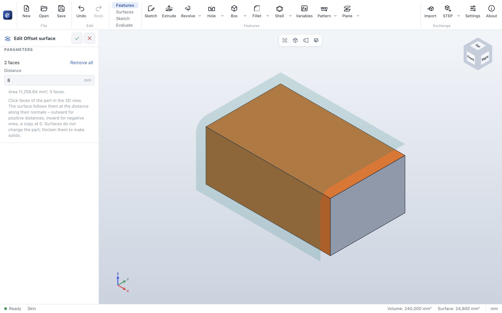

# ParaWerk 0.4.0-alpha.2 – multi-body parts and surfaces

This alpha completes the features of **Phase 3** of the [roadmap](../../ROADMAP.md) except lofts with
guide curves. On top of [0.4.0-alpha.1](v0.4.0-alpha.1.md) come twisted and guided sweeps, lofts along a
centerline, parts of several bodies and surface tools – gathered with the curves in a new *Surfaces* tab.
It is an alpha to try out and give feedback on, not yet a tool for productive work.

## Highlights

### Parts of several bodies

A part can now hold several solid **bodies** – a mold half and its core, two halves combined later, a tool
subtracted at the end. Features that add material have **Merge result**: cleared, the new material stays
a body of its own, also where it overlaps another body. Cuts remove material from every body they reach,
each on its own. **Combine** fuses bodies, subtracts them from a main body or keeps only what they share;
**Delete body** removes bodies. With more than one body, the feature tree lists them under *Solid bodies*.

### Surfaces

- **Offset surface** makes a surface from faces of the part, offset along their normals (or copied at 0);
  where faces meet, it rounds over their edge.
- **Knit** joins surfaces where their edges meet.
- **Thicken** turns a surface into a solid of a thickness – along its normal, against it or half each way –
  or fills a closed surface.

### Sweeps and lofts

- **Twist** turns the profile of a sweep about its path, from start to end – a twisted flat bar or a
  drill-like spiral.
- A **guide curve** keeps the profile touching it: the profile turns towards the guide and grows or
  shrinks with its distance from the path.
- A loft can follow a **centerline** between its profiles: bent transitions and ducts around a corner.

| A flat bar twisted half a turn | A duct bent around a corner |
|---|---|
|  |  |

### A Surfaces tab

The command bar has a new **Surfaces** tab with the surface tools, the curves (helix, projected and
composite curves) and the body commands. **Box** and **Cylinder**, **Fillet** and **Chamfer** now share a
split button each: the cylinder and the chamfer are in the arrow next to them. This keeps the labels of
the *Features* tab visible on narrower screens.

## Which file do I need?

| System | Download |
|---|---|
| Windows 10/11 (Intel/AMD) | `ParaWerk-0.4.0-alpha.2-win-x64-setup.exe` (installer) or `…-win-x64-portable.exe` |
| Windows on ARM | `ParaWerk-0.4.0-alpha.2-win-arm64-setup.exe` or `…-win-arm64-portable.exe` |
| macOS (Apple Silicon and Intel) | `ParaWerk-0.4.0-alpha.2-mac-universal.dmg` (or `…-mac-arm64.dmg` / `…-mac-x64.dmg`) |
| Linux | AppImage, `.deb`, `.rpm`, `.pacman`, Snap, Flatpak or `.tar.gz` for x64 (`x64`, `x86_64`, `amd64`) or arm64 (`arm64`, `aarch64`) |

The builds are not signed with a developer certificate yet, so the system asks once before the first
start (on Windows: *More info → Run anyway*). [Getting started](../user-guide/getting-started.md#install)
shows how to confirm on each system.

## Known limitations

- Not in this alpha yet: lofts with guide curves, splitting bodies, feature scope and moving or copying
  bodies; assemblies (Phase 4).
- Shell, draft, threads and face fillets on bodies that overlap other bodies act on the part as a whole.
- Part files with the features of this alpha (format version 10) cannot be opened by ParaWerk
  0.4.0-alpha.1.

Read the [user guide](../user-guide/README.md) for every tool, step by step.
