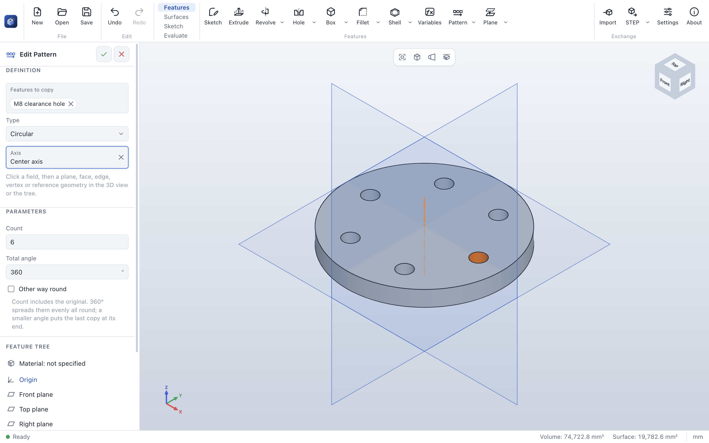
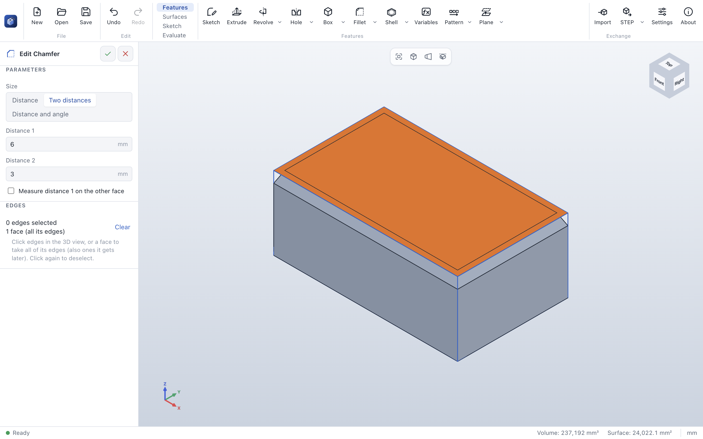
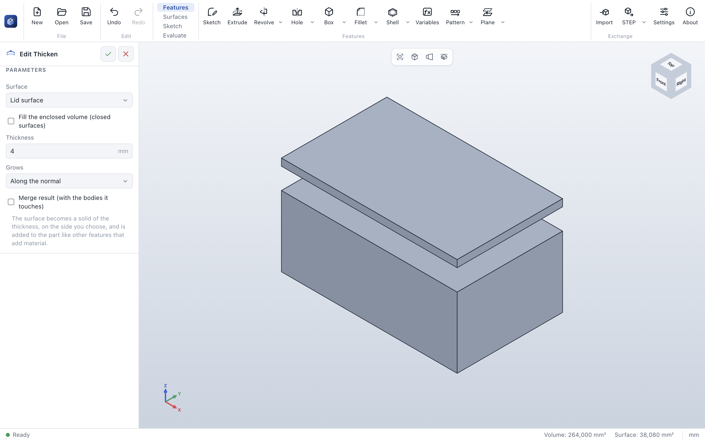

# ParaWerk 0.4.0-alpha.4 – patterns of patterns fixed, a function reference

A small alpha on top of [0.4.0-alpha.3](v0.4.0-alpha.3.md), with the fixes for what testing patterns of
patterns turned up, and a new function reference in the documentation. All features of alpha.2 are
described in its release notes and in the [user guide](../user-guide/README.md). It is an alpha to try
out and give feedback on, not yet a tool for productive work.

## Fixes

- **Patterns of patterns** no longer fail with *Reference 1 of this feature is missing*. A pattern now
  copies another pattern as it was built, with the direction that pattern had – also when its edge was
  rounded or cut later. When the pattern it copies has failed itself, the new pattern says so (*A feature
  this pattern or mirror copies has failed itself*) instead of passing on that pattern's message.
- **Picking the direction:** while you edit a pattern or mirror, a click on an edge, vertex, plane or axis
  goes into the *Direction* (*Axis*, *Plane*) field right away – also while *Features to copy* is still
  the active field. Before, such a click showed *Only features that add or cut material can be copied*.
  A face still names the feature to copy; for a planar face as direction, click the field first.
- Edges and faces of the copies a pattern shows while you edit it are refused as its own direction, with
  a hint to pick the original geometry.
- While a feature is edited, the features before it keep their error marks in the feature tree, so a
  broken pattern you are about to copy is visible right away.

## A function reference

The documentation has a new [function reference](../user-guide/reference/README.md): one page for every
function – from *Sketch* to *Export*, every sketch tool included. Each page tells where to find the
function and what it needs, walks through it step by step, lists every option with its default, gives
tips and explains every message it can show and what to do about it. New screenshots show boxes,
cylinders, chamfers, mirrors, circular patterns, knit and thickened surfaces, deleted bodies, coordinate
systems and the export dialog.

| Chamfer with two distances | A surface thickened into a lid |
|---|---|
|  |  |

## Which file do I need?

| System | Download |
|---|---|
| Windows 10/11 (Intel/AMD) | `ParaWerk-0.4.0-alpha.4-win-x64-setup.exe` (installer) or `…-win-x64-portable.exe` |
| Windows on ARM | `ParaWerk-0.4.0-alpha.4-win-arm64-setup.exe` or `…-win-arm64-portable.exe` |
| macOS (Apple Silicon and Intel) | `ParaWerk-0.4.0-alpha.4-mac-universal.dmg` (or `…-mac-arm64.dmg` / `…-mac-x64.dmg`) |
| Linux | AppImage, `.deb`, `.rpm`, `.pacman`, Snap, Flatpak or `.tar.gz` for x64 (`x64`, `x86_64`, `amd64`) or arm64 (`arm64`, `aarch64`) |

The builds are not signed with a developer certificate yet, so the system asks once before the first
start (on Windows: *More info → Run anyway*). [Getting started](../user-guide/getting-started.md#install)
shows how to confirm on each system.

## Known limitations

- Not in this alpha yet: lofts with guide curves, splitting bodies, feature scope and moving or copying
  bodies; assemblies (Phase 4).
- Part files with the features of 0.4.0-alpha.2 and later (format version 10) cannot be opened by
  ParaWerk 0.4.0-alpha.1.

Read the [function reference](../user-guide/reference/README.md) for every function, step by step.
