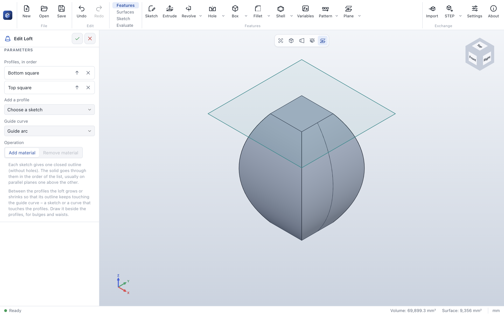
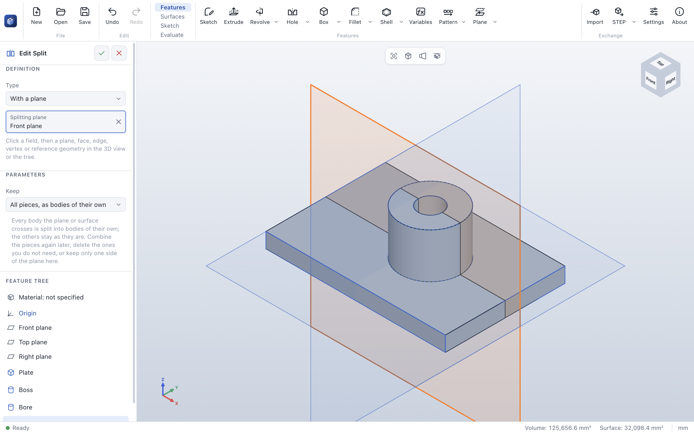

# ParaWerk 0.4.0 – advanced part modeling

ParaWerk 0.4.0 completes **Phase 3** of the [roadmap](../../ROADMAP.md): on top of the sketcher (Phase 1)
and part modeling (Phase 2) come the advanced features – sweeps and lofts in all their forms, drafts,
ribs, modeled threads, curves in space, parts of several bodies, surfaces, configurations and full
equations – together with a function reference for every tool and a large example part that is built and
edited in every test run. ParaWerk is still under active development: check every result before you
manufacture anything.

## New since 0.4.0-alpha.5

- **Split** (*Surfaces* tab, group *Bodies*) splits every body a plane or a surface crosses into bodies of
  their own – mold halves, a part cut in two to fit a print bed. With a plane it can keep only one side.
- **Move body** moves bodies – shifted along X, Y and Z or turned about an axis – or adds moved copies as
  bodies of their own. A moved body keeps the names of its faces, so the features after it follow it.
- **Feature scope:** on a part of several bodies, a feature that adds or cuts material can be limited to
  the bodies you tick – a bore through two overlapping bodies cuts only one of them.
- **One body alone:** the mass properties panel and the export dialog let you choose a single body – to
  weigh it, or to print it on its own.
- **Lofts with a guide curve:** between its profiles, a loft grows or shrinks so that its outline keeps
  touching a curve beside it – bellies, waists, vases, also from a square to a circle.
- **Reference geometry on and off:** a button in the view toolbar hides reference planes, axes, points and
  coordinate systems; they still show while a feature picks references.
- **Patterns three levels deep** (a mirror of a grid of a row) copy every place: before, the innermost
  copies were left out.

| A loft bulging out to a guide arc | A bore limited to one body by its feature scope |
|---|---|
|  |  |

| A boss split along the front plane | A puck copied to the other side of the plate |
|---|---|
|  |  |

## Everything Phase 3 brought

- **Sweeps** along a sketch path, a **helix** (springs, coils, helical grooves) or a curve; **twisted**
  sweeps and sweeps that follow a **guide curve**.
- **Lofts** through the outlines of several sketches, also from a square to a circle, along a
  **centerline** or a **guide curve**.
- **Draft** on picked faces about a neutral plane, **ribs** from open sketch lines, **variable radius
  fillets**, **modeled ISO threads** for 3D printing.
- **Curves** in space: helices, curves projected onto faces or from two sketches, composite curves of
  edges, sketches and curves – as paths and guides for sweeps.
- **Parts of several bodies:** bodies of their own, cuts body by body, combine (add, subtract, common),
  split, move, copy and delete bodies, feature scope, mass properties and exports of single bodies.
- **Surfaces:** offset, knit and thicken (also filling a closed surface).
- **Configurations** with a design table, and **equations** with functions and conditions in every number
  field.
- **Patterns of patterns** and mirror images of patterns; a linear pattern turns into the part and shows
  its direction with an arrow.
- A **function reference** with one page per function, and a **feature showcase** – an example part of
  86 features of all 33 kinds ([download](../examples/feature-showcase.pwpart)) – that every CI run
  builds, edits, saves, opens and exports.

## Performance

| Case (Apple M3) | Time |
|---|---|
| Part of 502 features: edit the last feature / rebuild everything | 151 ms / 6.9 s |
| Feature showcase: a new value of its first variable (86 features rebuilt) | 2.1 s |
| A fillet on all 101 rims of a face with 100 holes | 0.84 s |

Rebuilds run in the background, so the window stays responsive. See the
[benchmarks](../benchmarks/README.md) for all measurements.

## Which file do I need?

| System | Download |
|---|---|
| Windows 10/11 (Intel/AMD) | `ParaWerk-0.4.0-win-x64-setup.exe` (installer) or `…-win-x64-portable.exe` |
| Windows on ARM | `ParaWerk-0.4.0-win-arm64-setup.exe` or `…-win-arm64-portable.exe` |
| macOS (Apple Silicon and Intel) | `ParaWerk-0.4.0-mac-universal.dmg` (or `…-mac-arm64.dmg` / `…-mac-x64.dmg`) |
| Linux | AppImage, `.deb`, `.rpm`, `.pacman`, Snap, Flatpak or `.tar.gz` for x64 (`x64`, `x86_64`, `amd64`) or arm64 (`arm64`, `aarch64`) |

The builds are not signed with a developer certificate yet, so the system asks once before the first
start (on Windows: *More info → Run anyway*). [Getting started](../user-guide/getting-started.md#install)
shows how to confirm on each system.

## Known limitations

- A loft follows one guide curve, not several; with a guide it has no centerline.
- Bodies have one material: the part's.
- Rebuilding everything in parts of several hundred features takes seconds (editing the last feature stays
  quick).
- Part files with the features of this release (format version 11) cannot be opened by the alphas before
  it.
- Not yet: assemblies (Phase 4), standard parts (Phase 5), drawings (Phase 6).

Read the [user guide](../user-guide/README.md) and the [function reference](../user-guide/reference/README.md)
for every tool, step by step.
