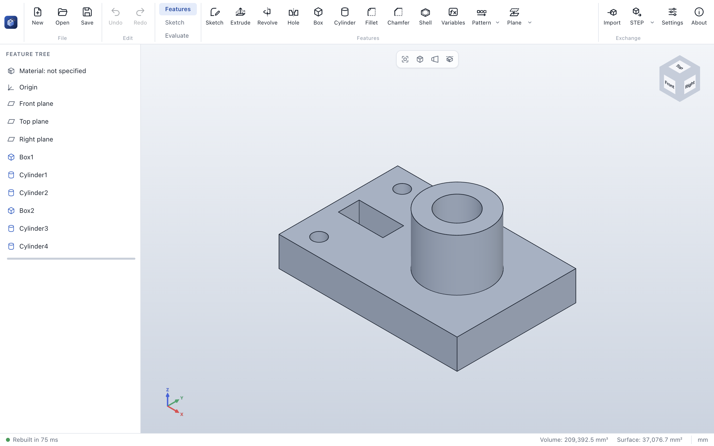

# ParaWerk user guide

> [!CAUTION]
> ParaWerk is under active development. This guide describes preview 0.2 with the complete 2D sketcher
> of Phase 1.
> Check every result before you manufacture anything.

## Contents

1. [Getting started](getting-started.md): install ParaWerk and build your first part
2. [The interface](interface.md): command bar, feature tree, property panel, 3D view, status bar
3. [Navigating the 3D view](navigation.md): rotate, pan, zoom, view cube and standard views
4. [Sketches](sketches.md): planes, sketch mode, drawing and editing tools, snapping, relations,
   dimensions, definition status, DXF, and a step-by-step example
5. [Modeling features](features.md): extrude, revolve, holes, patterns and mirror, box, cylinder, fillet,
   chamfer, shell, reference geometry, variables, editing and undo
6. [Files, import and export](files.md): `.pwpart` files, STEP and STL, sketches as DXF
7. [Settings](settings.md): language, theme, navigation and projection
8. [Troubleshooting](troubleshooting.md): self-test, logs and known limitations

## What the preview can do

| Area | Available now |
|---|---|
| Modeling | Extrude and revolve sketches (add or remove material), holes for metric screws (clearance, counterbore, countersink, tapped with cosmetic threads), linear and circular patterns and mirror images of features, box and cylinder, fillet and chamfer on edges picked in the 3D view, shells open at picked faces; features keep their edges and faces when earlier features change |
| Reference geometry | Planes (offset, at an angle, through three points, between two planes, parallel through a point), axes and points that follow the part and carry sketches |
| Sketching | Sketches on the front, top and right plane and on planar faces, with their own undo history; lines, rectangles (corner, center, 3-point, parallelogram), circles, ellipses, arcs (center, 3-point, tangent), splines (with points on them, trimmed exactly), slots, polygons and points, with snapping and automatic relations; relations checked by the solver and shown as symbols next to the geometry; smart dimensions with reference dimensions; status colors and conflict diagnosis; trim, extend, sketch fillet and chamfer, offset, mirror, patterns, move, copy and scale; converting model edges; dragging with live solving; DXF import and export |
| Feature tree | Edit, suppress and delete features; rollback while editing; undo and redo |
| Variables | Named values and equations for the whole part, used by name in parameters and sketch dimensions; calculations in every number field |
| Evaluation | Exact volume and surface area, face and edge information under the cursor |
| Files | Save and open `.pwpart`, export STEP (AP214) and binary STL |
| Interface | English and German, light and dark theme, mouse and trackpad navigation |

More sketch-based features (sweep, loft, holes) and patterns follow in Phase 2. See the [roadmap](../../ROADMAP.md).
