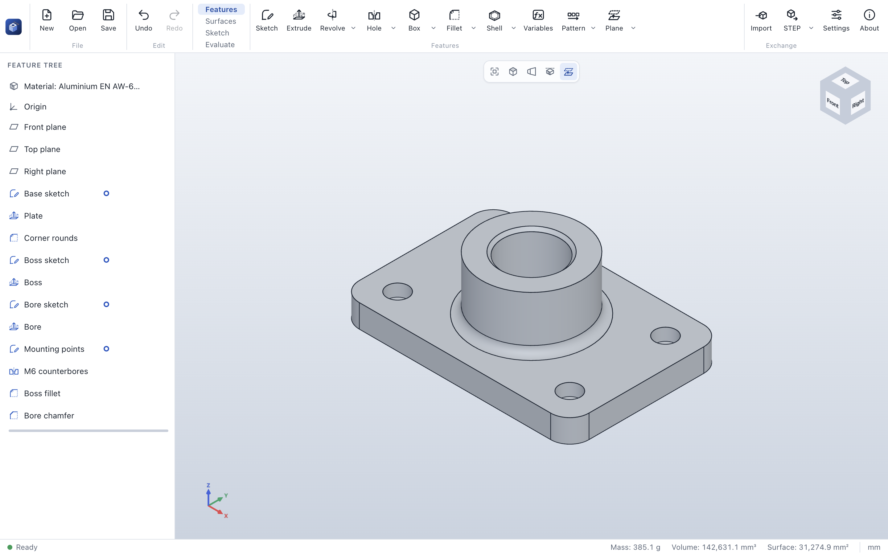

# ParaWerk user guide

> [!CAUTION]
> ParaWerk is under active development. This guide describes alpha 0.4 and what has been added since
> (marked in the [changelog](../../CHANGELOG.md)): the 2D sketcher of Phase 1, part modeling of Phase 2
> and the advanced features of Phase 3.
> Check every result before you manufacture anything.

## Contents

1. [Getting started](getting-started.md): install ParaWerk and build your first part
2. [The interface](interface.md): command bar, feature tree, property panel, 3D view, status bar
3. [Navigating the 3D view](navigation.md): rotate, pan, zoom, view cube, standard views and section view
4. [Sketches](sketches.md): planes, sketch mode, drawing and editing tools, snapping, relations,
   dimensions, definition status, DXF, and a step-by-step example
5. [Modeling features](features.md): extrude, revolve, sweep, helix and springs, loft, holes, threads,
   patterns and mirror, bodies, surfaces, box, cylinder, fillet, chamfer, shell, draft, rib, reference geometry, curves, variables,
   configurations, editing and undo
6. [Material and evaluation](evaluate.md): material and density, color, mass, center of mass,
   moments of inertia, and the measure tool
7. [Files, import and export](files.md): `.pwpart` files, recovery after a crash, STEP import, STEP, STL and 3MF export, sketches as DXF
8. [Settings](settings.md): language, theme, navigation and projection
9. [Troubleshooting](troubleshooting.md): self-test, logs and known limitations

## What the alpha can do

| Area | Available now |
|---|---|
| Modeling | Extrude and revolve sketches (add or remove material; a depth, through all, up to the next face, a planar or curved surface or a vertex; two directions; draft; thin features), holes for metric screws (clearance, counterbore, countersink, tapped with cosmetic threads), sweeps along paths, helices (springs) and curves, also twisted or along a guide curve, lofts (also along a centerline), ribs, drafts on picked faces, modeled ISO threads, linear and circular patterns and mirror images of features (also of other patterns), box and cylinder, fillet (constant or variable radius) and chamfer (equal, two distances, distance and angle) on edges or whole faces picked in the 3D view, face fillets and full rounds, shells open at picked faces; features keep their edges and faces when earlier features change |
| Reference geometry and curves | Planes (offset, at an angle, through three points, between two planes, parallel through a point), axes, points, coordinate systems, helices, projected and composite curves that follow the part, carry sketches and guide sweeps |
| Sketching | Sketches on the front, top and right plane and on planar faces, with their own undo history; lines, rectangles (corner, center, 3-point, parallelogram), circles, ellipses, arcs (center, 3-point, tangent), splines (with points on them, trimmed exactly), slots, polygons and points, with snapping and automatic relations; relations checked by the solver and shown as symbols next to the geometry; smart dimensions with reference dimensions; status colors and conflict diagnosis; trim, extend, sketch fillet and chamfer, offset, mirror, patterns, move, copy and scale; converting model edges; dragging with live solving; DXF import and export |
| Feature tree | Edit, suppress and delete features; rollback bar to insert features in the middle of the history; reorder by dragging, with dependency checks; undo and redo |
| Bodies and surfaces | Parts of several bodies (separate bodies, cuts body by body, combine and delete bodies); offset, knit and thicken surfaces |
| Variables | Named values and equations for the whole part, used by name in parameters and sketch dimensions; calculations with functions and conditions in every number field; configurations with a design table |
| Evaluation | Materials (27 metals, plastics and woods, or your own density) and part colors; exact mass, volume, surface area, center of mass and moments of inertia; measuring distances, angles, center distances, lengths and areas; face and edge information under the cursor |
| Files | Save and open `.pwpart` with recovery copies of unsaved work after a crash, import STEP as a body, export STEP (AP214), binary STL and 3MF with material and color |
| Interface | English and German, light and dark theme, mouse and trackpad navigation |

Lofts with guide curves follow later; assemblies come in Phase 4. See the
[roadmap](../../ROADMAP.md).
