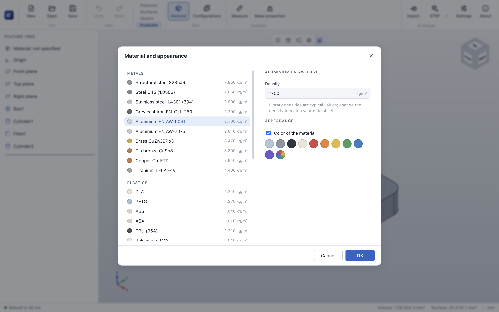
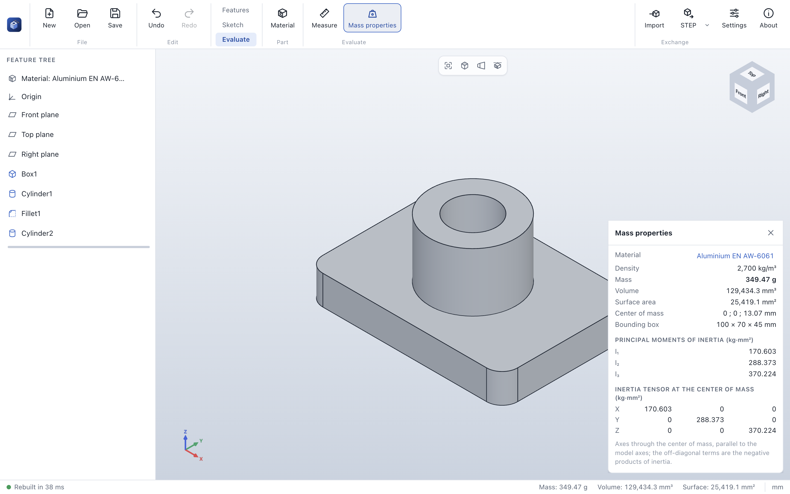
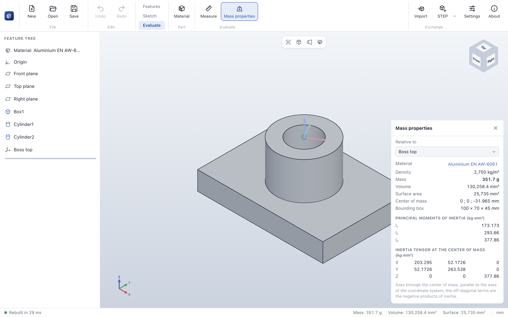
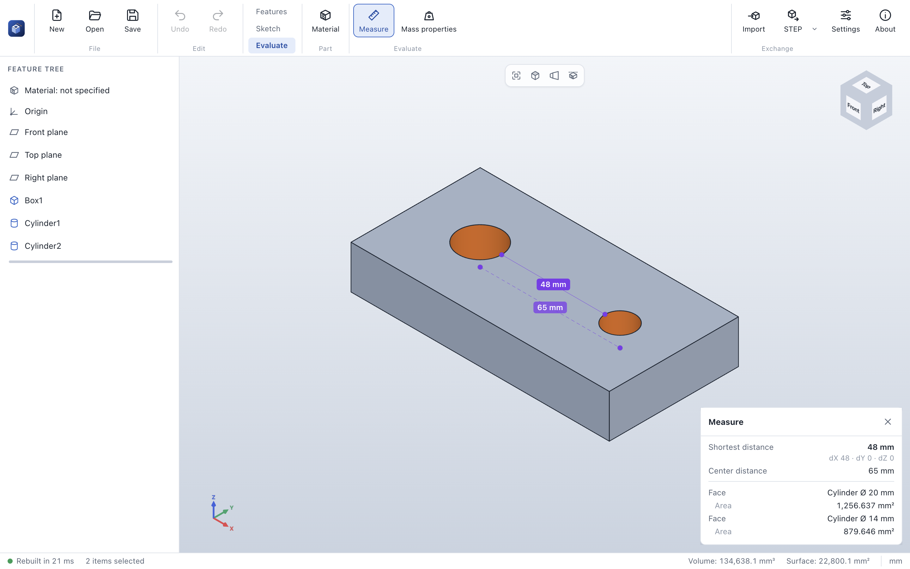

# Material and evaluation

The **Evaluate** tab of the command bar holds what concerns the part as a whole: its material and color,
what it weighs, and the measure tool.

## Material and appearance

**Material** (also: double-click *Material* at the top of the feature tree) opens the material dialog.

- **Library:** structural and tempering steel, stainless steel, grey cast iron, two aluminium alloys,
  brass, bronze, copper and titanium; the common 3D printing and engineering plastics (PLA, PETG, ABS,
  ASA, TPU, PA12, PA6, POM, PC, PMMA, HDPE, PTFE); oak, beech, pine, birch plywood and MDF. The densities
  are typical values at room temperature.
- **Density:** change it to match your data sheet or your printer's infill (*Library value* goes back).
- **Custom material:** a name and a density of your own, for anything that is not in the library.
- **No material:** the part has no mass, only a volume.
- **Appearance:** the part is shown in the color of its material, or in a color of your own (one of the
  swatches, or any color from the color picker on the right).

**OK** applies material and color as one step that **Undo** reverts; **Cancel** or **Esc** keeps the
part as it was. Material and color are saved in the part file (format version 7).

## Mass properties

**Mass properties** shows a panel over the 3D view that follows every change of the part:

| Value | Meaning |
|---|---|
| Material, density | Click the material to change it. |
| Mass | Volume × density, in grams below 1 kg, otherwise in kilograms. Also shown in the status bar. |
| Volume, surface area | Integrated exactly over the B-Rep faces (not over the display mesh). |
| Center of mass | In model coordinates, mm (or in a coordinate system, see below). |
| Bounding box | Size of the part along X, Y and Z. |
| Principal moments of inertia | I₁ ≤ I₂ ≤ I₃ about the principal axes through the center of mass, in kg·mm². |
| Inertia tensor | In axes through the center of mass, parallel to the model axes, in kg·mm². The diagonal holds the moments about X, Y and Z; the other terms are the negative products of inertia (−∫xy dm). |

When the part has [coordinate systems](features.md#reference-geometry), **Relative to** at the top of
the panel gives the center of mass in the coordinates of one of them and the inertia tensor about its
axes; the principal moments do not depend on it. The bounding box stays along the model axes.

The values are for the part as it is built: while the part is rolled back, they are for the features
above the rollback bar; while a feature or sketch is edited, the panel keeps the last values until the
edit is finished. Without a material the panel shows volume, area and center of mass only.

## Measure

**Measure** turns on the measure tool; a panel opens at the top left of the 3D view. Click faces, edges
or vertices of the part (no Ctrl needed): the first pick is described, two picks are measured against
each other, and a third click starts a new measurement. Click a pick again to remove it. **Measure** or
the ✕ of the panel turns the tool off.

| Picks | What is measured |
|---|---|
| One face | Kind of surface, diameter of cylinders and spheres, area |
| One edge | Kind of curve, length, diameter and center of circles and arcs |
| One vertex | Position |
| Any two | The **shortest distance** between them (solid line in the view) with its components dX, dY, dZ |
| Two planes or straight edges, or one of each | The **angle** between them (0° to 90°); for parallel planes also the **distance of the planes** along their normal |
| Circles, arcs, cylinders, spheres (with each other or with a vertex) | The **center distance**: between centers, from a center to an axis, or between axes (dashed line in the view) |

All values come from the exact B-Rep geometry, not from the display mesh. Standard planes and reference
geometry cannot be measured yet.
