# Modeling features

A part is a list of features applied from top to bottom. Every feature can be edited later; the part is
rebuilt automatically and only from the first changed feature onwards.

## Extrude

**Extrude** (in the *Features* tab) turns the closed outlines of a sketch into a solid, or cuts them out
of the body with **Remove material**. Draw and close the outlines in a [sketch](sketches.md) first, then
choose **Extrude**: it takes the newest sketch that no extrusion or revolution uses yet; *Sketch* in the side panel
chooses another one.

- *End*: **Depth** extrudes a given distance in millimeters; like every parameter it takes a calculation
  or a [variable](#variables-and-equations). **Through all** goes past the whole body in the chosen
  direction – the usual choice for holes and cut-outs through a plate – and still does when the body
  grows later. It needs a body to go through.
- **Up to next** extrudes until the outline meets the body: a column from a plate up to a roof, a rib up
  to a wall. The end follows the shape of what it meets – a step, a slope or a curved face. With **Remove
  material** it cuts through the first material each outline meets and stops where that material ends: a
  hole through the lid of a closed box, not through its floor as well. Every outline of the sketch finds
  its own first wall. When the body does not stop the whole outline (part of it would go on without end),
  the feature reports it.
- **Up to surface** extrudes until a face of the part – planar or curved, such as the round side of a
  shaft – or until a [reference plane](#reference-geometry) or a standard plane, picked in the 3D view or
  the tree. A plane may lie at an angle – the extrusion then ends in a sloped face along it; a curved face
  gives a curved end, and the face counts as going on past its edges (a cylinder all the way round and
  further along its axis). *Offset* stops that far before the surface, or past it with **Past the
  surface**. When the face moves later, the extrusion follows it.
- **Up to vertex** extrudes until the height of a vertex of the part or a reference point, measured along
  the extrusion. All up-to ends go one way (**Normal** or **Reversed**).
- *Direction*: **Normal** extrudes along the normal of the sketch plane (out of the face for a sketch on a
  face), **Reversed** the other way (into the body, as a pocket usually needs), **Mid-plane** half the
  depth to each side, **Two directions** the *Depth* along the normal and *Depth 2* against it. For a
  sketch on a face, **Remove material** turns the direction into the part (**Reversed**) and **Add
  material** back out of it. A cut that does not touch the part removes nothing; it is built anyway and
  marked with a yellow warning that suggests the other direction.
- **Draft while extruding** tapers the side faces by the *Draft angle* (up to 60°) towards the far end, as
  cast and molded parts need; **Draft outward** widens them instead. An extrusion to both sides tapers each
  half towards its own end. Fillets and other features on the drafted faces stay on them when the angle
  changes.
- Every closed outline of the sketch is extruded. An outline inside another one becomes a hole, an outline
  inside that hole is material again. Construction geometry and open curves are ignored, and so are lines
  that only divide an outline from within.
- Curves that cross each other make the outlines ambiguous: the feature then reports where they cross, so
  you can trim them. A sketch without a closed outline is reported too.
- All sketch curves stay exact in the solid: lines, arcs, circles, ellipses and splines become exact B-Rep
  edges and faces, and volumes and areas are computed exactly.

Once an extrusion uses a sketch, the sketch is hidden in the 3D view; editing the extrusion shows it again,
and editing the sketch (double-click it in the feature tree) rebuilds the extrusion.

### Thin features

**Thin feature** extrudes walls of a *Wall thickness* along the curves of the sketch instead of the
areas they enclose: brackets and channels from a bent profile, ribs from a single line, tubes and frames
from a closed outline. Open curves work too, so a sketch of open curves only starts as a thin feature
right away.

- *Walls*: **One side** puts the walls outside a closed outline (for open curves on the side the preview
  shows), **Other side** inside, **Both sides** half the thickness on each side of the curves.
- Lines stay lines and arcs and circles stay arcs and circles around the same center, so the walls are
  exact. Where lines and arcs meet at an angle, the walls meet in a sharp corner; outside a very sharp
  corner an arc around it joins them. Open ends are square.
- Curves that branch (more than two meeting in one point) are reported, and so are walls too thick for
  the curves (an arc or a short line would vanish inside them). Walls along ellipses and splines are not
  possible yet.
- All other options of the extrusion work as usual: ends, directions, draft, *Remove material* (a thin
  cut makes a groove along the curves). The wall faces are named after their curves and side, so fillets
  on them stay put.

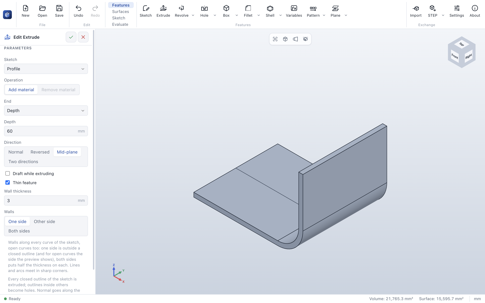

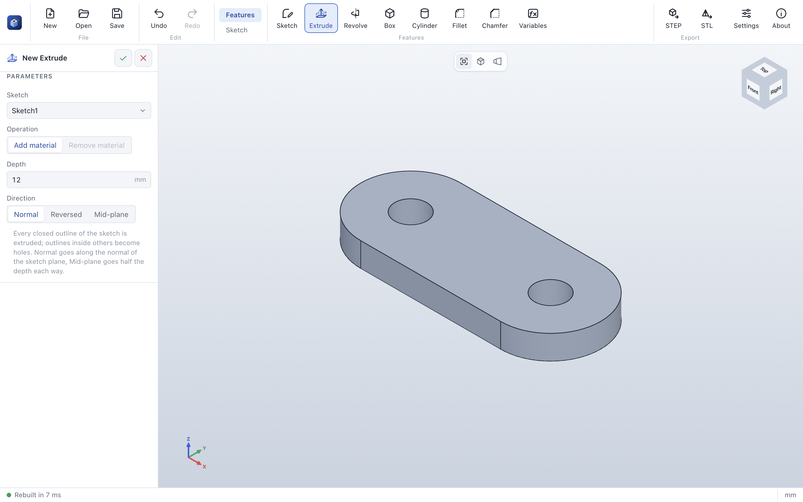

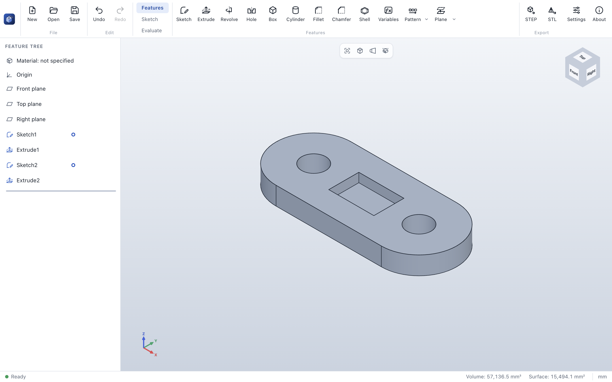

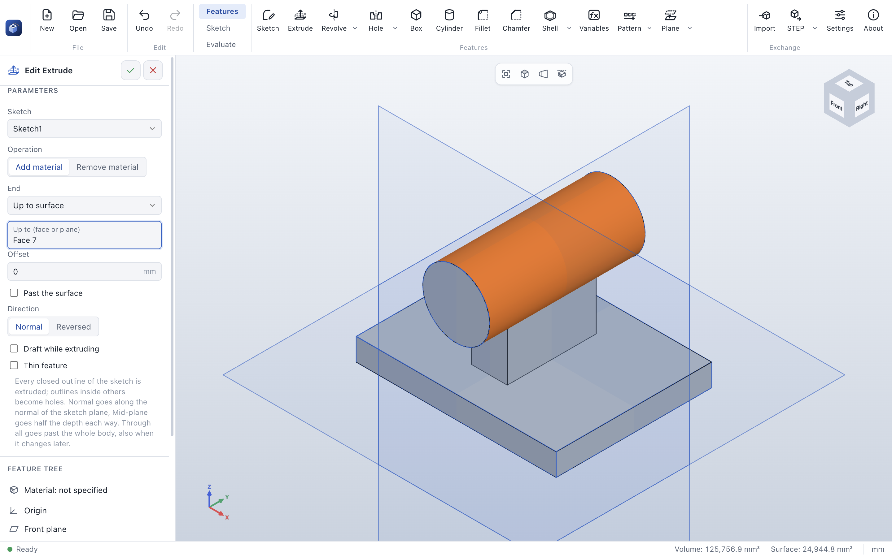

## Revolve

**Revolve** turns the closed outlines of a sketch around an axis into a solid – shafts, bushes, pulleys,
knobs – or cuts them out of the body (grooves, recesses) with **Remove material**. Draw a half section and
a **centerline** as the axis in the sketch; the outlines may touch the axis but must stay on one side of
it. As a [thin feature](#thin-features) it turns walls along the curves (not along the axis line), for
example a cup from the open outline of its inside.

- *Sketch* and *Axis*: Revolve takes the newest sketch that no extrusion or revolution uses yet and its
  first centerline. *Axis* lists the centerlines and the other lines of the sketch; the chosen one is shown
  in orange. A line of the outline itself can be the axis too. Below them, *Axis* lists the
  [reference axes](#reference-geometry) of the part: an axis outside the sketch, for example one along an
  edge of the part, works as long as it lies in the sketch plane. A sketch without a centerline turns
  around the newest reference axis.
- *Angle* in degrees, up to 360 (a full turn, the default); like every parameter it takes a calculation or
  a variable.
- *Direction*: **Normal** and **Reversed** turn one way or the other from the sketch plane, **Symmetric**
  half the angle to each side.
- Outlines inside others become holes, as for extrusions, and every sketch curve stays exact: lines become
  planes, cylinders and cones, arcs become spheres and tori, splines become exact surfaces of revolution.

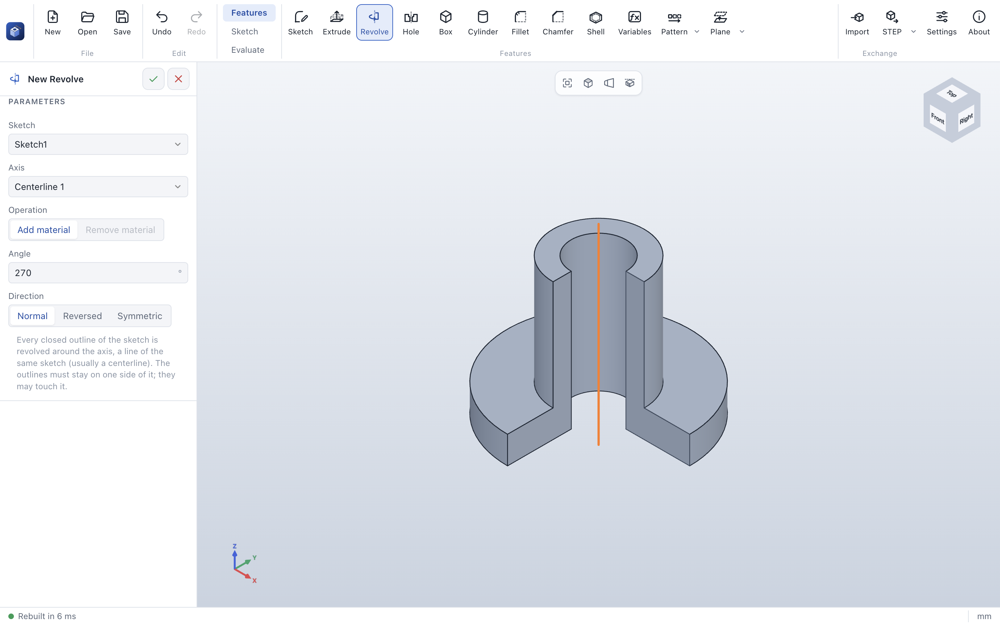

## Sweep

**Sweep** (in the arrow of the **Revolve** button) moves the closed outlines of one sketch along a path,
the curves of another sketch – handles, tubes, wires, grooves along a curve with **Remove material**.

- *Profile*: the sketch with the closed outlines. They are swept as they lie, so draw them across the
  start of the path – usually on a plane at a right angle to it, through its first point.
- *Path*: a sketch with one chain of lines, arcs, ellipses or splines, open or closed, a
  [helix](#helix-and-springs) or a [projected or composite curve](#curves). Curves that branch or do not connect are reported. The path runs from its
  end nearer to the outlines, so it does not matter in which direction it was drawn.
- Sweep starts with the newest sketch with closed outlines as profile and the newest helix or sketch
  without closed outlines as path, if no feature uses them yet.

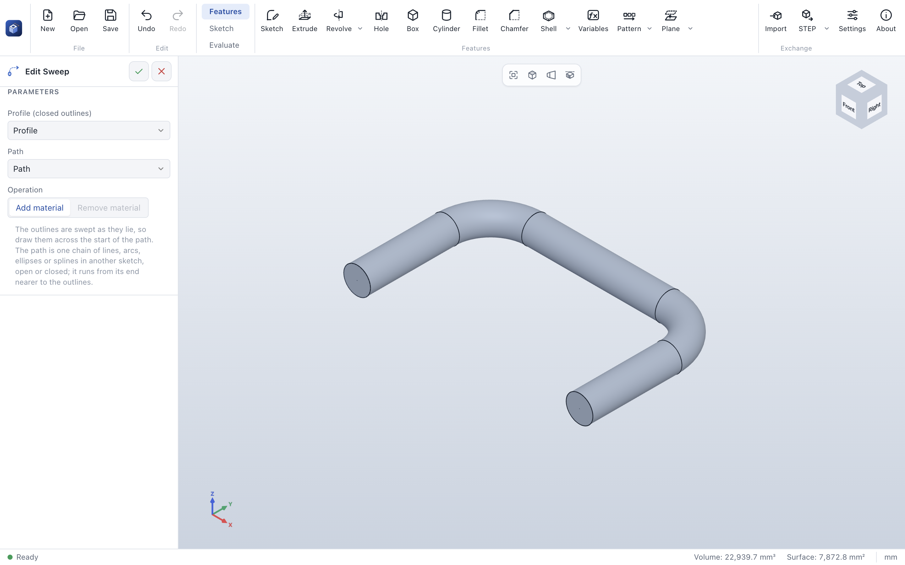

The profile keeps its angle to the path as it follows it. Where the path bends tighter than the profile is
wide, the sweep would cross itself and is reported.

Along a sketch path or a curve, two options shape the sweep further:

- *Twist* turns the outlines about the path, evenly from start to end – 180° for a twisted flat bar,
  several turns (720°, 1080° …) for a drill-like spiral. Negative angles turn the other way.
- *Guide curve* – a sketch or a curve that starts on the outlines – is followed all the way: the outlines
  turn towards it and grow or shrink with its distance from the path, for handles, horns and bottle
  necks. A guide at a constant distance keeps the outlines as they are; with a guide there is no twist.

Twisted and guided sweeps take outlines without holes.

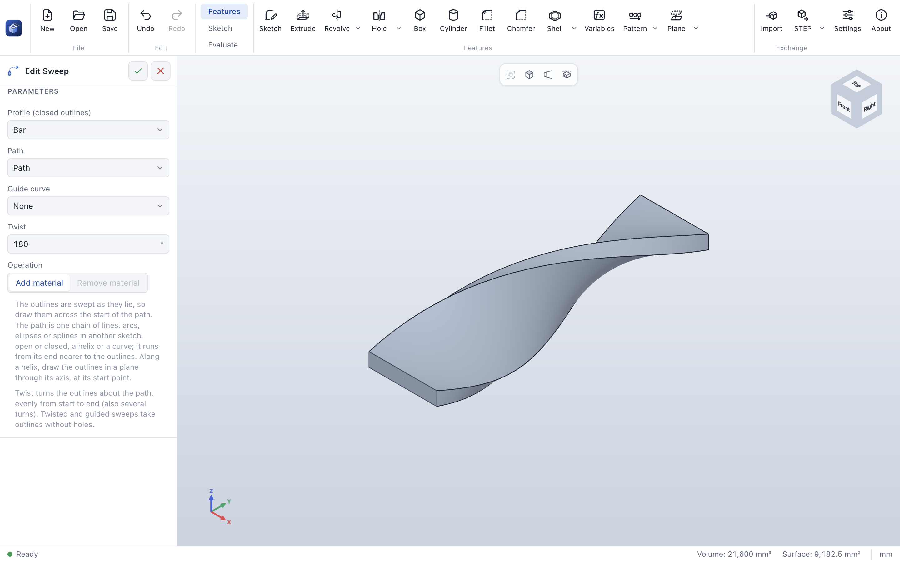

## Helix and springs

**Helix** (in the arrow of the **Plane** button) is a curve that winds around the axis of a circle:
the path for springs, coils and spiral grooves. It does not change the body; it is drawn as a line in
the 3D view and listed in the tree like reference geometry.

- *Sketch with the circle*: the helix takes the first circle of the sketch (not a construction circle):
  its center and the sketch normal give the axis, its radius the radius of the helix. Helix starts with the
  newest sketch with a circle that no feature uses yet.
- *Pitch*: how far the helix rises in one turn. *Turns*: how many turns it makes, also parts of a turn
  (0.25 is a quarter turn). The panel shows the height, pitch × turns. All three take equations.
- *Start angle*: where on the circle the helix starts, measured from the X axis of the sketch.
- **Wind to the other side of the sketch** lets the helix rise against the sketch normal instead.
- **Left-hand (counterclockwise)** winds it the other way round; by default it is right-handed like most
  springs and threads.

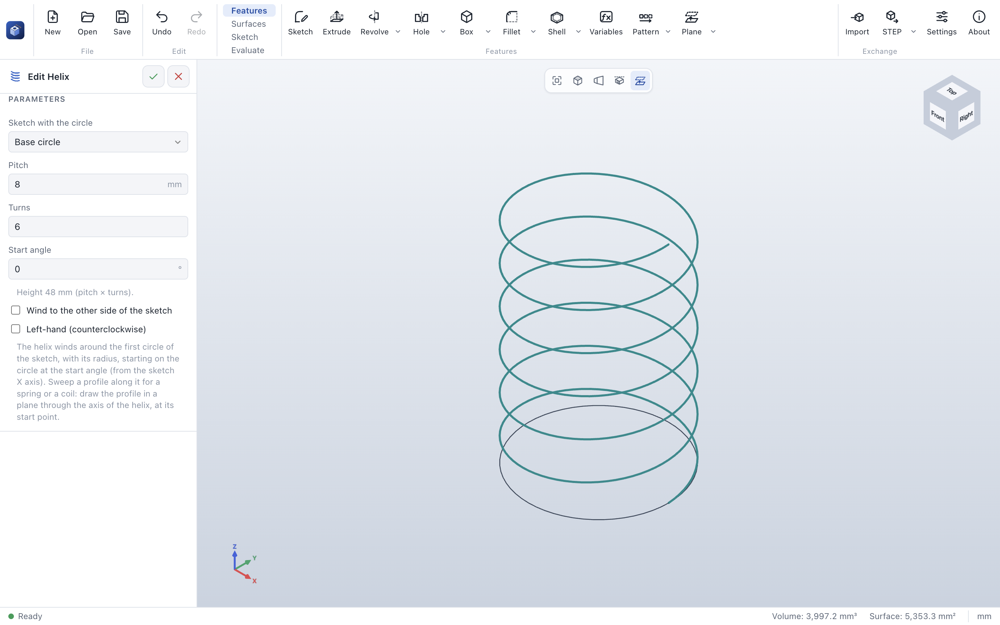

For a **spring**, draw the cross-section of the wire in a sketch on a plane through the axis of the helix,
at the point where the helix starts – for a helix around the origin on the top plane with start angle 0,
a circle on the front plane centered at (radius, 0). Then click **Sweep** and choose the helix as the path.
Along a helix the profile keeps its angle to the axis as it winds around it, so the cross-section of the
spring is the profile in every plane through the axis. **Remove material** cuts a helical groove into
the body instead. Along a helix, profiles take outlines without holes (for a tube, sweep the outer outline
and cut the inner one).

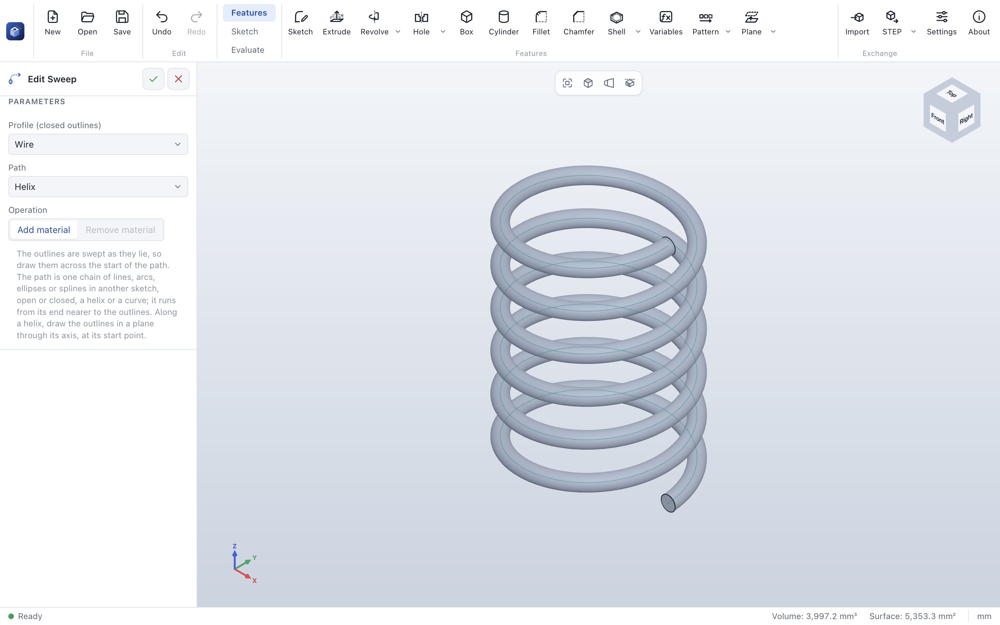

## Curves

Curves in space are paths for sweeps that no single sketch can draw. Like reference geometry they do not
change the body; they are drawn as lines in the 3D view and listed in the tree. Both are in the arrow of
the **Plane** button. While you edit a curve, the panel shows its length and how many pieces it has; a
sweep needs a curve of one piece.

### Projected curve

- **Onto faces** projects the curves of a sketch (all that are not construction geometry) along the sketch
  normal onto faces of the part: a mark or a groove path on a shaft, a line across a curved lid. Click the
  faces in the 3D view (again to take one out). *Lands* decides where: on **both sides** of the sketch,
  only **along the normal** or only **against** it – a curve projected onto a whole shaft would otherwise
  land on its top and its bottom.
- **Sketch on sketch** makes a 3D curve from two views: draw it as seen from above in one sketch and as
  seen from the front in another. The curve is where the two meet when each is extended along its sketch
  normal – for example a line rising along a bent path.

Projected curve starts with the newest sketch that no feature uses yet and takes faces selected before.

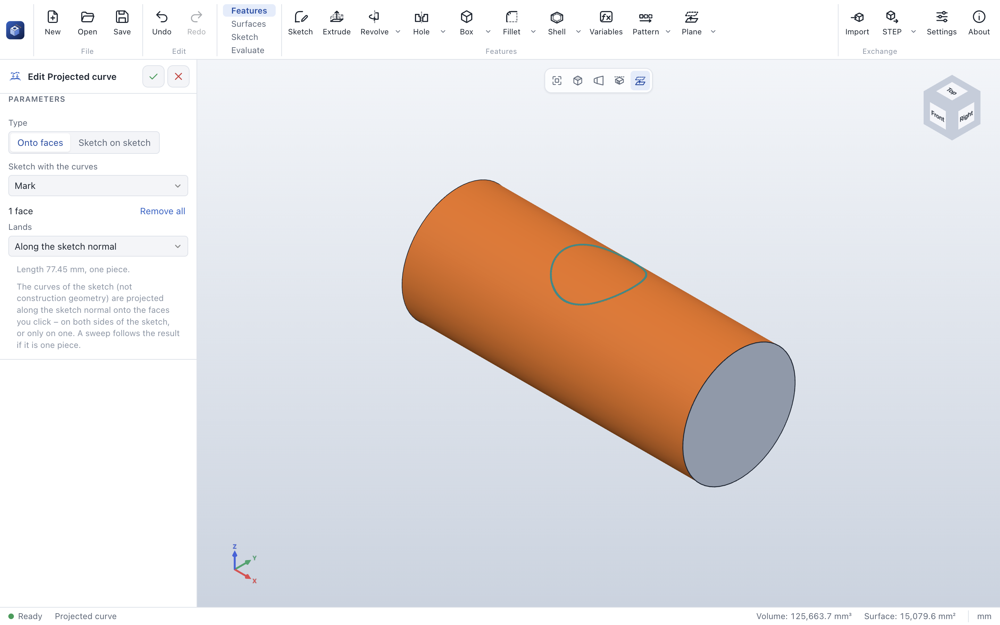

### Composite curve

**Composite curve** joins edges of the part, sketches and other curves end to end into one chain: click
edges in the 3D view (again to take one out) and add sketches and curves from the list. Together they must
form one chain without branches or gaps – it is reported otherwise. Edges are remembered by name like the
edges of a fillet, so the curve follows the part when earlier features change.

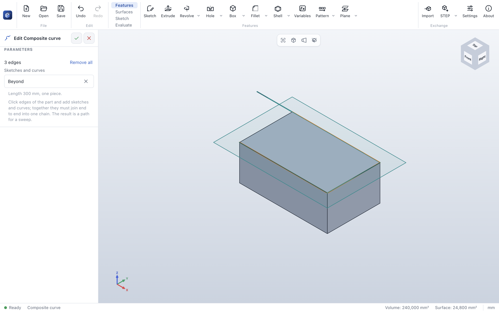

## Loft

**Loft** (also in the arrow of **Revolve**) makes a solid through the outlines of several sketches, in
order – transitions from a square duct to a round one, bottles, blades. Each sketch gives one closed
outline without holes, usually on parallel planes one above the other (reference planes at offsets).

- *Profiles, in order*: the list of sketches; **↑** moves a sketch up, **✕** takes it out, *Add a profile*
  adds another one at the end. Loft starts with the sketches with closed outlines that no feature uses yet.
- **Flat faces between the profiles** joins neighboring outlines with straight faces instead of a smooth
  surface through all of them.
- Outlines with different numbers of edges (a square and a circle) are joined too; the side faces are
  named after the edges of the first outline.
- *Centerline* (optional): a sketch or a [curve](#curves) through the profiles. The profiles stay where
  they are drawn, and between them the loft follows the centerline instead of running straight – bent
  transitions, elbows, ducts around a corner. With a centerline there are no flat faces between the
  profiles.

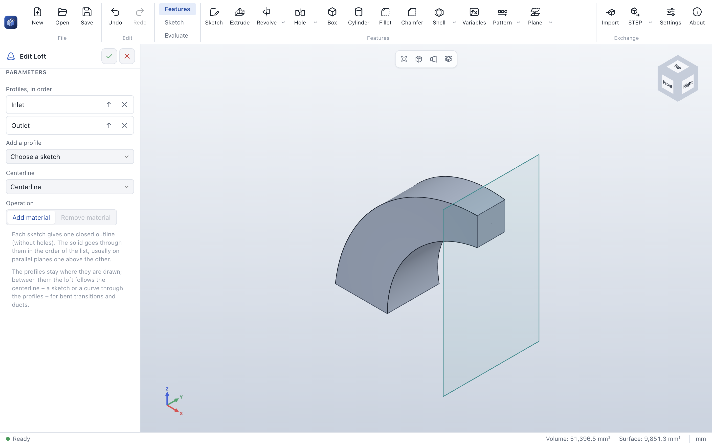

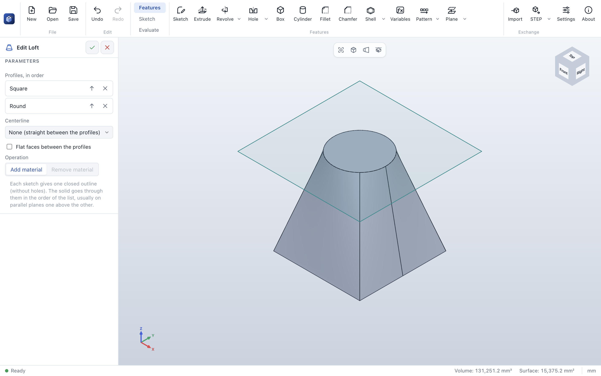

## Hole

**Hole** drills holes for ISO metric screws – M1.6 to M30 – at the points of a sketch. Sketch on the face
you want to drill into, place a **Point** for every hole (dimension them like any other geometry), close
the sketch and click **Hole**. Points that are ends or centers of lines, arcs and circles, and construction
points, get no hole, so construction lines can position the points.

- *Type*: **Clearance hole**, **Counterbore** (for cap screws ISO 4762), **Countersink** (90°, for
  countersunk screws ISO 10642) or **Tapped hole** (coarse thread, tap drill).
- *Size* and, for clearance holes, the *Fit*: **Fine**, **Medium** or **Coarse** series of ISO 273.
- *End*: **Through all**, or a **Depth**; blind holes end in a 118° drill point. A tapped hole is drilled
  four turns deeper than its *Thread depth*.
- *Positions*: the sketch whose points are the hole centers; the panel says how many holes it makes.
  Holes go into the material, against the normal of the sketch plane; **Drill the other way** turns them
  round (for a sketch on a plane below the part, for example).
- *Dimensions*: hole diameter (the tap drill of a tapped hole), counterbore or countersink diameter and
  depth or angle, thread depth. Changing the type, size or fit sets them from the standards again; you
  can change each of them afterwards, also as an equation.

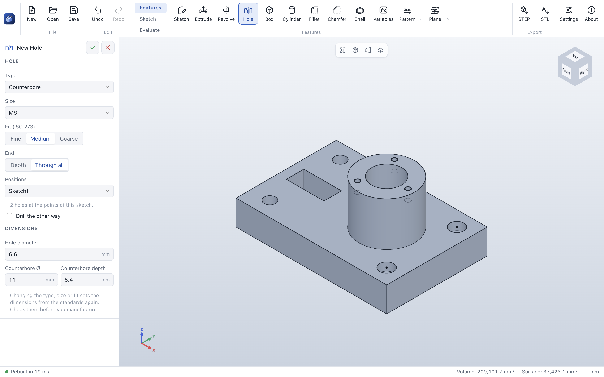

Threads are not modeled: a tapped hole is cut with its tap drill, and the thread is shown as dashed
circles of its nominal diameter where it starts and where it ends (dimmed where the part hides them).

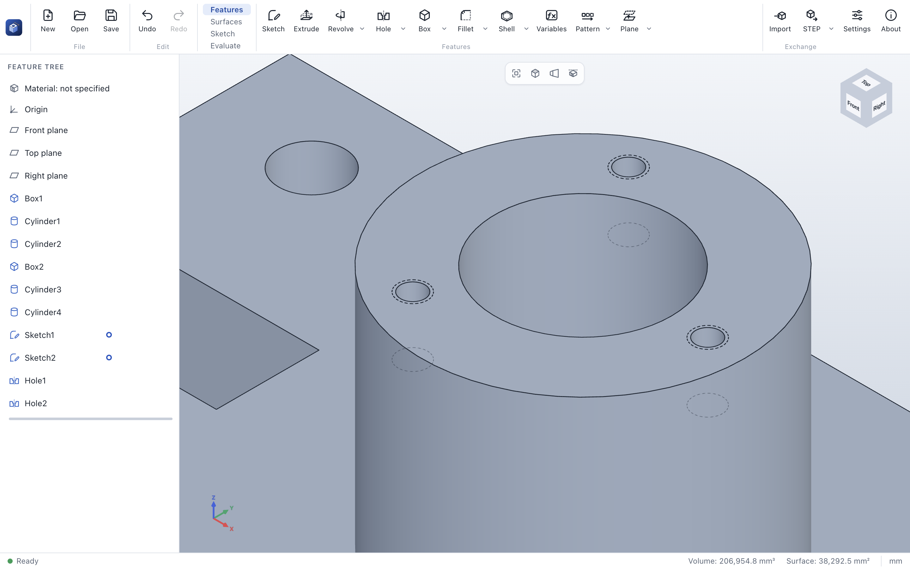

> [!NOTE]
> The standard values come from ISO 273 (clearance holes), ISO 2306 (tap drills), DIN 974-1
> (counterbores for ISO 4762) and the head diameters of ISO 10642 (countersinks). Check them against
> your screws and your manufacturing before you make parts.

## Thread

**Thread** (in the arrow of the **Hole** button) cuts a modeled ISO metric thread into a bolt or into the
wall of a hole – the thread is real geometry, as 3D printing needs. For parts that are drilled and tapped,
a [tapped hole](#hole) with its cosmetic thread is lighter and enough.

- Click the **cylindrical face** of the bolt or the hole. *Size* follows the face: a bolt of that diameter,
  or a hole of that tap drill; *Pitch* follows the size (the coarse thread of ISO 261) and can be changed.
- A bolt keeps its diameter as the outside of the thread, and the groove goes in by the depth of the ISO
  basic profile. A hole keeps its diameter as the minor diameter, and the groove goes out into the wall –
  so draw the hole with the tap drill diameter.
- *Length*: how far the thread goes into the face from the end it starts at, at most to the other end.
  It runs out of the face at the start. **Start at the other end** and **Left-hand thread** turn it round.

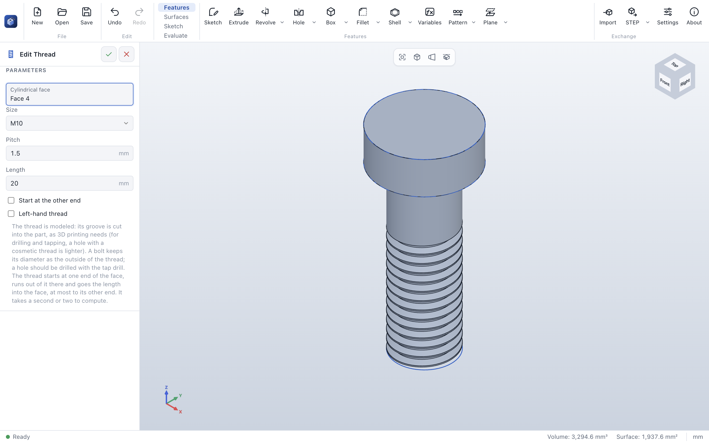

A modeled thread takes a second or two to compute (it runs in the background) and makes the part's mesh
and files larger; add it late in the history, after the features it does not depend on.

## Patterns and mirror

**Pattern** copies features in a row, **Circular pattern** around an axis, **Mirror** through a plane
(all three under the *Pattern* button and its arrow). They copy features that add or cut material –
extrusions, revolutions, sweeps, lofts, holes, boxes and cylinders – with everything that defines them;
fillets and chamfers are not copied. They also copy **other patterns and mirror images**: with the
original and all its copies – a row of holes turned around an axis, a row copied into a grid, one half of
a part mirrored with its patterns. A feature that ends up at the same place twice is made only once.

1. *Features to copy*: click the features in the feature tree (shown below the side panel while you
   edit) or click one of their faces in the 3D view; click again to take one out. Their faces are
   highlighted.
2. Click the next field and pick what the copies follow: for a **linear** pattern a *Direction* – a
   straight edge, an axis, or a plane or planar face (its normal); for a **circular** pattern an *Axis* –
   a reference axis, a cylindrical face or a circular edge; for a **mirror** a *Plane* – a standard plane,
   a planar face or a reference plane.
3. *Count* (the original included) and *Spacing*, or the *Total angle* of a circular pattern: 360° spreads
   the copies evenly all round, a smaller angle puts the last copy at its end. **Other direction** and
   **Other way round** turn the pattern the other way.

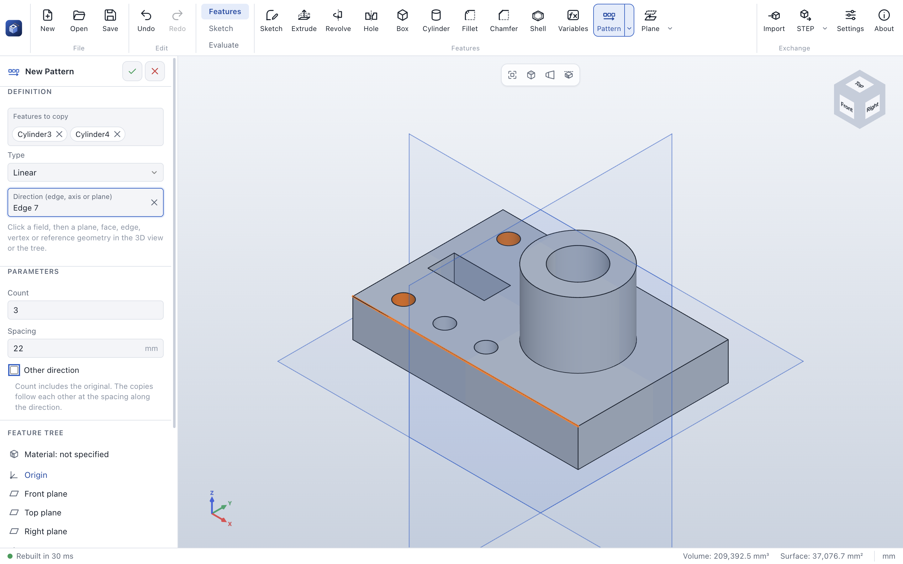

All copies of a feature are added or cut in one operation, so even long patterns rebuild quickly; a
pattern of patterns makes at most 10,000 copies.

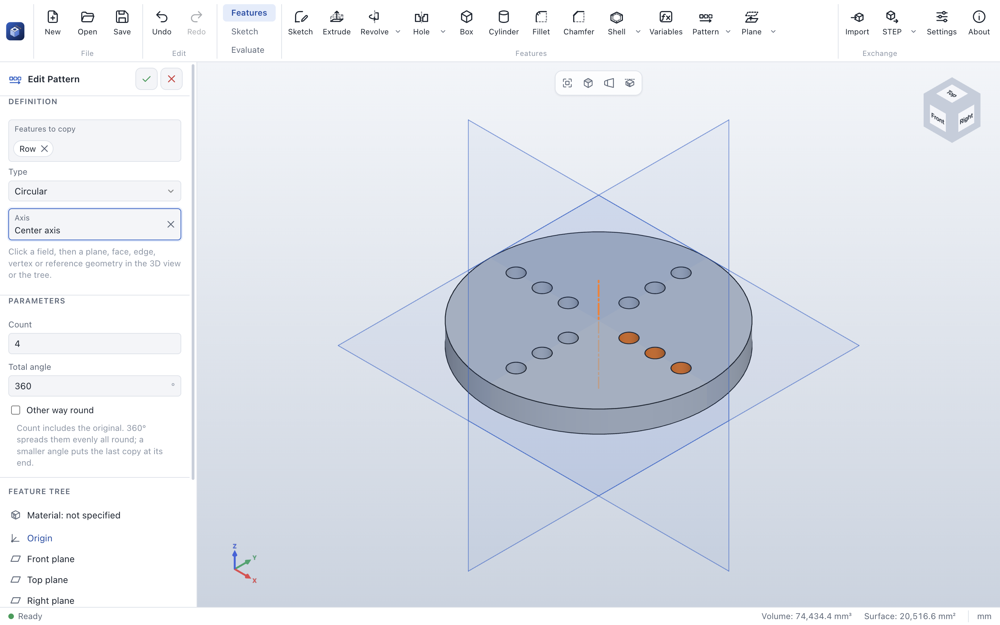
 Faces of
the copies have names of their own (the pattern, the copied feature and the copy), so fillets on them stay
in place when the pattern changes.

## Box

Adds or removes a box. *Width* (X), *Depth* (Y) and *Height* (Z) are in millimeters; *Position* is the
center of the bottom face. The first feature of a part always adds material.

## Cylinder

Adds or removes a cylinder with *Radius*, *Height* and *Axis* (X, Y or Z). *Position* is the center of
the base circle. Use **Remove material** to drill holes; make the cylinder longer than the part so it
cuts through.

## Fillet

Rounds edges with a constant *Radius*. Click edges in the 3D view to add or remove them (selected edges
are orange). While you edit, the 3D view shows the result and draws the original edges as thin blue lines,
so you can keep picking.

Click a **face** instead of an edge to round all of its edges at once – the rim of a top face, both
circles of a boss. The face stays in the fillet as a face: edges it gets later, for example from a hole
cut into it before the fillet, are rounded too. Seams of round faces are left out. A click near an edge
picks the edge; click the face again to take it out. Faces and edges selected before choosing **Fillet**
are taken over.

**Variable radius** (under *Type*) rounds the picked edges with a radius that changes evenly along each
edge, from *Radius at the start* to *Radius at the end*. The start is the end of an edge with the smaller
coordinates – its left, front or bottom end; **Swap start and end** turns that round.

*Type* offers two more kinds of rounds, which are picked as faces in order (the fields show which one is
next; ✕ clears a field and the ones after it):

- **Face fillet** rounds with the *Radius* between two planar faces that meet at a corner – also where
  they share no edge: faces between them, such as a chamfer or a small step, are rounded over. At an
  inner corner (a wall on a floor) the corner is filled. A radius too large for the faces is reported.

  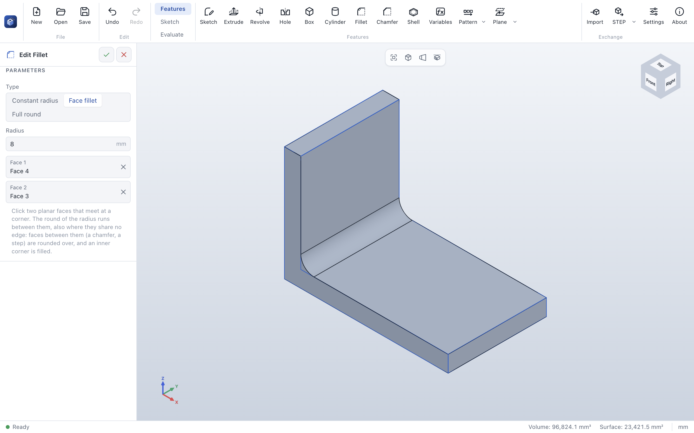

- **Full round** replaces a face by half a cylinder that touches it and the two faces beside it: pick
  *Side face 1*, the *Center face* and *Side face 2*. The sides must be parallel planes, such as the
  sides of a rib or the top and bottom of a tab whose end is rounded; the round is as wide as the sides
  are apart and follows them when the rib changes. Holes through the rounded part stay holes.

  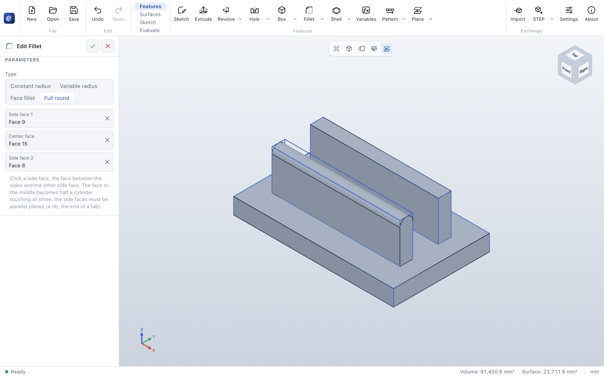

## Chamfer

Bevels edges. Edge and face selection works like for fillets. *Size* decides the shape of the bevel:

- **Distance:** the same distance on both faces of each edge (a 45° bevel).
- **Two distances:** *Distance 1* along one face of the edge, *Distance 2* along the other.
- **Distance and angle:** *Distance 1* along one face, and the bevel at the *Angle* to that face (45°
  is the same as equal distances; smaller angles make a flatter bevel).

For uneven chamfers, the preview shows which face *Distance 1* is measured on; *Measure distance 1 on
the other face* swaps the faces.

## Shell

**Shell** hollows the part out to walls of one *Wall thickness* – enclosures, cups, covers. Click the
faces where it should be open (click again to close one); without any open face the part gets a closed
cavity inside. **Walls outside the part** puts the walls around the part instead, so the part's own size
becomes the inside size. While you edit, the 3D view previews the shell; rounded and sloped faces get
walls that follow them.

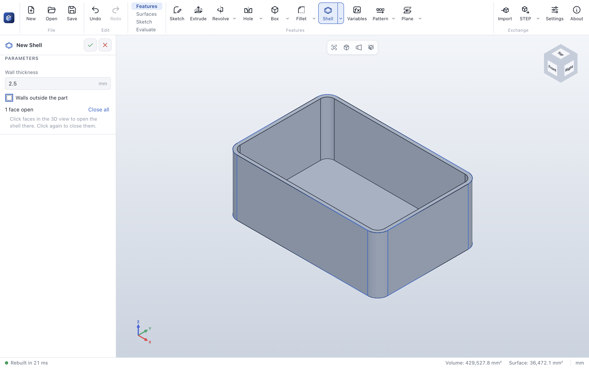

If the walls are too thick for the part – thicker than half its narrowest place – the shell cannot be
made and is marked in red. Open faces are remembered like edges: when an earlier change removes one, the
shell leaves it out and warns.

## Draft

**Draft** (in the arrow of the **Shell** button) tilts faces by a *Draft angle*, as molded and cast parts
need to come out of their mold. First pick the **neutral plane** – a standard plane, a planar face or a
reference plane – then click the faces to tilt (click again to take one out). Each face turns about the
line where it crosses the neutral plane, so the part gets narrower along the pull direction, the normal
of the neutral plane; **Pull the other way** reverses it. The 3D view previews the tilted faces and draws
the original edges as thin blue lines.

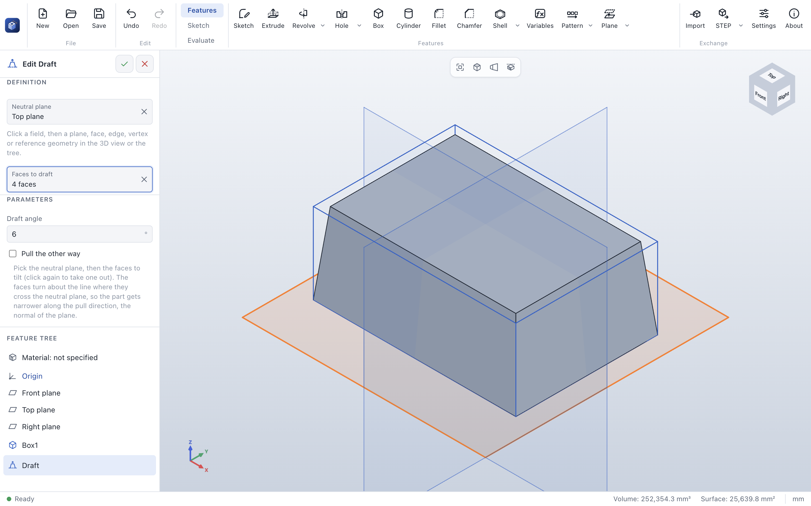

A face across the pull direction (such as the top of a block pulled upwards) cannot be tilted and is
reported. The faces keep their names, so fillets on them stay put; faces that an earlier change removed
are left out with a warning, as for shells. For extrusions, *Draft while extruding* in the extrusion
itself is often simpler.

## Rib

**Rib** (in the arrow of the **Shell** button) adds a wall from the open curves of a sketch to the body –
a gusset in the corner of an angle bracket, a stiffening rib across the inside of a housing. Draw open
lines where the rib should end, for example on the front plane from the wall down to the floor; Rib
starts with the newest such sketch that no feature uses yet.

- *Thickness*: how thick the rib is, half to each side of the sketch.
- *Direction*: **Within the sketch plane** fills the space between each line and the body, in the plane
  of the sketch (lines only); **Normal to the sketch** grows from the curves along the sketch normal until
  it meets the body, like a thin extrusion up to the next face.
- The rib grows towards the material by itself: the side of the lines where it meets the body. **Try the
  other side first** prefers the other side where both would work. Lines whose rib meets nothing are
  reported.

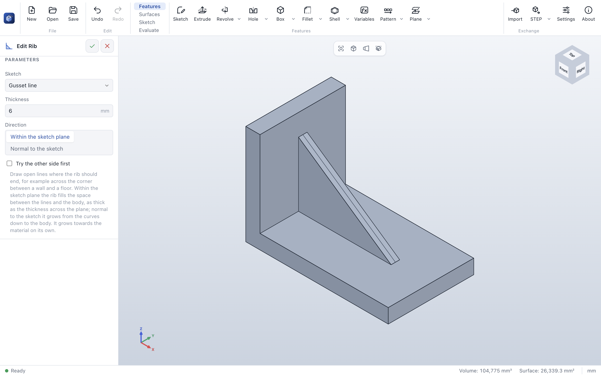

## How features remember their edges

A fillet or chamfer remembers each edge by the two faces it lies between – for example "the top face of
Box1 and the side face that line l3 of Sketch1 swept" – not by a number. Every face is named after the
feature that made it, and keeps its name when later features cut, add or round the body. So when you
change an earlier feature – make a sketch wider, add a hole to it, insert or suppress a cut – the fillet
stays on the edge you picked, even though the body now has more or fewer edges.

When a face was only made anew (a sketch line deleted and drawn again in the same place), ParaWerk
finds the edge by its position and updates what the feature remembers.

### When edges are gone

If an edge is really gone – a cut that made it was suppressed, or a corner of the sketch was rounded so
the two side faces no longer meet – the fillet or chamfer leaves it out and still rounds the other
edges. The feature gets a yellow warning sign in the tree; hovering over it tells how many edges are
missing. Only when none of its edges exist any more does the feature fail (red).

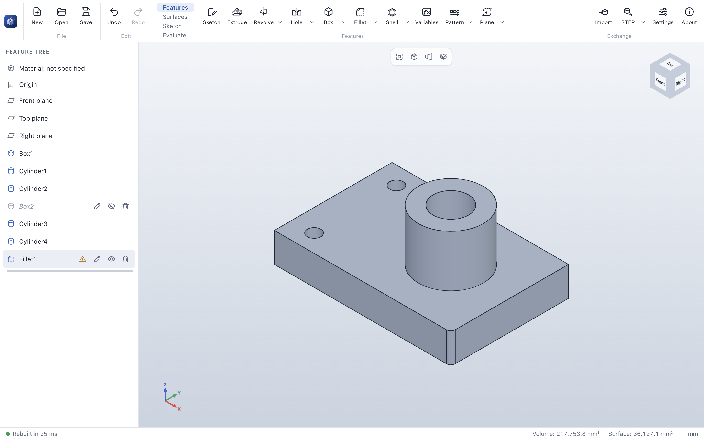

Edit the feature to fix it: the side panel says how many edges no longer exist, and the 3D view marks
with a red ⊗ where each of them was, so you can see what was meant. Pick the edges that should be
rounded now, and click **Remove** to drop the lost ones. With **✓** the warning goes away.

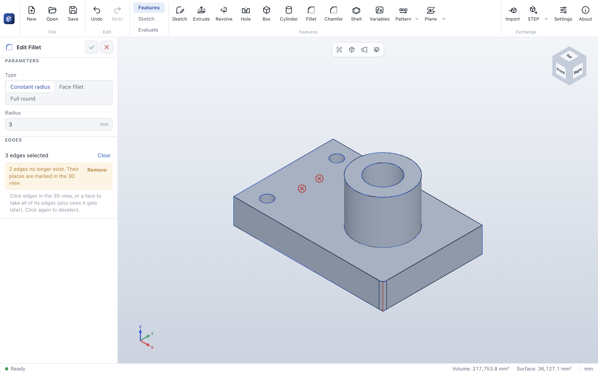

## Reference geometry

Planes, axes, points and coordinate systems that are not faces of the part: a plane at an angle to
sketch on, an axis through the middle of a bore, a point to build a plane through, a coordinate system
to give mass properties in or to export in. They do not change the body. Create them with the **Plane**
button in the *Features* tab; its arrow offers **Axis**, **Point** and **Coordinate system** as well, and
the [Helix](#helix-and-springs) and the [curves](#curves). Where a field takes an axis, a helix gives
its axis.

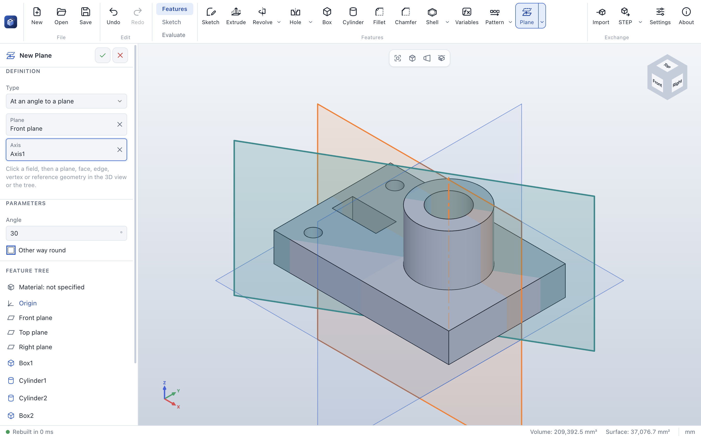

In the side panel, choose the **Type**, then fill its fields one after the other: click a field (the
active one has a blue frame) and pick in the 3D view. A field only takes what fits – a *Plane* field a
standard plane, a planar face or a reference plane; an *Axis* field a straight or circular edge, a
cylindrical face or a reference axis; a *Point* field a vertex, a reference point or (with **Use origin**)
the origin. Near the end of an edge a click picks the vertex there. While you edit, the standard planes
are shown so you can pick them, the new geometry is previewed in teal and what it is built on is
highlighted in orange; **✓** becomes available when all fields are filled.

| Plane | Built from |
|---|---|
| Offset from a plane | a plane and a *Distance*; *Other side* puts it on the other side |
| At an angle to a plane | a plane and an axis parallel to it; the new plane goes through the axis, turned by the *Angle* |
| Through three points | three vertices or points |
| Between two planes | two parallel planes or faces (the plane in the middle), or two at an angle (the plane halving the angle) |
| Parallel through a point | a plane and a point |

| Axis | Built from |
|---|---|
| Along an edge or face | a straight edge, the axis of a circular edge or of a cylindrical, conical or toroidal face, or another axis |
| Where two planes meet | two planes that are not parallel |
| Through two points | two vertices or points |
| Normal to a plane through a point | a plane and a point |

| Point | Built from |
|---|---|
| Coordinates | *X*, *Y* and *Z* (also as equations) |
| Center of an edge or face | the center of a circle or arc, the middle of any other edge, or the center of a face's area |
| Where an axis meets a plane | an axis and a plane that is not parallel to it |

| Coordinate system | Built from |
|---|---|
| Position and angle | the *X*, *Y* and *Z* of its origin and an angle it is *Turned around Z* (also as equations); its axes are otherwise those of the model |
| Point and two directions | an *Origin* (a vertex, a point or the origin), an *X axis* (an edge, an axis or the normal of a plane) and a *Y axis*: the second direction, made perpendicular to X |

*X axis the other way* and *Y axis the other way* turn an axis round; Z always follows from X and Y, so
the axes stay right-handed. A coordinate system is drawn as three short arrows in the colors of the axis
triad (X red, Y green, Z blue), the same size at every zoom. [Mass properties](evaluate.md#mass-properties)
can be given in it, and [exports](files.md#export) written in its coordinates – for example so that a
part lies on the build plate of a 3D printer the right way up. Where a field takes a point, a plane or an
axis, a coordinate system gives its origin, its XY plane or its Z axis.

Selecting the references first and then clicking **Plane**, **Axis** or **Point** fills the fields right
away and chooses the type that fits – a planar face gives an offset plane, two vertices an axis through
them.

Reference geometry follows the part: it remembers faces, edges and vertices by name (see
[How features remember their edges](#how-features-remember-their-edges)), so a plane offset from the top
face moves up when the part gets taller. If something it is built on is gone, it is marked in red in the
tree. Planes, axes, points and coordinate systems can be selected in the tree and in the 3D view; a reference plane has a
**Sketch on this plane** button in the tree, and sketches on it follow it as well.

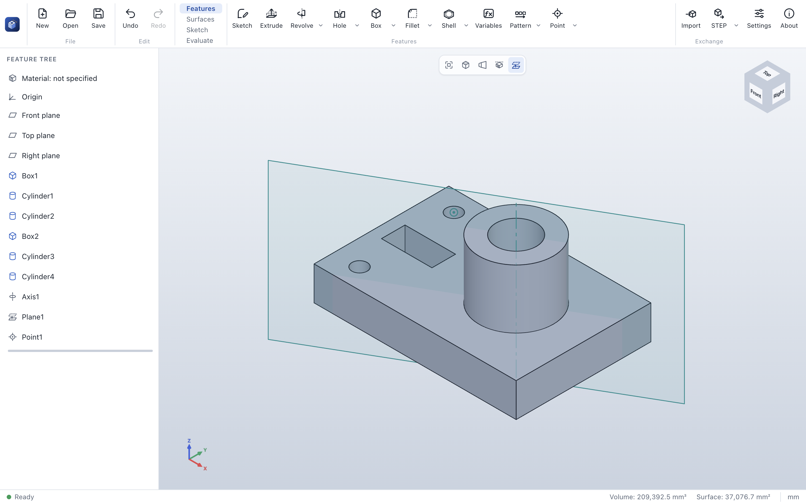

## Variables and equations

**Variables** (in the *Features* tab) holds named values for the whole part – a width, a wall thickness,
a hole diameter. Each one has a *Value or equation*: a number such as `120`, or a calculation that uses
other variables, such as `width / 2` or `thickness * 1.2`. The *Result* column shows what it comes to;
a name that is not allowed, a name used twice, an unknown name or a variable that depends on itself is
explained right in the row, and **✓** stays disabled until everything is valid.

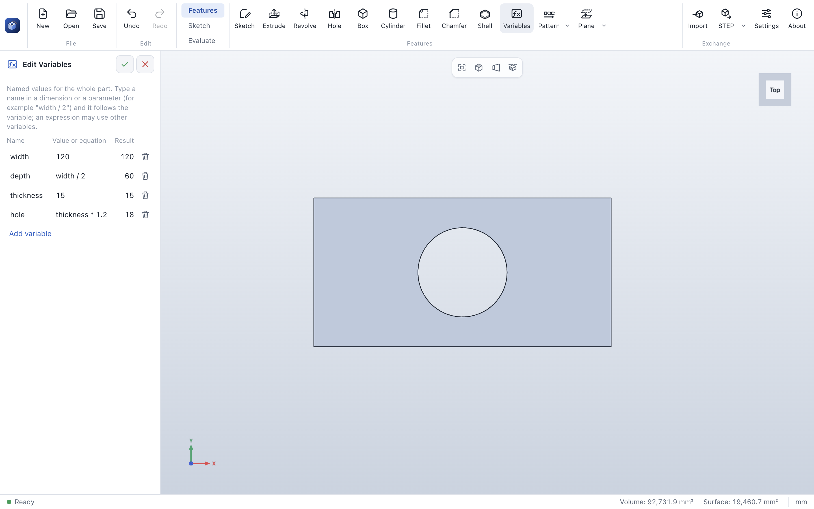

To use a variable, type its name – or an equation with it – into a parameter field instead of a number:
`width`, `depth - 2*thickness`. The field keeps the equation and shows its result below. When you change
a variable later, every parameter and every sketch dimension that uses it follows, and the part is
rebuilt – all in one step that **Undo** reverts. Typing a plain number turns the parameter back into a
fixed value.

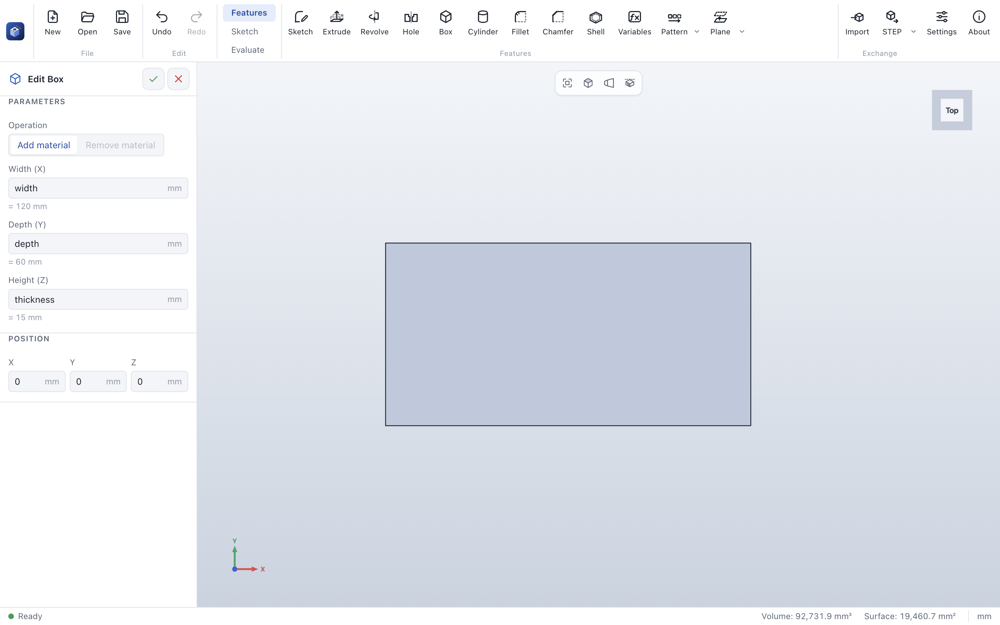

Names start with a letter or `_` and may contain letters, digits and `_`; upper and lower case do not
matter. Units and functions (`mm`, `in`, `sin`, `sqrt`, `pi`, …) cannot be used as names.

Equations can use:

| | |
|---|---|
| Arithmetic | `+ - * /` (also `× ÷ −`), powers `^`, brackets |
| Units | `mm`, `cm`, `m`, `in` or `"` after a number or a bracket (`2 in`, `(a + 3) cm`) |
| Functions | `sqrt`, `abs`, `sin`, `cos`, `tan` and `asin`, `acos`, `atan` (in degrees), `round`, `floor`, `ceil`, `pi` |
| Several values | `min(a; b; …)`, `max(a; b; …)` |
| Choices | `if(condition; then; else)` with `<`, `>`, `<=`, `>=`, `=`, `<>` – for example `if(length > 100; 8; 5)` |

Arguments are separated by `;`. A comma is a decimal separator between digits (`2,5`) and separates
arguments otherwise (`max(a, b)`). The count of a pattern takes an equation too, such as
`floor(length / 30)`; it is rounded to a whole number of at least 2.

## Configurations

**Configurations** (in the *Evaluate* tab, group *Part*) are variants of one part in one file – a mounting
plate in three sizes, a bracket with and without a hole. Each configuration remembers the values of the
part's [variables](#variables-and-equations) and which features are suppressed.

- **Add configuration** makes a copy of the part as it is now and shows it; the first time, the part as it
  was is kept as *Default*. Change variables or suppress features as usual: the changes belong to the
  configuration that is shown.
- The **design table** in the dialog lists every configuration with its name and the expressions of all
  variables; change a cell to change a configuration (equations work too, such as `width / 20`). The
  radio button shows a configuration, the bin deletes one.
- The switch at the top of the feature tree shows another configuration right away. Switching is one undo
  step; exports, mass properties and drawings use the configuration that is shown.

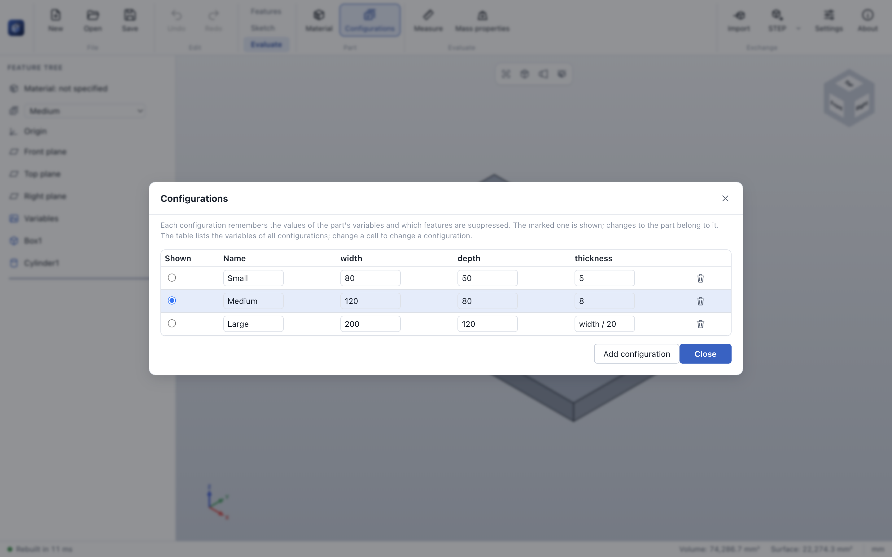

Configurations work through variables: give the dimensions that change between the variants a variable
(in feature parameters or sketch dimensions), then give each configuration its values.

## Editing features

- **Edit:** double-click a feature in the tree or use the pencil icon. Features below it are rolled back
  (dimmed) while you edit.
- **Suppress:** the eye icon temporarily removes a feature from the part without deleting it.
- **Delete:** the trash icon removes the feature.
- **Undo / Redo:** every change can be undone (up to 200 steps).

### Rolling back and inserting features

The **rollback bar**, a grey line at the end of the tree (orange while the part is rolled back), marks
how far the part is built. Drag it up
between two features (or focus it and use the arrow keys) and everything below it is rolled back: dimmed
in the tree and not built, so you see the part as it was at that point. New features and sketches go in
above the bar, so you can add a feature in the middle of the history, for example a hole before the
fillets that round its rim. The arrow button on the bar (or <kbd>End</kbd>) rolls the part forward to
the end. Editing a feature below the bar moves the bar to just below it.

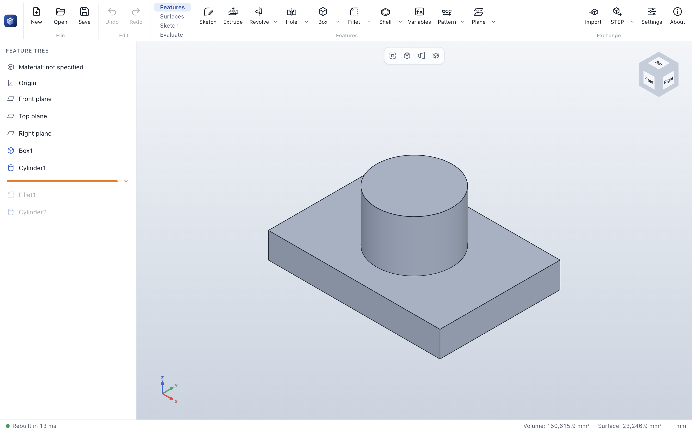

### Reordering features

Drag a feature up or down in the tree to change the order in which the part is built. A blue line shows
where it goes. A feature cannot move above a feature it builds on (its sketch, the reference plane its
sketch lies on, the faces and edges it uses, the features a pattern copies) or below a feature that
builds on it. There the line turns red, and dropping it explains which feature is in the way. Moving a
feature is one undo step; the variables always stay at the top.

## When a feature fails

If the kernel cannot build a feature, for example because a fillet radius is larger than the adjacent
faces allow, the feature is marked in red in the tree and the property panel explains why. The rest of
the part stays intact: the failed feature is skipped until you fix it.
