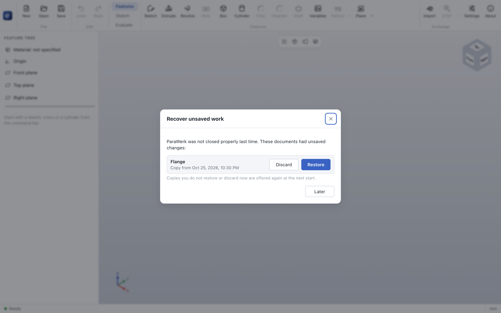
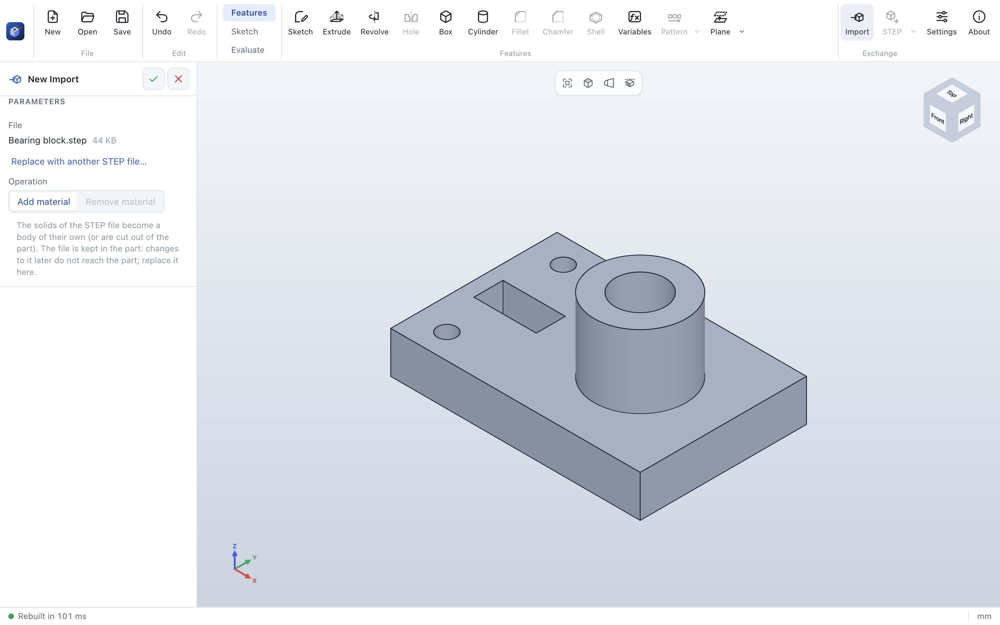

# Files, import and export

## ParaWerk parts (.pwpart)

**Save** (Ctrl/⌘ + S) stores the complete feature history in a `.pwpart` file, so every feature stays
editable after reopening. **Save as** stores a copy under a new name. The window title shows a dot (•)
while there are unsaved changes; ParaWerk asks before discarding them.

Double-clicking a `.pwpart` file opens it in ParaWerk. If ParaWerk is already running, the file opens in
the existing window.

The format is documented in [ADR 0003](../adr/0003-native-file-format.md).

## Recovery after a crash

While a part has unsaved changes, ParaWerk writes a recovery copy of it 15 seconds after a change,
including a sketch that is still open. Saving the part, or closing ParaWerk normally (also when you
choose to discard the changes), removes the copy. If ParaWerk ends any other way – a crash, a power cut,
a killed process – the copy stays, and the next start offers it:

- **Restore** opens the copy as an unsaved part with its name; save it to keep it. A part that had been
  saved before keeps its file name, but *Save* asks where to save it.
- **Discard** deletes the copy.
- **Later** (or closing the dialog) keeps the copies; they are offered again at the next start.

If the 3D window itself crashes, ParaWerk reloads it right away and offers the copy. Recovery copies are
kept in the `recovery` folder of the application data folder (see [settings](settings.md)). They can be
turned off in the settings (*Keep recovery copies of unsaved work*).

## Import STEP

**Import** in the *Exchange* group of the command bar (or *File → Import STEP…*) reads the solids of a STEP
file (`.step`, `.stp`) as a feature of the part, at the rollback bar:

- **Add material** makes the solids a body of their own (or joins them with the part); **Remove
  material** cuts them out of the part, for example a purchased part's envelope.
- The file is kept **in the part** (as its own entry of the `.pwpart` package), so the part opens
  without it and later changes of the file do not reach the part. *Replace with another STEP file…*
  in the side panel exchanges it.
- Faces of imported solids get names of their own, so fillets, chamfers, sketches on faces and
  reference geometry built on them stay where they are when earlier features change.
- Surfaces and wireframes in the file are left out; a file without solids is reported. Files up to 64 MB
  are imported.

## Export

The export button in the *Exchange* group exports in the format used last; its arrow offers all formats
(also in *File → Export*).

| Format | Use | Details |
|---|---|---|
| **STEP** (`.step`) | Exchange with other CAD systems | AP214, millimeters, exact B-Rep geometry |
| **STL** (`.stl`) | 3D printing | Binary STL in millimeters; tessellation is finer than in the 3D view and adapts to the part size |
| **3MF** (`.3mf`) | 3D printing | 3MF core specification in millimeters with the part's name, its material and its color (see [material](evaluate.md)); the mesh is closed and oriented, which slicers check, and finer than in the 3D view |

## Sketches as DXF

In sketch mode, the **DXF** group of the *Sketch* tab exchanges sketch geometry with 2D CAD, laser
cutting and CNC software:

- **Export** saves the open sketch as a DXF file (R12, millimeters) with its lines, circles and arcs.
  R12 has no ellipses and splines, so they are written as polylines that stay within 0.005 mm of the true
  shape. Construction geometry and sketch points are left out, so only the real outline gets cut.
- **Import** adds the geometry of a DXF file to the open sketch, at its coordinates: lines, circles,
  arcs, points and polylines (also with arc segments). End points that coincide are joined, so imported
  outlines are connected. Drawings in inches, centimeters or meters are converted to millimeters (from
  the file's unit setting). Full ellipses become sketch ellipses and splines given by fit points become
  sketch splines. Texts, dimensions, splines given only by control points, elliptical arcs, hatches and
  blocks are not imported; a message lists what was left out.

More formats (3MF, PDF, IGES, glTF) and STEP import follow according to the
[roadmap](../../ROADMAP.md).
