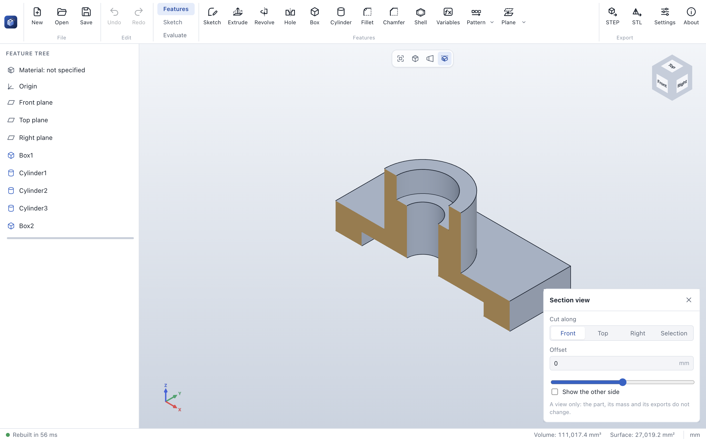

# Navigating the 3D view

ParaWerk offers two navigation presets; choose one under **Settings → 3D navigation**.

| Action | Mouse preset | Trackpad preset |
|---|---|---|
| Rotate | Middle mouse button, or Alt + left button | Two-finger scroll, or Alt + left button |
| Pan | Shift or Ctrl + middle button, or right button | Shift + two-finger scroll, or Alt + Shift + left button |
| Zoom | Mouse wheel (zooms towards the cursor) | Pinch (zooms towards the cursor) |

**Rotation pivot.** The model rotates around the point under the cursor when you start rotating. A small
orange dot marks the pivot. This keeps the detail you are looking at in place.

**Zoom to fit.** Press **F** or click the frame icon in the view toolbar.

**View cube.** Click a face, edge or corner of the cube to look from that direction. The labels follow
the interface language.

**Standard views.** Use the cube icon in the view toolbar or Ctrl/⌘ + 1…7. The views follow ISO naming:
*front* looks along +Y, *top* looks down along −Z, *right* looks along −X; Z points up.

**Projection.** Orthographic projection is the default for engineering work. Toggle perspective with the
projection icon in the view toolbar or in the *View* menu.

## Section view

The section icon in the view toolbar cuts the part open, so you can look inside: at wall thicknesses,
bores and pockets. Where the plane cuts through material, the cut face is filled in a sand color.

- **Cut along:** the front, top or right plane, or **Selection**: a planar face or a (reference) plane
  selected in the 3D view or the tree. If one is selected when you turn the section on, the section uses
  it right away (*Cut along the selected face or plane* switches to it later).
- **Offset:** moves the cut along the plane's normal; type a value or drag the slider, which covers the
  whole part. A new section starts through the origin if the part extends there, else through the middle
  of the part.
- **Show the other side:** keeps the other half instead.

The section is a view only: the part, its mass properties and its exports do not change. Faces and edges
that are cut away cannot be picked, so you can select and measure what lies behind the cut. Click the
section icon again or the ✕ of the panel to see the whole part.
