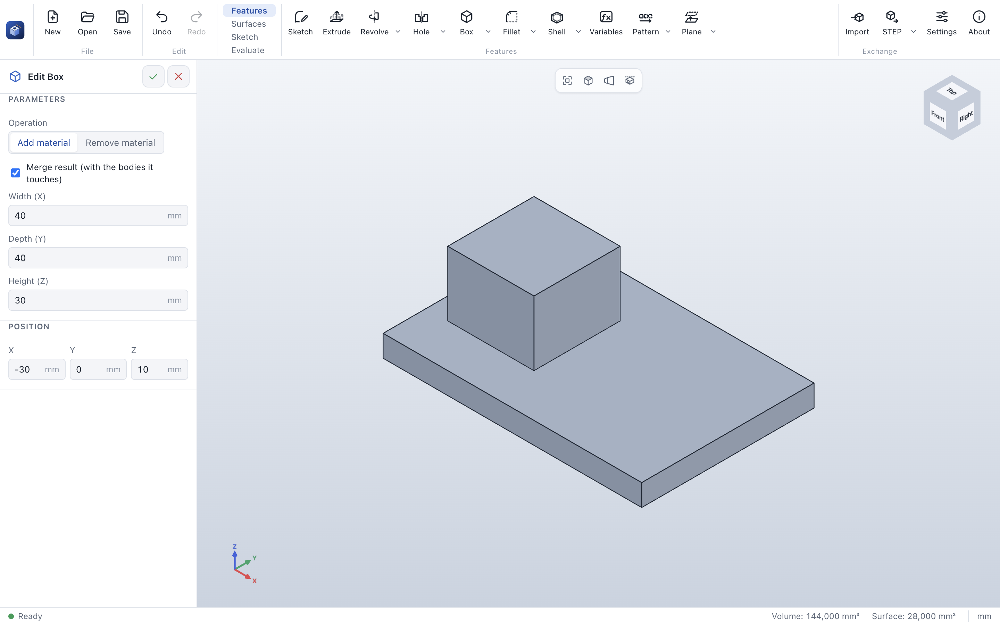

# Box

> **Where:** *Features* tab → **Box** (the split button that also offers **Cylinder**) · **Needs:** nothing

Box adds a box to the part or removes one from it, without a sketch: a quick base plate, a block to start
from, a rectangular cut-out.

## Step by step

1. Click **Box**. A box of 100 × 60 × 40 mm appears at the origin.
2. Set *Width (X)*, *Depth (Y)* and *Height (Z)*.
3. Set the *Position*: the center of the **bottom face**.
4. Choose **Add material** or **Remove material** (the first feature always adds).
5. Click **✓**.

## Options

| Field | What it does | Default |
|---|---|---|
| *Operation* | **Add material** or **Remove material** | Add material |
| *Merge result (with the bodies it touches)* | Only when adding: cleared, the box stays a [body of its own](combine.md) | on |
| *Width (X)*, *Depth (Y)*, *Height (Z)* | The size along the model axes, in mm | 100, 60, 40 |
| *Position* X, Y, Z | The center of the bottom face | 0, 0, 0 |

## Tips

- Every field takes equations and [variables](variables.md): `width`, `depth - 2*wall`.
- A box is always aligned with the model axes; for boxes at an angle, sketch a rectangle on a
  [reference plane](plane.md) and [extrude](extrude.md) it.
- To cut a box through the whole part, make it taller than the part.

## Messages

| Message | What to do |
|---|---|
| *The first feature must add material.* | Add a body first. |
| *This cut does not touch the part, so it removes nothing.* (yellow) | Move the box into the part. |
| *The operation removed the whole body.* | The cut is bigger than the part: make it smaller. |

## See also

- [Cylinder](cylinder.md) · [Extrude](extrude.md)
- [User guide: Box](../features.md#box)
