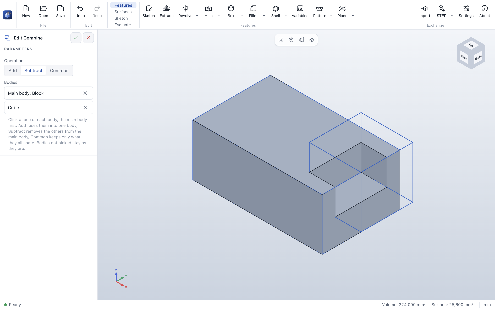
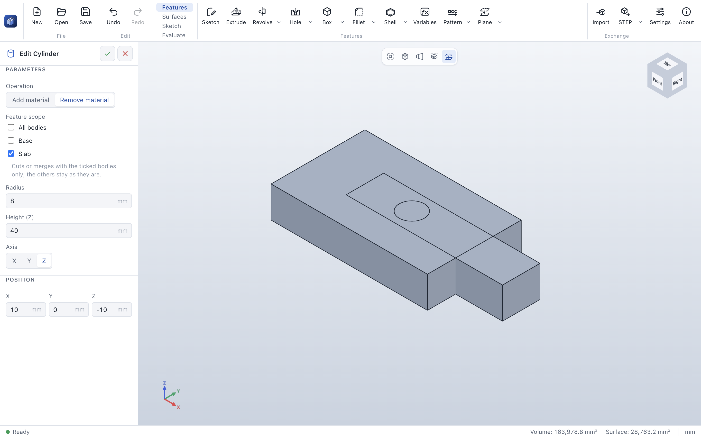

# Combine

> **Where:** *Surfaces* tab → *Bodies* group → **Combine** · **Needs:** a part with at least two bodies

A part can hold several solid **bodies** – a mold half and its core, two halves combined later, a tool body
subtracted at the end. Combine joins bodies: it fuses them, subtracts them from a main body, or keeps only
what they all share.

## How a part gets several bodies

Features that add material – extrude, revolve, sweep, loft, box, cylinder, thicken, import – have **Merge
result (with the bodies it touches)**. Cleared, the new material stays a body of its own, even where it
overlaps another body. With more than one body, the feature tree lists them under *Solid bodies*; click one
to select all its faces.

## Step by step

1. Click **Combine** (or select a face of each body first).
2. Click a face of each body in the 3D view, **the main body first**.
3. Choose the *Operation*.
4. Click **✓**.

## Options

| Field | What it does | Default |
|---|---|---|
| *Operation* | **Add** fuses the bodies into one, **Subtract** removes the others from the main body, **Common** keeps only what they all share | Add |
| *Bodies* | The picked bodies, the main body first (*Main body: …*); **✕** takes one out | faces selected before |

Bodies you do not pick stay as they are.

## Feature scope

On a part of several bodies, every feature that adds or cuts material shows **Feature scope** in its
panel. *All bodies* is the default. Clear it and tick the bodies the feature may change: a cut through two
overlapping bodies then cuts only the ticked one, and added material merges only with the ticked bodies.

## Tips

- Cuts remove material from every body they reach, each on its own.
- Bodies are picked by one of their faces, remembered by name, so the feature follows the part.
- Mass properties and exports cover all bodies.

## Messages

| Message | What to do |
|---|---|
| *Pick at least two different bodies …* | Click a face of each body. |
| *A picked body no longer exists …* | Pick the bodies again. |

## See also

- [Split](split.md) · [Delete body](delete-body.md) · [Extrude](extrude.md) (Merge result)
- [User guide: Bodies](../features.md#bodies)
