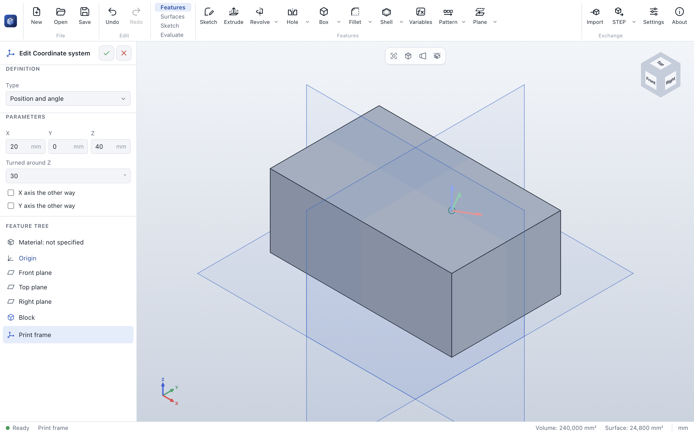

# Coordinate system

> **Where:** *Features* tab → arrow of **Plane** → **Coordinate system** · **Needs:** nothing (position
> and angle) or a point and directions

A coordinate system is an origin with X, Y and Z axes. [Mass properties](mass-properties.md) can be given
in it, and [exports](export.md) written in its coordinates – for example so that a part lies on the build
plate of a 3D printer the right way up.

## Step by step

1. Choose **Coordinate system** in the arrow of **Plane**.
2. Choose the *Type*:
   - **Position and angle**: enter *X*, *Y*, *Z* of the origin and the angle it is *Turned around Z*;
   - **Point and two directions**: pick the *Origin*, the *X axis* and the *Y axis (direction)*.
3. Turn an axis round with *X axis the other way* or *Y axis the other way* if needed.
4. Click **✓**.

## Options

| Field | What it does | Default |
|---|---|---|
| *Type* | **Position and angle** or **Point and two directions** | Position and angle |
| *X*, *Y*, *Z* | Position: the origin (also as equations) | 0, 0, 0 |
| *Turned around Z* | Position: the axes turned around Z; otherwise they are the model's | 0° |
| *Origin* | Point and directions: a vertex, a point or the origin | |
| *X axis* | An edge, an axis or the normal of a plane | |
| *Y axis (direction)* | The second direction; it is made perpendicular to X | |
| *X axis the other way*, *Y axis the other way* | Turn an axis round | off |

Z always follows from X and Y, so the axes stay right-handed.

## Tips

- It is drawn as three short arrows in the colors of the axis triad (X red, Y green, Z blue), the same size
  at every zoom.
- For 3D printing: put the coordinate system on the face that should lie on the build plate, with Z
  pointing into the part, and choose it when you [export](export.md).
- Where a field takes a point, a plane or an axis, a coordinate system gives its origin, its XY plane or its
  Z axis.

## See also

- [Export](export.md) · [Mass properties](mass-properties.md) · [Plane](plane.md)
- [User guide: Reference geometry](../features.md#reference-geometry)
