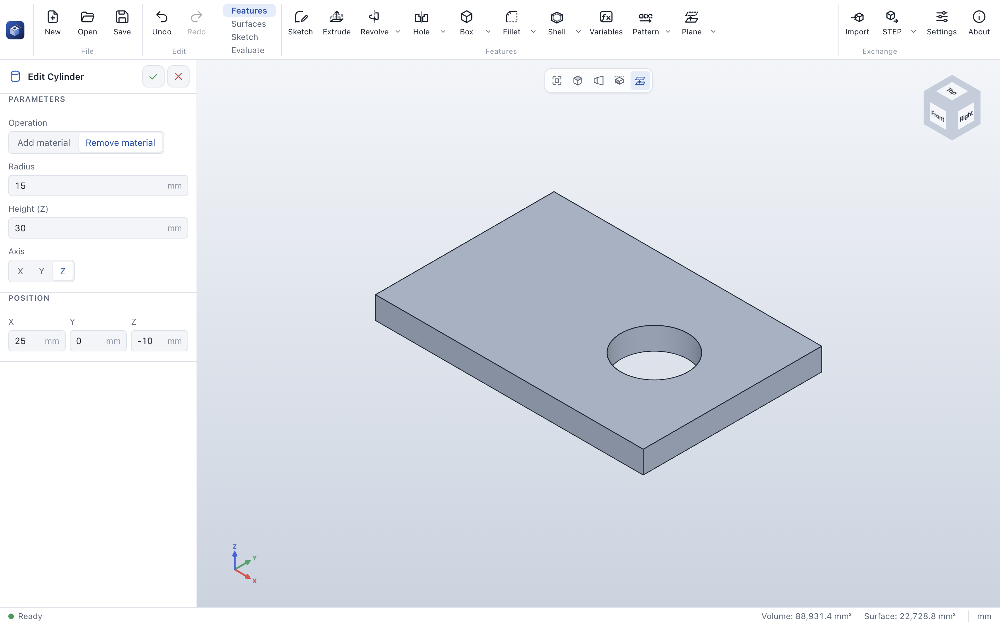

# Cylinder

> **Where:** *Features* tab → arrow of **Box** → **Cylinder** · **Needs:** nothing

Cylinder adds a cylinder to the part or removes one from it, without a sketch: a shaft, a boss, a bore.

## Step by step

1. Open the arrow next to **Box** and choose **Cylinder** (afterwards the button offers it directly).
2. Set *Radius* and *Height*, and the *Axis* it stands along.
3. Set the *Position*: the center of the **base circle**.
4. Choose **Add material** or **Remove material**.
5. Click **✓**.

## Options

| Field | What it does | Default |
|---|---|---|
| *Operation* | **Add material** or **Remove material** | Add material |
| *Merge result (with the bodies it touches)* | Only when adding: cleared, the cylinder stays a [body of its own](combine.md) | on |
| *Radius* | In mm | 20 |
| *Height* | Along the axis, from the base circle | 50 |
| *Axis* | **X**, **Y** or **Z** | Z |
| *Position* X, Y, Z | The center of the base circle | 0, 0, 0 |

On a part of several bodies, *Feature scope* limits the feature to the bodies you tick (see
[Combine](combine.md#feature-scope)).

## Tips

- To drill through a part, make the cylinder longer than the part and start it below the part (a negative
  position along the axis).
- For holes for screws, [Hole](hole.md) is better: it knows the standard diameters and counterbores.
- For cylinders along other directions, sketch a circle on a [reference plane](plane.md) and
  [extrude](extrude.md) it.

## Messages

| Message | What to do |
|---|---|
| *This cut does not touch the part, so it removes nothing.* (yellow) | Move the cylinder into the part. |
| *The first feature must add material.* | Add a body first. |

## See also

- [Box](box.md) · [Hole](hole.md)
- [User guide: Cylinder](../features.md#cylinder)
