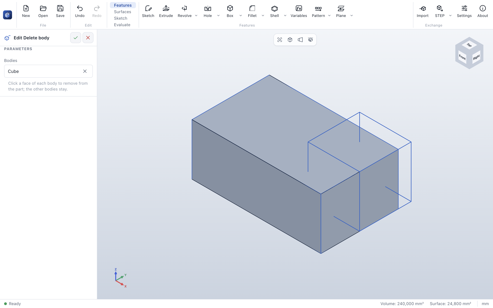

# Delete body

> **Where:** *Surfaces* tab → *Bodies* group → **Delete body** · **Needs:** a body

Delete body removes bodies from the part – a helper body that was only needed to build others, a tool body
after it was used.

## Step by step

1. Click **Delete body** (or select a face of each body first).
2. Click a face of each body to remove.
3. Click **✓**. The other bodies stay.

## Options

| Field | What it does |
|---|---|
| *Bodies* | The bodies to remove; **✕** takes one out |

## Tips

- Deleting a body is a feature: suppress or delete the *Delete body* feature to get the body back.

## Messages

| Message | What to do |
|---|---|
| *A picked body no longer exists …* | Pick the bodies again. |

## See also

- [Combine](combine.md)
