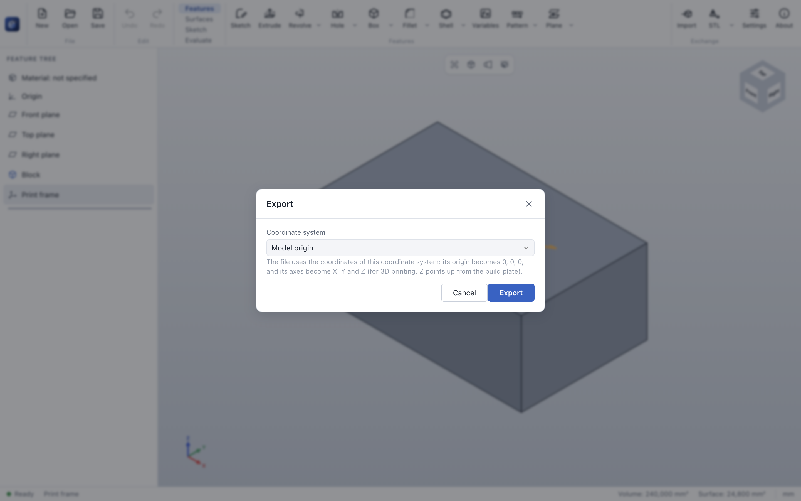

# Export

> **Where:** command bar → *Exchange* group → the export button (its arrow offers **STEP**, **STL** and
> **3MF**), or *File → Export* · **Needs:** a body

Export writes the part for other CAD systems and for 3D printing. The button exports in the format used
last; its arrow offers all formats.

## Formats

| Format | Use | Details |
|---|---|---|
| **STEP** (`.step`) | Other CAD systems | AP214, millimeters, exact B-Rep geometry |
| **STL** (`.stl`) | 3D printing | Binary, millimeters; finer than the 3D view, adapted to the part size |
| **3MF** (`.3mf`) | 3D printing | Millimeters, with the part's name, material and color; closed, oriented mesh |

## Step by step

1. Open the arrow next to the export button and choose the format.
2. If the part has [coordinate systems](coordinate-system.md), choose the one the file uses (or *Model
   origin*) and click **Export**.
3. Choose the file name.

## Coordinate systems

The origin of the chosen coordinate system becomes 0, 0, 0 of the file, and its axes become X, Y and Z.
For 3D printing, a coordinate system on the face that should lie on the build plate, with Z pointing into
the part, puts the part right way up in the slicer. The dialog remembers the last choice.

## Tips

- Exports use the configuration that is shown, and always the whole part – also features below the
  rollback bar.
- Sketches are exported as DXF from sketch mode: see [DXF import and export](sketch-dxf.md).

## Messages

| Message | What to do |
|---|---|
| *There is no body to export yet.* | Model something first. |
| *Export failed: …* | Check the folder is writable; see [troubleshooting](../troubleshooting.md). |

## See also

- [Coordinate system](coordinate-system.md) · [Material](material.md) · [User guide: Export](../files.md#export)
