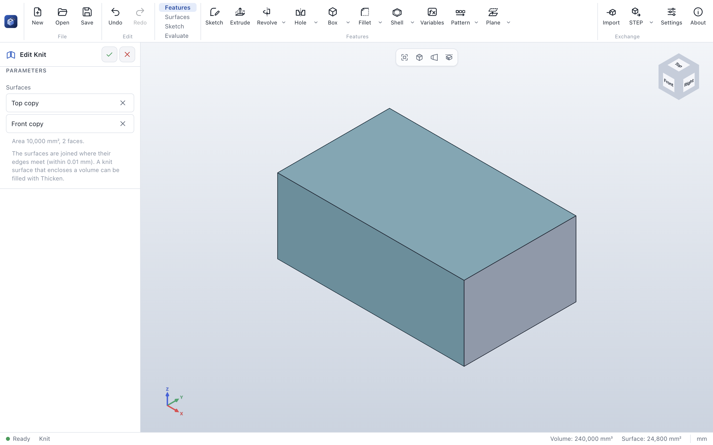

# Knit

> **Where:** *Surfaces* tab → *Surfaces* group → **Knit** · **Needs:** at least one surface

Knit joins surfaces into one where their edges meet (within 0.01 mm). A knit surface that encloses a volume
can be filled into a solid with [Thicken](thicken.md).

## Step by step

1. Create the surfaces, for example with [Offset surface](offset-surface.md).
2. Click **Knit**. It takes all surfaces that no feature uses yet.
3. Add more with *Add a surface*, or take one out with **✕**.
4. Check the summary – *encloses a volume* if the result is closed – and click **✓**.

## Options

| Field | What it does |
|---|---|
| *Surfaces* | The surfaces to join (with **✕** to take one out) |
| *Add a surface* | Adds another surface of the part |
| Summary | *Area …, n faces*, and *encloses a volume* when the result is closed |

## Messages

| Message | What to do |
|---|---|
| *Make a surface first, for example with Offset surface.* | There is no surface yet. |
| *Pick the faces of the surface, or choose the surfaces to join.* | Add surfaces to the list. |
| *The surface no longer exists.* | A surface in the list is gone: take it out. |

## See also

- [Offset surface](offset-surface.md) · [Thicken](thicken.md)
