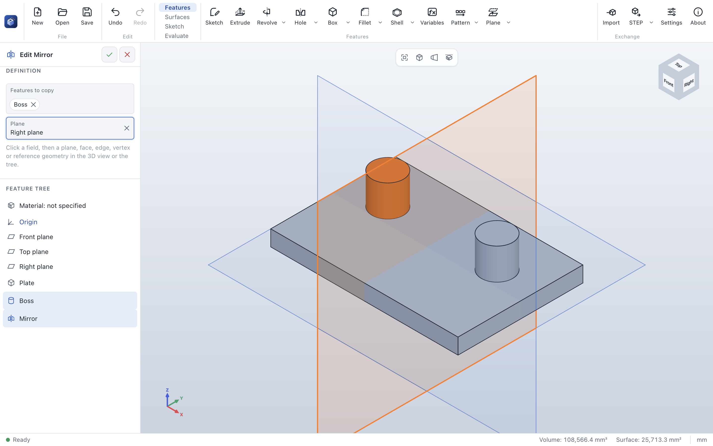

# Mirror

> **Where:** *Features* tab → arrow of **Pattern** → **Mirror** · **Needs:** a feature that adds or cuts
> material, and a plane

Mirror copies features to the other side of a plane: the second half of a symmetric part, a boss on both
sides.

## Step by step

1. Choose **Mirror** in the arrow of **Pattern**.
2. Click the features to mirror in the tree or one of their faces in the 3D view.
3. Pick the *Plane*: a standard plane or [reference plane](plane.md) in the tree goes into the field right
   away; for a planar face, click the *Plane* field first.
4. Click **✓**.

## Options

| Field | What it does |
|---|---|
| *Features to copy* | As for [Pattern](pattern.md); patterns are mirrored with all their copies |
| *Type* | **Through a plane** |
| *Plane* | A standard plane, a planar face or a reference plane |

## Tips

- Model half of a symmetric part about a standard plane, then mirror all its features at once.
- Mirroring a pattern mirrors the original and every copy.

## Messages

The messages are those of [Pattern](pattern.md#messages).

## See also

- [Pattern](pattern.md) · [Circular pattern](circular-pattern.md) · [Sketch mirror](sketch-copy-move.md)
