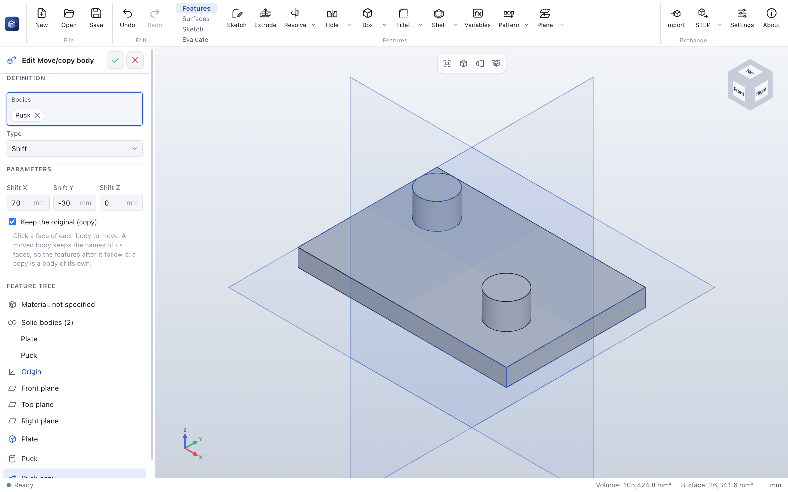

# Move body

> **Where:** *Surfaces* tab → *Bodies* group → **Move body** · **Needs:** a body

Move body moves bodies of the part – shifted along X, Y and Z, or turned about an axis – or adds moved
copies of them as bodies of their own: a second bracket next to the first, a half turned into place, a
tool body positioned before it is subtracted.

## Step by step

1. Click **Move body** (or select a face of each body first). The *Bodies* field is active.
2. Click a face of each body to move in the 3D view; click again to take one out.
3. Choose the *Type*:
   - **Shift**: enter *Shift X*, *Shift Y* and *Shift Z*;
   - **Turn about an axis**: pick the *Axis* – an edge, a reference axis or (after clicking the field) a
     cylindrical face – and enter the *Angle*.
4. Turn on **Keep the original (copy)** to add moved copies instead of moving the bodies.
5. Click **✓**. The preview shows the result; the bodies before the feature are outlined in blue.

## Options

| Field | What it does | Default |
|---|---|---|
| *Bodies* | The bodies to move, each picked by one of its faces | faces selected before |
| *Type* | **Shift** or **Turn about an axis** | Shift |
| *Shift X*, *Shift Y*, *Shift Z* | How far the bodies move along the model axes (also as equations) | 20, 0, 0 |
| *Axis* | Turn: an edge, a reference axis, a helix or a cylindrical face | |
| *Angle* | Turn: how far, in degrees; negative turns the other way | 90° |
| *Keep the original (copy)* | Adds moved copies as bodies of their own; the originals stay | off |

## Tips

- A moved body keeps the names of its faces: fillets, sketches and features on it follow it when the move
  changes.
- The faces of a copy are named after this feature (`<feature>:<face>`), so features on the copy stay on
  the copy.
- Copies and moved bodies may overlap other bodies; [Combine](combine.md) them afterwards to fuse or
  subtract them.
- To copy features rather than bodies, use [Pattern](pattern.md) or [Mirror](mirror.md).

## Messages

| Message | What to do |
|---|---|
| *Pick the bodies to move: click a face of each in the 3D view.* | Click a face of each body. |
| *A picked body no longer exists …* | Pick the bodies again. |
| *Reference 1 of this feature is missing …* | Turn: the axis is gone – pick it again. |

## See also

- [Combine](combine.md) · [Split](split.md) · [Delete body](delete-body.md) · [Pattern](pattern.md)
- [User guide: Bodies](../features.md#bodies)
