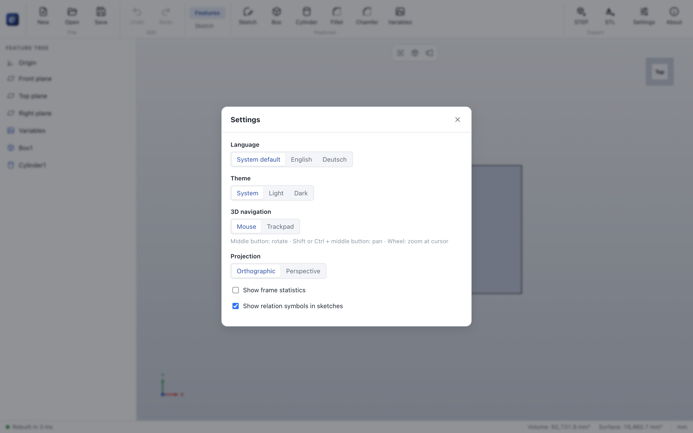
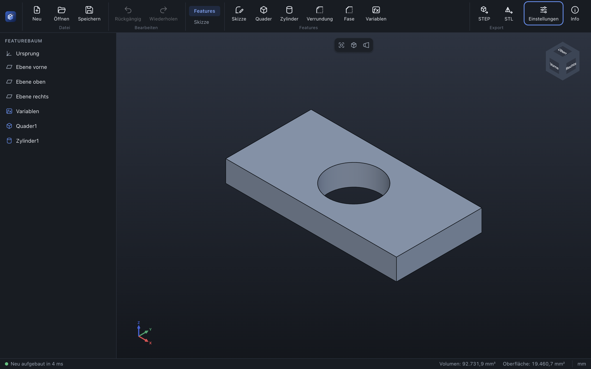

# Settings

> **Where:** command bar → **Settings** · **Keys:** Ctrl/⌘ + ,

| Setting | Options | Default |
|---|---|---|
| *Language* | System default, English, Deutsch – takes effect immediately, menus and view cube included | System default |
| *Theme* | System, Light, Dark | System |
| *3D navigation* | **Mouse** (middle button rotates, Shift/Ctrl + middle button pans, wheel zooms) or **Trackpad** (two fingers rotate, Shift + two fingers pan, pinch zooms) | Mouse |
| *Projection* | Orthographic or Perspective | Orthographic |
| *Show frame statistics* | Frames per second and render time in the status bar | off |
| *Show relation symbols in sketches* | The H, V, ∥ … symbols next to sketch geometry | on |
| *Keep recovery copies of unsaved work* | A copy 15 s after a change, offered after a crash | on |

Settings are stored per user in `settings.json` in the application data folder (`%APPDATA%/ParaWerk` on
Windows, `~/Library/Application Support/ParaWerk` on macOS, `~/.config/ParaWerk` on Linux). The window size
and position are restored at the next start.

## See also

- [View tools](view-tools.md) · [New, open and save](new-open-save.md) (recovery)
