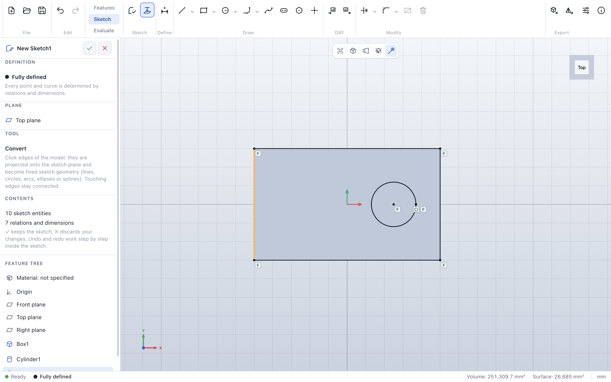

# Convert

> **Where:** *Sketch* tab → *Sketch* group → **Convert** · **Needs:** an open sketch on a part with edges

Convert takes edges of the part into the sketch, so a new profile can follow the existing model – for
example a sketch on a face along its outline.

## Step by step

1. In an open sketch, click **Convert**. The edge under the cursor is highlighted.
2. Click edges one by one. Each one is projected onto the sketch plane.
3. **Esc** leaves the tool.

## What edges become

| Edge | Becomes |
|---|---|
| Line | a line |
| Circle or arc parallel to the sketch | a circle or arc |
| Tilted circle | an ellipse |
| Other curves | a spline through points of the edge |
| Edge perpendicular to the sketch plane | nothing (it has no extent there) |

## Tips

- Converted geometry is **fixed**: it is fully defined right away, but does not follow later changes of the
  model yet.
- Touching edges share their end points, so a face outline becomes a closed profile; converting an edge
  twice does not add it twice.
- [Dimensions](sketch-dimension.md) to an edge of the part convert that edge automatically as construction
  geometry.

## Messages

| Message | What to do |
|---|---|
| *This edge has no extent on the sketch plane …* | It is perpendicular to the sketch: pick another edge. |
| *Click an edge of the model.* | The click hit no edge. |
| *This edge is already in the sketch.* | Nothing to do. |

## See also

- [Dimension](sketch-dimension.md) · [User guide: Converting model edges](../sketches.md#converting-model-edges)
