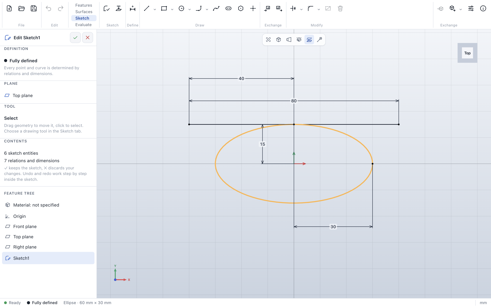

# Ellipse

> **Where:** *Sketch* tab → *Draw* group → arrow of **Circle** → **Ellipse** · **Key:** C (when used last)
> · **Needs:** an open sketch

An ellipse has three points: its **center** and the ends of its two **axes**, which stay perpendicular.

## Step by step

1. Choose **Ellipse** in the arrow next to **Circle**.
2. Click the center, then the end of one axis.
3. Move sideways to set the other axis and click.

## Defining an ellipse

- **Size:** dimension the distance from the center to each axis point (the semi-axes): an ellipse of
  60 × 30 mm has the values 30 and 15.
- **Direction:** an axis drawn horizontally or vertically keeps that direction; otherwise fix the axis
  point with dimensions or relations.
- **Position:** dimension or relate the center like any point.

## Tips

- Points can lie *on* an ellipse and lines can be *tangent* to it.
- Drag an axis point to change the size, or the curve to move the whole ellipse.
- Other curves can be trimmed and extended up to an ellipse; an ellipse itself can only be trimmed as a
  whole, and [Offset](sketch-copy-move.md) leaves ellipses out.
- Extruded, an ellipse stays an exact elliptical face; DXF export writes it as a polyline within 0.005 mm.

## Messages

| Message | What to do |
|---|---|
| *An ellipse that other curves cross cannot be cut into pieces …* | Trim the other curves, or delete the ellipse. |

## See also

- [Circle](sketch-circle.md) · [User guide: Ellipses](../sketches.md#ellipses)
