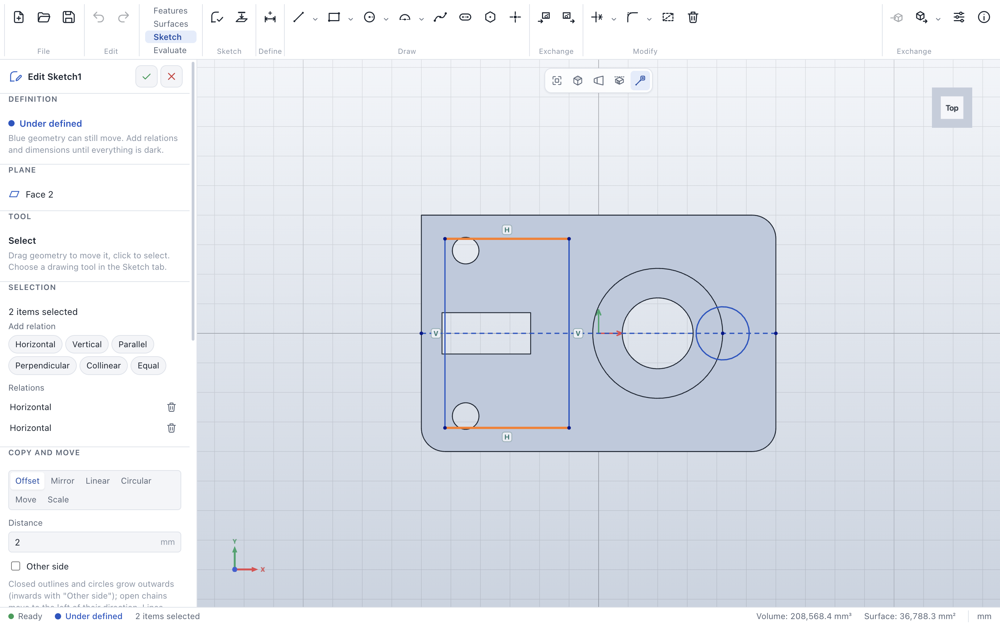

# Relations

> **Where:** side panel → *Selection* section (in sketch mode, with geometry selected) · **Needs:** an
> open sketch

Relations are the geometric rules of a sketch: this line stays horizontal, these two lines stay parallel,
this point stays on that circle. Many are added automatically while you draw; others you add yourself.

## Step by step

1. Select the geometry: click, and **Shift**/**Ctrl**/**⌘**-click for more. The sketch origin can be
   selected too.
2. The *Selection* section lists the relations that fit. Click one to add it; the geometry moves as much
   as needed.
3. Below, the relations the selection already has are listed; the bin removes one.

## Which relations

| Selection | Relations offered |
|---|---|
| One or more lines | Horizontal, vertical; with two or more lines also equal length |
| Two lines | Parallel, perpendicular, collinear, equal length |
| Two points | Horizontal, vertical (aligned), coincident, fix |
| A point and a line | On curve, midpoint |
| A point and a circle, arc, ellipse or spline | On curve |
| Two circles or arcs | Equal radius, tangent, concentric |
| A line and a circle, arc or ellipse | Tangent |
| Two points and a line | Symmetric about the line |
| Points | Fix |

## Relation symbols

Every relation shows a symbol next to its geometry: **H** horizontal, **V** vertical, **∥** parallel,
**⊥** perpendicular, **=** equal, **T** tangent, **◎** concentric, **M** midpoint, **S** symmetric,
**F** fix, **•** coincident, **◦** on curve, **⋯** collinear.

- Point at a symbol to highlight its geometry; click it to select the relation; **Delete** removes it.
- The view toolbar button (in sketch mode), **View → Show sketch relations** or the
  [settings](settings.md) hide and show the symbols.

## Fully defined

| Color | Status |
|---|---|
| Blue | **Under defined** – can still move: add relations or dimensions |
| Dark | **Fully defined** |
| Red | **Over defined** – relations or dimensions contradict each other; the panel lists them to delete |

## Messages

| Message | What to do |
|---|---|
| *This relation already follows from the existing relations and dimensions …* | It would over-define the sketch: not needed. |
| *This relation contradicts the existing relations and dimensions.* | Remove the one it contradicts first. |
| *No relation fits this selection.* | Select different geometry (see the table). |

## See also

- [Dimension](sketch-dimension.md) · [User guide: Relations](../sketches.md#relations)
