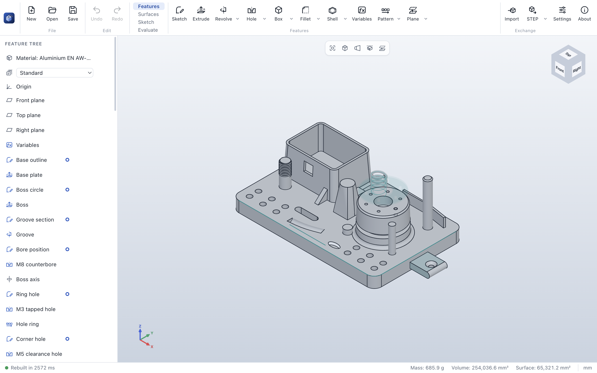

# Feature showcase

The feature showcase is one large part that uses nearly every feature of ParaWerk, built on each other the
way you would build a real part: sketches on faces, edges and faces picked in the body, patterns of
patterns, a shelled housing joined to the plate, surfaces, curves and two configurations. Open it to see
what ParaWerk can do, to try out editing, or as a starting point for your own tests.

**Download:** [`docs/examples/feature-showcase.pwpart`](../examples/feature-showcase.pwpart) (about
10 KB) – on GitHub, open the file and click *Download raw file*, then open it in ParaWerk with **Open**.

## What is in it

83 features of all 32 kinds, in aluminium EN AW-6061:

| Area | Features |
|---|---|
| Variables | `thickness` (the plate) and `bossHeight`, used by the plate, the boss, reference planes and points |
| Base | A plate extruded from a rectangle; corners rounded (constant fillet) |
| Boss | Extruded with a 2° draft, rounded at its foot, a groove revolved around it (revolved cut), a counterbored M8 bore, a reference axis along the bore, six tapped M3 holes in a circular pattern around it, a chamfer of two distances on its rim |
| Holes | A row of M5 clearance holes along an edge (linear pattern), copied into a grid (pattern of a pattern), the grid mirrored (mirror of a pattern of a pattern): 12 holes; a countersink in the tab |
| Housing | Extruded as a body of its own, drafted about a reference plane, rounded, shelled open at the top, a window cut with a tool body (combine – subtract), joined to the plate (combine – add), a face fillet at its foot, a gusset (rib) in a plane through a reference point |
| Spring | A helix around a sketch circle, a wire profile in a plane through its start, swept along it |
| Post | A loft from a square on the plate to a circle on a reference plane 40 mm up |
| Channel | A half-round groove swept along a spline path (sweep – cut) |
| Pockets and cuts | A slot cut through all, an elliptical pocket |
| Columns | One extruded down from a plane above the part up to the next face, with a chamfer at its top; one up to a reference plane |
| Fence | A thin feature from an open line, with a variable fillet along its top |
| Tab and pin | A box with a full round at its end; a cylinder with a chamfer (distance and angle) and a modeled M10 thread |
| Import | A block imported from a STEP file |
| Surfaces and bodies | The boss top offset 10 mm up and thickened into a lid of its own, the lid split in two slabs along a surface in its middle (*Split*), both slabs deleted with *Delete body*; copies of two tab faces knit into one surface |
| Curves and frames | A sketch line projected onto the plate, a composite curve of three top edges, a coordinate system at the plate's corner |
| Configurations | *Standard*, and *Compact* (thinner plate, lower boss, without spring, column and fence) |

## Things to try

- **Configurations:** switch between *Standard* and *Compact* at the top of the feature tree.
- **Variables:** open **Variables** and set `thickness` to 16 – the plate, the housing, the boss and
  everything on them follow.
- **Edit a sketch:** double-click *Base outline* and drag a corner: the holes, fillets and curves stay on
  their edges.
- **Roll back:** drag the rollback bar up to see how the part was built, step by step.
- **Suppress:** suppress the *Housing shell* or the *Hole row* and watch what follows.
- **Section view, measure, mass properties:** look inside the housing and the boss, measure the hole
  spacing, check the mass (about 685 g).
- **Export** STEP, STL or 3MF in the *Corner frame* coordinate system.

## How it is tested

The same part is built in an automated test in every CI run (`tests/integration/feature-showcase.test.ts`):

- every feature builds without an error or a warning, and every kind of fillet, chamfer, hole and
  extrusion end is used;
- the part follows a thicker plate and a taller boss set in the variables, and a longer plate drawn in its
  first sketch – without losing any reference;
- both configurations build;
- every single feature is suppressed once: what builds on it may fail, but always with a reason;
- the part saves and opens again unchanged, and exports to STEP, STL and 3MF – the STEP file imports again
  with the same volume;
- the whole part builds in about 2 seconds.

An end-to-end test opens the file in ParaWerk itself and switches its configurations.
